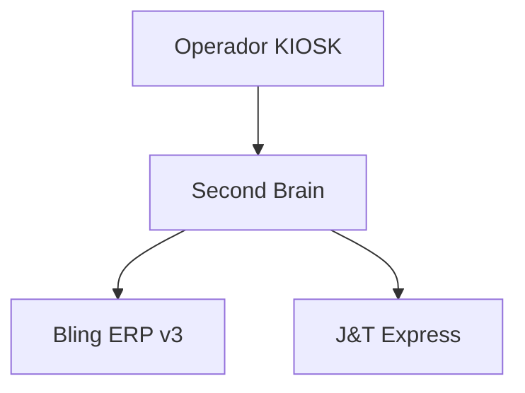

# Architecture Spec Planner — Especificação Técnica Guiada

> Skill do Persona Arquiteto para o sistema multi-agente KIOSK Brands.
> Fonte: System Design (6 módulos), FullCycle Dev (Módulo 01), Engineering Guidelines.
> Resolve gaps: G-01 (PRD Feature), G-02 (Prompt de Entrevista), G-03 (FDD), G-04 (C4).

---

## Quando Ativar

- Nova feature que requer decisão arquitetural
- Demanda do Radar de Prioridades (RICE ≥ 5.0)
- Refatoração que altera bounded contexts ou contratos de API
- Pedido explícito de PRD, HLD, FDD, C4 ou MADR
- Antes de qualquer implementação que afete mais de 2 serviços

---

## Workflow Obrigatório (7 Etapas)

### Etapa 1 — Coleta de Contexto

Antes de qualquer especificação, coletar:

```
□ Qual problema de negócio está sendo resolvido?
□ Quais sistemas/serviços são afetados? (hub, nexus, bling, etc.)
□ Qual o volume esperado? (RPS, registros/dia, concorrência)
□ Quais os requisitos não-funcionais? (latência, disponibilidade, consistência)
□ Existe algum ADR relevante? Consultar via MCP: search_knowledge_base
□ Existe algum padrão de System Design aplicável?
```

**MCP a usar:** `kiosk-second-brain.search_knowledge_base(query="<contexto>")`
**MCP a usar:** `kiosk-second-brain.get_adr(id="ADR-XXX")`

### Etapa 2 — Entrevista Estruturada (12 Perguntas)

Conduzir entrevista com o solicitante usando o protocolo de 12 etapas:

| # | Pergunta | Default |
|---|----------|---------|
| 1 | Nome da feature | — |
| 2 | Problema que resolve (1 frase) | — |
| 3 | Usuários impactados (persona + volume) | Operadores KIOSK |
| 4 | Throughput esperado (req/s ou eventos/dia) | 10 req/s |
| 5 | Latência máxima aceitável | P95 < 150ms |
| 6 | Disponibilidade mínima | 99.9% |
| 7 | Modelo de consistência necessário | Eventual (AP/EL) |
| 8 | Integrações externas afetadas | — |
| 9 | Dados sensíveis envolvidos? | Não |
| 10 | Estratégia de deploy preferida | Canary |
| 11 | Prazo / sprint alvo | — |
| 12 | Riscos conhecidos | — |

> [!IMPORTANT]
> Se o solicitante não souber responder, usar os defaults.
> Registrar explicitamente quais respostas são defaults vs confirmadas.

### Etapa 3 — Classificação CAP/PACELC

Com base nas respostas, classificar o subsistema:

| Perfil | Classificação | Exemplo KIOSK |
|--------|--------------|---------------|
| Financeiro/Fiscal/Estoque | PC/EC (consistência) | Emissão de NF, conciliação Bling |
| Catálogo/Busca/Dashboard | PA/EL (disponibilidade) | Busca de produtos, grafo |
| Comunicação/Eventos | PA/EL | WebSocket, event bus |

Documentar a decisão como seção no PRD.

### Etapa 4 — Gerar PRD de Feature (12 Seções)

Produzir documento Markdown com a seguinte estrutura obrigatória:

```markdown
# PRD: [Nome da Feature]

## 1. Visão Geral
## 2. Problema e Contexto
## 3. Objetivos e Métricas de Sucesso (OKRs)
## 4. Personas e Casos de Uso
## 5. Requisitos Funcionais (FR-01, FR-02, ...)
## 6. Requisitos Não-Funcionais (NFR-01, NFR-02, ...)
## 7. Arquitetura e Componentes Afetados
## 8. Dependências e Integrações
## 9. Classificação CAP/PACELC
## 10. Riscos e Mitigações
## 11. Plano de Testes (referência ao QA)
## 12. Cronograma e Milestones
```

**Destino:** `vault/product/prds/prd-<nome-feature>.md`

### Etapa 5 — Gerar Diagramas C4 Mermaid

Produzir até 3 níveis de diagrama C4:

**Nível 1 — Contexto:** Sistemas externos e seus relacionamentos


**Nível 2 — Contêineres:** Serviços, databases, filas
**Nível 3 — Componentes:** Classes e módulos internos (quando necessário)

**Destino:** Embutidos no PRD, seção 7.

### Etapa 6 — Avaliar Necessidade de MADR

Se a feature envolve trade-off significativo (ex: escolha de banco, protocolo, padrão):

1. Aplicar raciocínio **Tree of Thought (ToT)**: gerar 3 alternativas
2. Para cada alternativa: listar prós, contras, impacto em CAP/PACELC
3. Recomendar com justificativa técnica
4. Formalizar como MADR no padrão do vault

**Destino:** `vault/adrs/ADR-0XX-<titulo>.md`
**MCP:** `kiosk-second-brain.get_adr(id="last")` para obter próximo número

### Etapa 7 — Validação e Entrega

Checklist de saída:

```
□ PRD tem todas as 12 seções preenchidas
□ Requisitos não-funcionais têm valores numéricos (não "rápido" ou "seguro")
□ Diagrama C4 Nível 1 presente
□ Classificação CAP/PACELC explícita
□ Riscos documentados com mitigação
□ Se houver trade-off: MADR formalizado
□ Arquivos commitados no vault via branch feature/
```

---

## Referências do Vault

Estas fontes DEVEM ser consultadas durante o workflow:

| Fonte | Caminho no vault | Uso |
|-------|-----------------|-----|
| System Design Index | `architecture/system-design-index.md` | Princípios de escala, CAP, sharding |
| Inteligência Arquitetura | `architecture/system-design/inteligencia-time-arquitetura.md` | Entrevista, estimativas, C4, MADR |
| Design Docs com IA | `architecture/full-cycle/01-design-docs-com-ia.md` | Estrutura do PRD de 12 seções |
| Engineering Guidelines | `architecture/engineering-guidelines.md` | Princípios de código e contratos |
| Gap Analysis | `architecture/full-cycle-gap-analysis.md` | Gaps G-01 a G-05 |
| Plano de Evolução | `architecture/plano-evolucao-plataforma-mba.md` | Roadmap e fases |

---

## MCP Tools Utilizadas

| MCP Server | Tool | Quando usar |
|------------|------|-------------|
| `kiosk-second-brain` | `search_knowledge_base` | Buscar ADRs, padrões e contexto |
| `kiosk-second-brain` | `get_adr` | Consultar ADR específico |
| `kiosk-second-brain` | `get_system_architecture` | Visão geral da arquitetura |
| `kiosk-github-gateway` | `github_search_code` | Verificar implementação atual |
| `kiosk-github-gateway` | `github_list_contents` | Navegar repositórios |

---

## Critérios de Aceitação

- [ ] PRD produzido segue estrutura de 12 seções sem exceção
- [ ] Valores de NFRs são numéricos e mensuráveis (P95 < Xms, X% uptime)
- [ ] Classificação CAP/PACELC documentada para cada subsistema
- [ ] Diagrama C4 Nível 1 renderiza corretamente em Mermaid
- [ ] Se trade-off existir: MADR segue padrão KIOSK com ≥ 3 alternativas
- [ ] Fontes do vault consultadas e referenciadas no documento
