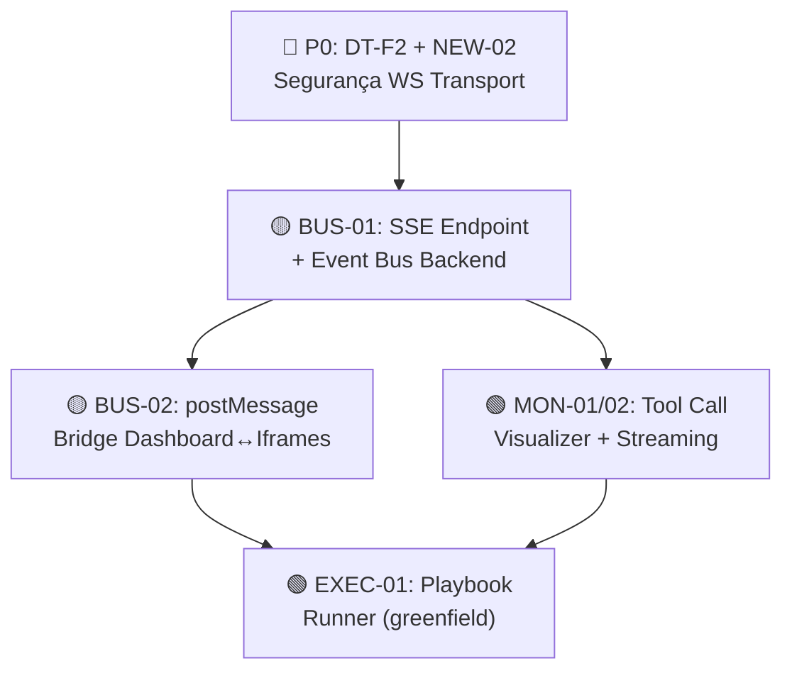

# Evidências 3D — UI/UX Roadmap Phase 2 (Integração Cross-App)

> **Fase:** 1 — Discovery 3D  
> **Data:** 16/10/2026  
> **Baseline pós-Fase 1:** PR #37 mergeada em `main`  
> **Branch:** `feature/uiux-roadmap-phase2`  
> **Escopo investigado:** BUS-01, BUS-02, MON-01/02, EXEC-01 (conforme spec Fase 1)

---

## 1. Eixo Vertical — Ingress Trace (Pontos de Entrada & Call Graphs)

### 1.1 Topologia de Rede dos 3 Frontends

```
┌─────────────────────────────────────────────────────────────────────┐
│                    BROWSER (localhost)                               │
│                                                                     │
│  ┌──────────────┐   iframe (same-origin)   ┌──────────────────┐    │
│  │  Dashboard    │──────────────────────────│  JEV             │    │
│  │  :8847        │   jev/index.html         │  (built asset)   │    │
│  │  (vanilla JS) │                          │  (React/Vite)    │    │
│  │               │   iframe (cross-port)    ├──────────────────┤    │
│  │               │──────────────────────────│  Nexus           │    │
│  │               │   http://127.0.0.1:5173  │  :5173           │    │
│  └───────┬───────┘                          │  (React/R3F)     │    │
│          │                                  └────────┬─────────┘    │
│          │ REST HTTP                                 │ WebSocket    │
│          │ /api/*, /v1/*                             │ ws://:8848   │
│          │                                           │              │
│  ┌───────┴───────────────────────────────────────────┴─────────┐   │
│  │                  Python Backend                              │   │
│  │  BFF server.py :8848 (HTTP + session)                       │   │
│  │  WS  ws_server.py :8848 (WebSocket, agent missions)         │   │
│  │  Dev serve.py :8847 (dashboard static + API mount)          │   │
│  └─────────────────────────────────────────────────────────────┘   │
└─────────────────────────────────────────────────────────────────────┘
```

### 1.2 Canais de Comunicação Atuais

| Canal | De → Para | Protocolo | Bidirecional | Arquivo |
|-------|-----------|-----------|:---:|---------|
| REST HTTP | Dashboard → Backend | `fetch()` | Não | `app.js`, `agent-arena.js`, `live-adapter.js` |
| REST HTTP | JEV → Backend | `fetch()` | Não | `jev-app/src/lib/api.js` |
| WebSocket | Nexus ↔ Backend | JSON over WS | **Sim** | `nexus/src/adapters/ws-transport.js` ↔ `backend/ws_server.py` |
| SSE (tentativa) | Dashboard ← Backend | EventSource | Não | `dashboard/graph-events.js:76` → `/v1/graph-events` |
| iframe DOM | Dashboard → JEV | `frame.contentDocument` | Não | `dashboard/app.js:276-302` |
| iframe CSS | JEV → Dashboard | `MutationObserver` (parent DOM) | Não | `jev-app/src/lib/theme.js` |
| **postMessage** | — | — | — | **🔴 INEXISTENTE em todo o repo** |
| **BroadcastChannel** | — | — | — | **🔴 INEXISTENTE em todo o repo** |

### 1.3 Achado Crítico: SSE `/v1/graph-events` NÃO implementado

- `dashboard/graph-events.js:76`: `source = new EventSource(SSE_ENDPOINT)` aponta para `/v1/graph-events`
- **Esse endpoint NÃO existe** em `backend/server.py` nem em `dashboard/serve.py`
- Quando falha, `graph-events.js:84-90` faz fallback para WebSocket `ws://127.0.0.1:8848`
- Quando WS também falha, cai em simulação randômica local
- **Implicação para BUS-01**: O canal SSE é a opção natural para o barramento unificado, mas precisa ser implementado do zero no backend

### 1.4 Portas e Origens Permitidas

| Serviço | Porta | Origens aceitas no WS |
|---------|-------|-----------------------|
| Nexus dev | 5173 | — (client) |
| Dashboard dev | 8847 | — (client) |
| Backend BFF | 8848 | `http://127.0.0.1:5173`, `http://localhost:5173`, `http://127.0.0.1:8847` |

---

## 2. Eixo Histórico — ADR Drift & Código Zumbi

### 2.1 Drift Documentacional

| Documento | Diz | Realidade | Severidade |
|-----------|-----|-----------|:---:|
| `README.md` | Sistema = Vault + CLI + MCP + BFF + Dashboard estático | Existem 3 frontends (Nexus, Dashboard, JEV) + MoE/Zero-Trust pipeline | 🟡 |
| ADR-016 (UX patterns) | `status: Proposto` | Fase 1 do roadmap já executou parcialmente (tema orgânico, nav agrupada) | 🟡 |
| ADR-019 (DDD Phase 1) | Fonte-de-verdade única para roles Nexus | Implementado com 5 personas canônicas em `simulation.mjs` | 🟢 |
| ADR-020 (DDD Phase 2-3) | Workflow Domain Entities | Entities existem em `core/domain/workflow/entities.py` | 🟢 |
| `graph-events.js` | Consome SSE `/v1/graph-events` | Endpoint não existe no backend | 🔴 |
| Security backlog | HITL spoofing via WS sem autenticação | WS não valida sessão (`ws_server.py:42-46` só checa Origin) | 🔴 |

### 2.2 PD-OVRs Vigentes (6 aprovadas)

| ID | Decisão | Relevância para Fase 2 |
|----|---------|:---:|
| PD-OVR-001 | RBAC deny ≠ Circuit Breaker | Baixa |
| PD-OVR-002 | Unicode NFKC apenas para injection scan | Baixa |
| PD-OVR-003 | TTL reset após HITL approval | **Alta** (HITL-01) |
| PD-OVR-004 | Fail-open resiliência / Fail-closed segurança | Média |
| PD-OVR-005 | Forbidden topics: base imutável + merge | Baixa |
| PD-OVR-006 | Callers sem persona → gates globais | Média |

### 2.3 ADRs Ativas Relevantes para Fase 2

| ADR | Título | Status | Impacto |
|-----|--------|--------|---------|
| ADR-012 | System Design para 4 Agentes Especialistas | Aceito | Arquitetura do Tool Call Visualizer |
| ADR-016 | Padrões de UX e Design System KIOSK | Proposto | Deve ser aceito formalmente com Fase 2 |
| ADR-019 | DDD Phase 1 — roles Nexus e schema Playbooks | Active | Fonte de verdade para personas |
| ADR-020 | DDD Phase 2-3 — Workflow Domain Entities | Active | Schema dos eventos de missão |
| ADR-022 | Política única e corretor de ferramentas | Aceito | Pipeline do broker para tool calls |

### 2.4 Dívidas Técnicas Herdadas da Fase 1

| # | Dívida | Impacto | Prioridade Fase 2 |
|---|--------|---------|:---:|
| DT-F1 | Tema orgânico sem teste em breakpoints mobile | Baixo | P3 |
| DT-F2 | `ws-transport.js` não auditado para segurança | Médio | P1 |
| NEW-02 | HITL spoofing via WS sem autenticação de sessão | Alto | **P0** |

---

## 3. Eixo Horizontal — Blast Radius & Consumidores

### 3.1 Mapa de Dependências por Item de Fase 2

#### BUS-01: Barramento Unificado de Eventos

**Consumidores diretos:**
- `dashboard/graph-events.js` — já tenta SSE, cai em WS, cai em simulação
- `dashboard/graph-ui.js:180` — mostra status "SSE ativo" / "WebSocket ativo" / "Simulando"
- `dashboard/live-adapter.js` — REST polling para `/v1/observability`
- `nexus/src/adapters/ws-transport.js` — transporte WS dedicado
- `nexus/src/adapters/simulation-adapter.js` — adapter plugável `createAdapter(mode, bindings)`

**Infraestrutura existente reutilizável:**
- `ws-transport.js` já implementa: reconnect exponencial, pending queue (64), subscribe/unsubscribe pattern
- `simulation-adapter.js` é transport-agnostic: aceita qualquer objeto `{ send(cmd), subscribe(cb) }`
- `graph-events.js` já tem lógica de fallback SSE → WS → simulação
- Backend `ws_server.py` já streama eventos em formato canônico (`schemaVersion: 1`)

**Risco de blast radius:** MÉDIO — toca 4 módulos de frontend + precisa de endpoint SSE no backend

#### BUS-02: Substituição de Iframes por postMessage

**Iframes atuais:**
1. `app.js:274` — JEV Playbooks (`jev/index.html#tab=playbooks`, same-origin)
2. `app.js:286` — Nexus Office (`http://127.0.0.1:5173`, cross-port)
3. `app.js:294` — JEV full (`jev/index.html`, same-origin)

**Comunicação atual com iframes:**
- Dashboard → JEV: inspeção direta de `frame.contentDocument` (only same-origin)
- JEV → Dashboard: `MutationObserver` no `parent.document.documentElement.dataset.theme` (one-way CSS sync)
- Dashboard → Nexus: **ZERO comunicação** (apenas renderiza o iframe)

**O que BUS-02 habilitaria:**
- Dashboard poderia enviar comandos ao Nexus (iniciar missão, aprovar HITL) sem o usuário interagir diretamente no iframe
- JEV poderia receber notificações de execução em tempo real
- Tema e estado de navegação sincronizados bidirecionalmente

**Risco de blast radius:** ALTO — toca Dashboard `app.js`, JEV `theme.js` + novo handler, Nexus precisa de novo `postMessage` transport adapter

#### MON-01/02: Tool Call Visualizer + Streaming de Raciocínio

**Estado atual:**
- Backend `orchestrator.py` executa steps determinísticos via `MISSION_PATTERNS` (L50-85)
- Cada step invoca `tool_executor.run_tool` → `broker.call` com pipeline completo (RBAC, DLP, audit)
- `broker.py` já emite trace spans em `core/tracing.py` → `.runtime/trace-log.jsonl`
- `workflow_api.py` grava audit entries em `.runtime/workflow_audit.jsonl`
- **Nenhum frontend** consome ou visualiza tool calls em tempo real

**O que precisaria ser construído:**
- Componente React de visualização de tool calls (timeline/DAG)
- Endpoint de streaming (SSE ou WS) para events de tool execution do broker
- UI de "raciocínio" mostrando thought → action → observation por step

**Risco de blast radius:** MÉDIO — backend já produz traces, precisa de novo endpoint + componentes React

#### EXEC-01: Execução Real de Playbooks no JEV

**Estado atual do JEV:**
- JEV é **exclusivamente** auditoria/evidência (`core/evidence.py:4`: "Nothing here runs a test")
- `ExecutionDialog.jsx` registra execuções **pós-fato** (formulário manual)
- `PlaybooksView.jsx` renderiza previews Liquid mas não executa nada
- Zero WebSocket, zero SSE, zero conceito de "execução em andamento"

**Backend de playbooks:**
- `playbooks_api.py` serve metadados e rendering, NÃO execução
- `core/liquid.py` renderiza templates, NÃO executa comandos
- `backend/workflow_api.py:4`: "It executes nothing: agent steps are scripted in the front-end"

**O que precisaria ser construído:**
- Runner de playbook no backend (ou via broker/orchestrator)
- Endpoint de streaming para progresso de execução
- UI de execução ativa no JEV (steps, logs, resultado parcial)
- Canal de retorno JEV → Dashboard via BUS-02

**Risco de blast radius:** MUITO ALTO — feature greenfield que toca backend + JEV + Dashboard

### 3.2 Baseline de Testes (pós-merge PR #37)

| Suíte | Tests | Comando |
|-------|:---:|---------|
| Nexus | 84 | `cd nexus && npm test` |
| Dashboard | 178+ | `cd dashboard && node --test --test-isolation=none tests/*.test.cjs` |
| JEV | 118 | `cd jev-app && npm test` |
| Python | varies | `python -m pytest -q` |
| **Total frontend** | **380+** | — |

---

## 4. Tabela de Hipóteses Descartadas

| # | Hipótese | Evidência de Descarte |
|---|----------|-----------------------|
| H1 | "Dashboard já usa postMessage para se comunicar com iframes" | Grep completo: 0 ocorrências de `postMessage` ou `addEventListener('message')` em código de produção |
| H2 | "JEV tem capacidade de executar playbooks" | `core/evidence.py:4` e `workflow_api.py:4` explicitamente dizem "nothing here runs a test" / "executes nothing" |
| H3 | "SSE /v1/graph-events está funcionando" | Endpoint não existe em `server.py` nem `serve.py`; frontend cai em fallback WS → simulação |
| H4 | "Nexus e Dashboard compartilham estado via algum mecanismo" | Zero comunicação entre Dashboard e iframe Nexus; Nexus opera isoladamente conectando direto ao WS backend |
| H5 | "Orchestrator usa LLM para planejar steps de missão" | `orchestrator.py:49`: "Padrões de missão → steps (regras fixas, sem LLM)". Usa pattern matching determinístico |
| H6 | "Backend faz streaming de tool calls para o frontend" | Tool calls são executados no broker mas traces vão apenas para arquivos `.jsonl`; nenhum streaming para frontend |

---

## 5. Classificação de Causa Raiz por Item

| Item | Causa Raiz | Classificação |
|------|-----------|:---:|
| BUS-01 | Não existe barramento de eventos; cada frontend fala direto com o backend por canal próprio (WS, REST) sem coordenação | **(b) Regra omissa** |
| BUS-02 | Iframes foram adotados sem canal de mensageria; comunicação é unidirecional via DOM inspection | **(b) Regra omissa** |
| MON-01/02 | Backend produz traces em arquivos mas não os expõe via streaming; frontend não tem componente de visualização | **(b) Regra omissa** |
| EXEC-01 | JEV foi construído como sistema de auditoria/evidência, não como runner; backend explicitamente não executa playbooks | **(b) Regra omissa** |

---

## 6. Priorização Proposta (Sequência de Dependências)



**Justificativa:**
1. **SEC (P0)** — WS sem autenticação de sessão é vulnerabilidade que precisa ser resolvida antes de expor mais canais
2. **BUS-01** — SSE endpoint é pré-requisito para streaming de qualquer dado em tempo real
3. **BUS-02** — postMessage bridge depende de haver eventos para transmitir (BUS-01)
4. **MON-01/02** — Visualização de tool calls depende do canal de streaming (BUS-01)
5. **EXEC-01** — Execução real de playbooks depende de comunicação bidirecional (BUS-02) + streaming (BUS-01)

---

*Relatório de evidências gerado na Fase 1 (Discovery 3D) do Manifesto Sem Retrabalho v3.0.0. Saldo de código: **+0 / -0**.*
