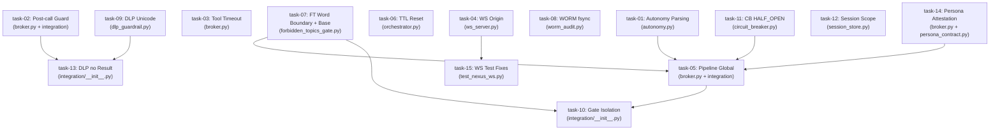

# Plano Mestre — Security Hardening P0/P1

> **Fase**: 3 — Plan Gate (Manifesto Sem Retrabalho v3.0.0)
> **Data**: 2026-10-15T16:08-03:00
> **Task**: `security-hardening-p0-p1`
> **Input**: Spec v1.0 aprovada (1032 linhas, 14 invariantes, 6 PD-OVRs)
> **Branch**: `fix/security-hardening-p0-p1` (base: commit `080044b`)
> **Base de Código**: `c:\KIOSK\second-brain\`
> **Suíte Baseline**: 882 passed, 16 failed (pré-existentes), 1 warning — 35.54s

---

## 1. Discrepâncias Spec × Código Real (Validação Cruzada)

A validação cruzada entre a spec e o código real revelou **9 discrepâncias** que o plano corrige:

| # | Discrepância | Impacto no Plano |
|---|-------------|-----------------|
| D1 | Classe se chama `ToolCircuitBreaker` (L51), não `CircuitBreaker` | Briefs usam nome correto |
| D2 | Código vive em `second-brain/core/...`, não `core/...` | Todos os paths absolutos corrigidos |
| D3 | `broker.py` não importa `asyncio` | task-03 adiciona `import asyncio` |
| D4 | `pre_call_pipeline` (L312-364): FT só roda `if task_text`; ordem é CB→RL→RBAC→FT→Autonomy→Input | task-05/10 reordenam: CB→RL→FT(sempre)→RBAC→Autonomy→Input + try/except per-gate |
| D5 | `post_call_pipeline` (L367-407): retorna `None`; sempre chama `record_tool_outcome` | task-02/13 adicionam `executed` guard e `return result` |
| D6 | `ForbiddenTopicsGate.evaluate` (L67-72): payload pode **substituir** patterns inteiros | task-07 implementa merge-only (INV-N04) |
| D7 | `ws_server.py`: sem `ALLOWED_ORIGINS`, sem `serve()`, PORT=8848 | task-04 adiciona ambos; PORT permanece 8848 |
| D8 | `test_nexus_ws.py`: mocks apontam para `exec_tool` inexistente em `orch_mod`; `AUTO_TOOLS` referenciado de `orch_mod`; `serve(0)` chamado | task-15 corrige todos os mocks |
| D9 | `persona_contract.py`: sem `persona-researcher` nem `persona-writer` | task-14 cria ambos como BUILTIN_CONTRACTS |

---

## 2. Grafo de Dependências



---

## 3. Ordem de Execução (Topológica)

| Wave | Briefs | Justificativa |
|------|--------|---------------|
| **Wave 1** (sem deps) | task-01, task-03, task-04, task-06, task-07, task-08, task-09, task-11, task-12 | Módulos independentes, 1 arquivo cada |
| **Wave 2** (deps Wave 1) | task-02, task-14 | task-02 toca `broker.py` + `integration`; task-14 cria personas |
| **Wave 3** (deps Wave 2) | task-05, task-10 | Reescrita de `pre_call_pipeline` depende de T01, T07, T11, T14 |
| **Wave 4** (deps Wave 3) | task-13 | DLP no resultado depende de T02 (executed flag) e T09 (NFKC) |
| **Wave 5** (deps Wave 4) | task-15 | Corrige testes WS — depende de T04 (serve factory + origins) |

---

## 4. Invariantes de Regressão (Verificação Contínua)

Após **cada** task, rodar:

```bash
cd c:\KIOSK\second-brain && python -m pytest tests/ -x -q --tb=short 2>&1 | tail -5
```

**Critério**: ≥ 882 passed. Os 16 failed pré-existentes são aceitos **somente** se seus nomes forem idênticos aos da baseline (task-15 corrige 5 deles).

---

## 5. Mapa de Arquivos por Brief

| Brief | Allowed Files | No-Touch (tudo mais) |
|-------|--------------|---------------------|
| task-01 | `core/policy/autonomy.py` | * |
| task-02 | `core/broker.py`, `core/integration/__init__.py` | * |
| task-03 | `core/broker.py` | * |
| task-04 | `backend/ws_server.py` | * |
| task-05 | `core/broker.py`, `core/integration/__init__.py`, `backend/orchestrator.py` | * |
| task-06 | `backend/orchestrator.py` | * |
| task-07 | `core/gates/forbidden_topics_gate.py` | * |
| task-08 | `core/audit/worm_audit.py` | * |
| task-09 | `core/security/dlp_guardrail.py` | * |
| task-10 | `core/integration/__init__.py` | * |
| task-11 | `core/resilience/circuit_breaker.py` | * |
| task-12 | `core/memory/session_store.py` | * |
| task-13 | `core/integration/__init__.py` | * |
| task-14 | `core/broker.py`, `core/schema/persona_contract.py` | * |
| task-15 | `tests/test_nexus_ws.py`, `backend/ws_server.py` | * |

> **Nota**: Todos os caminhos são relativos a `c:\KIOSK\second-brain\`. Ex: `core/broker.py` → `c:\KIOSK\second-brain\core\broker.py`.

---

## 6. Commits Semânticos

Cada brief gera **exatamente 1 commit**:

```
fix: F-AU-01+F-AU-02+GAP-03 — sentinel UNPARSEABLE e _parse_brl em autonomy.py
fix: F-IP-05 — executed flag e post_call guard em broker.py
fix: F-BR-01 — asyncio.wait_for com timeout 15s em broker.py
fix: GAP-WS-01+GAP-HT-01 — ALLOWED_ORIGINS e serve() em ws_server.py
fix: GAP-12+GAP-10 — pipeline global sem opt-in em broker.py
fix: F-OR-05 — TTL reset após HITL em orchestrator.py
fix: F-FT-01+GAP-FT-01 — word boundary e base imutável em forbidden_topics_gate.py
fix: F-WA-02 — os.fsync após write em worm_audit.py
fix: F-DLP-04 — NFKC + strip zero-width em dlp_guardrail.py
fix: F-IP-01 — gate isolation com try/except per-gate em integration
fix: GAP-CB-01 — _half_open_permitted semáforo em circuit_breaker.py
fix: GAP-SS-01 — FULL_ACCESS ownership check em session_store.py
fix: GAP-06 — DLP scan no resultado em post_call_pipeline
fix: GAP-13 — persona attestation com _validate_persona em broker.py
fix: Q7 — correção de 5 mocks em test_nexus_ws.py
```
