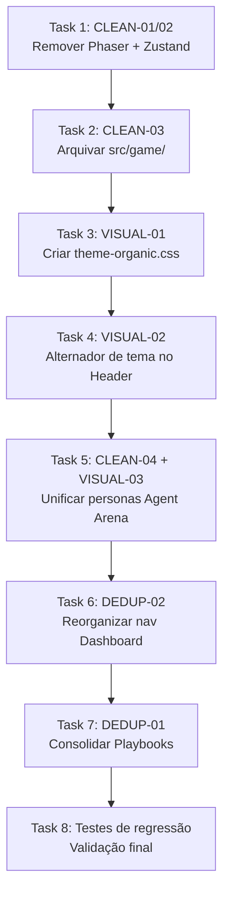

# Plano Mestre — UI/UX Roadmap Phase 1 (Higienização)

> **Fase:** 3 — Plan Gate  
> **Data:** 16/10/2026  
> **Spec:** [2026-10-16-uiux-roadmap-spec.md](file:///c:/KIOSK/second-brain/docs/superpowers/specs/2026-10-16-uiux-roadmap-spec.md)  
> **Branch:** `feature/uiux-roadmap-phase1`

---

## Sequência de Execução

## Tarefas

| # | ID | Brief SDD | Allowed Files | No-Touch | Teste CLI |
|---|-----|-----------|--------------|----------|-----------|
| 1 | CLEAN-01/02 | `task-1-brief.md` | `nexus/package.json`, `nexus/package-lock.json` | `nexus/src/**` | `cd nexus; npm install; npm ls phaser; npm ls zustand` → ambos "not found" |
| 2 | CLEAN-03 | `task-2-brief.md` | `nexus/src/game/**` → `nexus/src/_archived_game/**` | `nexus/src/components/**`, `nexus/src/scene/**` | `test -d nexus/src/game` → false; `test -d nexus/src/_archived_game` → true; `cd nexus; node --test` → 82 pass |
| 3 | VISUAL-01 | `task-3-brief.md` | `nexus/src/theme-organic.css` (novo) | `nexus/src/cyberpunk.css` | Arquivo existe com custom properties do DESIGN.md |
| 4 | VISUAL-02 | `task-4-brief.md` | `nexus/src/components/Header.jsx`, `nexus/src/App.jsx` ou `nexus/index.html` | `nexus/src/context.jsx`, `nexus/src/simulation.mjs` | `cd nexus; node --test` → 82 pass. Botão visível no markup SSR |
| 5 | CLEAN-04 + VISUAL-03 | `task-5-brief.md` | `dashboard/agent-arena.js` | `dashboard/app.js`, `dashboard/core.js` | `cd dashboard; node --test` → 178 pass. `grep -c "Maia" dashboard/agent-arena.js` ≥ 1 |
| 6 | DEDUP-02 | `task-6-brief.md` | `dashboard/app.js` | `dashboard/core.js`, `dashboard/DESIGN.md` | `cd dashboard; node --test` → 178 pass. Nav items ≤ 6 |
| 7 | DEDUP-01 | `task-7-brief.md` | `dashboard/app.js` | `dashboard/playbooks-ui.js` (preservar, não deletar) | `cd dashboard; node --test` → 178 pass. Rota `#page=playbooks` mostra JEV |
| 8 | REGRESSÃO | N/A (execução direta) | Nenhum | Todos | Todos os testes dos 3 frontends passam |

---

*Plano gerado em linguagem de máquina determinística. Briefs SDD em `.superpowers/sdd/`.*
