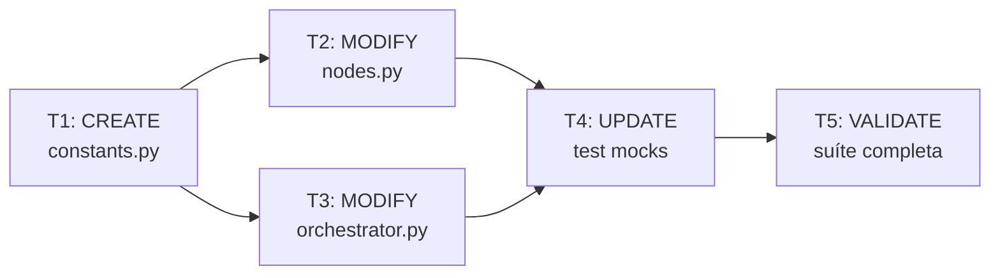

# Plano Mestre — V1 Clean Architecture: Extração de Constantes de Domínio

> **Fase:** 3 — Plan Gate  
> **Data:** 17/10/2026  
> **Task:** v1-clean-arch-constants  
> **Branch:** `refactor/v1-clean-arch-constants`  
> **Spec aprovada:** [`2026-10-17-v1-clean-arch-constants-spec.md`](file:///c:/KIOSK/second-brain-WO-0001/docs/superpowers/specs/2026-10-17-v1-clean-arch-constants-spec.md)

---

## Sequência de Execução



| # | Brief | Arquivo(s) | TDD | Tempo est. |
|---|-------|-----------|:---:|:---:|
| T1 | Criar `constants.py` | 1 CREATE | GREEN (import test) | 2 min |
| T2 | Atualizar `nodes.py` | 1 MODIFY | RED→GREEN | 2 min |
| T3 | Re-export em `orchestrator.py` | 1 MODIFY | GREEN (retrocompat) | 2 min |
| T4 | Atualizar mocks nos testes graph | 2 MODIFY | RED→GREEN | 3 min |
| T5 | Validação completa | 0 | Suíte full | 3 min |

**Total estimado:** ~12 minutos

---

## Allowed Files (escopo completo)

```
core/domain/workflow/constants.py          CREATE
core/graph/nodes.py                        MODIFY (linhas 73-78)
backend/orchestrator.py                    MODIFY (linhas 41-90)
tests/test_graph_unit.py                   MODIFY (linhas 539-548)
tests/test_graph_integration.py            MODIFY (linhas 37, 202-207)
```

## No-Touch Files (explícito)

```
core/domain/workflow/entities.py           PROIBIDO
core/domain/workflow/__init__.py           PROIBIDO
core/graph/runner.py                       PROIBIDO
core/graph/edges.py                        PROIBIDO
core/graph/entrypoint.py                   PROIBIDO
backend/server.py                          PROIBIDO
backend/ws_server.py                       PROIBIDO
tests/test_integration.py                  PROIBIDO
tests/test_mission_guard.py                PROIBIDO
tests/test_nexus_ws.py                     PROIBIDO
tests/test_pipeline_global.py              PROIBIDO
tests/test_sprint8_moe_wiring.py           PROIBIDO
tests/test_sprint8_postmission_hops.py     PROIBIDO
```

---

## Invariantes de Verificação

Após cada brief, verificar:

```powershell
# INV-N01: core/graph/ nunca importa de backend/
Get-ChildItem -Path "core" -Filter "*.py" -Recurse | Where-Object { $_.FullName -notlike "*__pycache__*" } | Select-String "from backend"
# Esperado: 0 matches

# INV-N04: Suíte de testes passa
C:\Python314\python.exe -m pytest tests/ -v --tb=short
```

---

*Plano gerado seguindo o Manifesto Sem Retrabalho v3.0.0 — Fase 3 (Plan Gate).*
