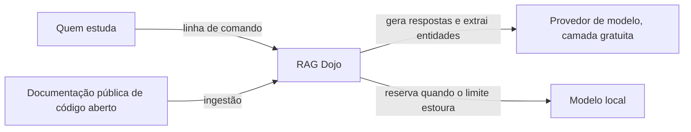
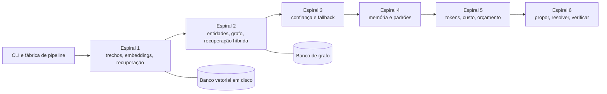

# Arquitetura

## Contexto

## Contêineres

## Estratégia

- **Espirais independentes.** Cada pacote usa apenas os símbolos exportados pelo anterior, sem import
  circular. Uma espiral quebrada não derruba as de antes.
- **Banco vetorial embutido.** Roda no mesmo processo e grava em disco, para que a integração contínua não
  precise de servidor.
- **Modelo gratuito com reserva local.** O provedor de nuvem é o principal; o modelo local assume quando o
  limite diário estoura.
- **Testes como contrato.** O README registra cerca de 900 funções de teste e mínimo de 90% de cobertura
  por arquivo.

## Riscos

| Risco | Efeito | Situação |
|---|---|---|
| Limite da camada gratuita | Sessão interrompida | Coberto pela reserva local |
| Sem benchmark publicado | Não há como afirmar ganho de uma espiral sobre a outra | Em aberto |
| Banco de grafo exige serviço à parte a partir da espiral 2 | Ambiente mais pesado para quem começa | Aceito |
