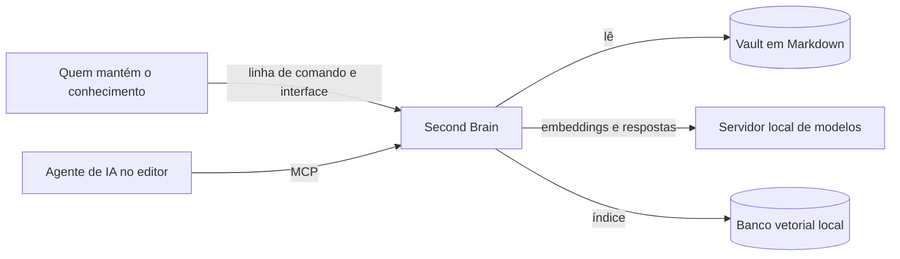
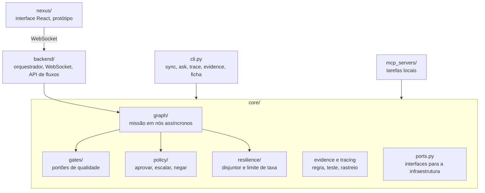

# Arquitetura

## Contexto

## Contêineres

## Estratégia

- **Fonte única em arquivos.** O vault é a verdade; índice e respostas são derivados.
- **Núcleo sem infraestrutura.** `core/ports.py` define as interfaces; quem instala fornece os adaptadores.
- **Decisão centralizada.** Nenhum módulo fora de `core/policy/` mantém lista de comandos permitidos.
- **Tudo local.** Os serviços auxiliares sobem por `docker-compose.yml` na própria máquina.

## Riscos

| Risco | Efeito | Situação |
|---|---|---|
| Dois serviços locais obrigatórios para a busca | Instalação mais pesada; `ask` falha sem eles | Em aberto |
| 92 testes assíncronos não rodam por falta de uma dependência de teste | O grafo de missão e o WebSocket estão sem verificação | Pendência da auditoria de construção |
| Sem adaptadores de infraestrutura | Ferramentas de comando não executam nada | Aceito e declarado no README |
| Sem integração contínua | Regressão só aparece quando alguém roda a suíte | Em aberto |
