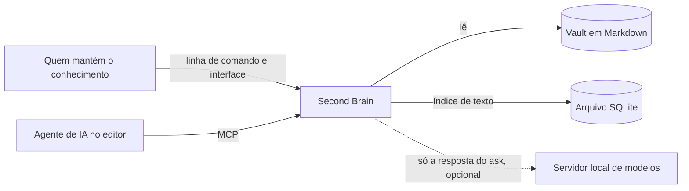
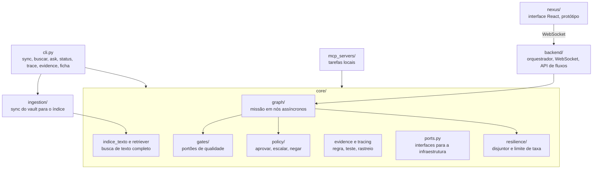

# Arquitetura

## Contexto

## Contêineres

## Estratégia

- **Fonte única em arquivos.** O vault é a verdade; índice e respostas são derivados.
- **Núcleo sem infraestrutura.** `core/ports.py` define as interfaces; quem instala fornece os adaptadores.
- **Decisão centralizada.** Nenhum módulo fora de `core/policy/` mantém lista de comandos permitidos.
- **Tudo local e sem serviço para buscar.** O índice é um arquivo SQLite derivado do vault; só a resposta
  do `ask` usa um servidor de modelos, que é opcional.

## Riscos

| Risco | Efeito | Situação |
|---|---|---|
| Piso de relevância não medido | A busca pode devolver trecho fraco ou cortar trecho bom | Em aberto, até existir vault de exemplo |
| Busca por palavras | Pergunta com vocabulário diferente da nota não acha nada | Aceito; a busca devolve a lacuna |
| `ask` com modelo real sem cobertura de teste | A geração da resposta só é verificada com gerador falso | Em aberto |
| Sem adaptadores de infraestrutura | Ferramentas de comando não executam nada | Aceito e declarado no README |
| Sem integração contínua | Regressão só aparece quando alguém roda a suíte | Em aberto |
