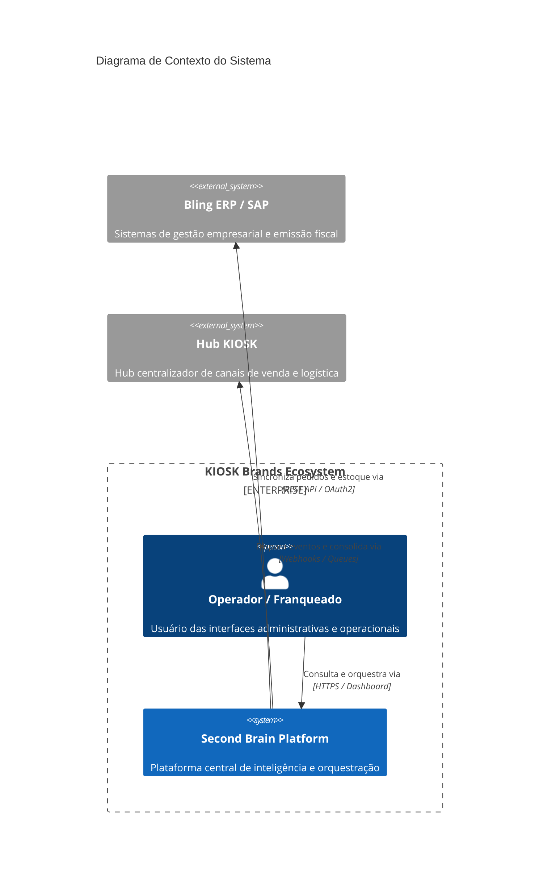
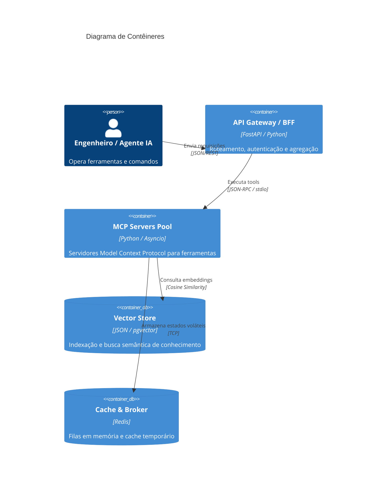
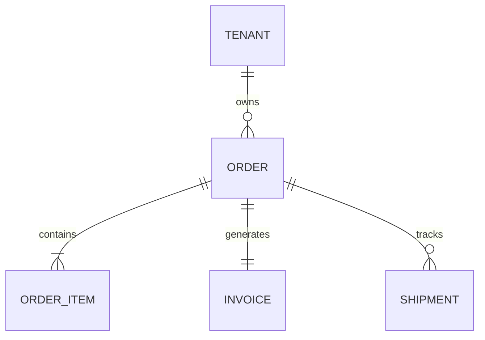

# HLD (High Level Design): [Nome do Sistema / Solução]

## 1. Visão Geral & Contexto de Negócio
*Descrição em alto nível do objetivo arquitetural do sistema, seu papel no ecossistema KIOSK Brands e os limites de fronteira do domínio.*

---

## 2. Requisitos de Engenharia & Metas de Capacidade

### 2.1 Metas de Throughput e Latência (Back-of-the-Envelope)
- **Leituras por Segundo (RPS Pico):** [Ex: 350 RPS]
- **Escritas por Segundo (WPS Pico):** [Ex: 50 WPS]
- **Razão Read/Write:** [Ex: 7:1]
- **Latência Alvo (SLO P95/P99):** [Ex: P95 < 200ms, P99 < 500ms]
- **Projeção de Armazenamento:** [Ex: 10 GB/mês com retenção de 2 anos = ~240 GB]

### 2.2 Concorrência Máxima (Lei de Little)
$$L = \lambda \times W$$
*Exemplo: $\lambda = 200\text{ RPS}$, $W = 0.25\text{s} \implies L = 50\text{ conexões concorrentes}$. Com margem de segurança de 50%, dimensionar para 75 workers.*

---

## 3. Modelo C4 — Diagramação Arquitetural (Mermaid)

### 3.1 Nível 1: Diagrama de Contexto (System Context)

### 3.2 Nível 2: Diagrama de Contêineres (Container Diagram)

---

## 4. Núcleo de Entidades & Modelo de Dados
*Definição das entidades de domínio, agregados e relacionamentos.*

---

## 5. Estratégia de Comunicação & Resiliência
- **Síncrono vs Assíncrono:** [Quais fluxos são síncronos e quais são orientados a eventos]
- **Circuit Breaker:** [Threshold de falhas para abertura e tempo de half-open]
- **Retry Policy:** [Backoff exponencial com full jitter]
- **Dead Letter Queue (DLQ):** [Tratamento de mensagens que falham repetidamente]

---

## 6. Segurança e Governança
- **Autenticação & Autorização:** [RBAC, mTLS, Bearer Token]
- **Proteção de Dados Sensíveis:** [LGPD, mascaramento de PII em logs e traces]
- **Auditoria:** [Logs de trilha de auditoria para operações críticas]

---

## 7. Decisões Arquiteturais Registradas (ADRs Relacionados)
- [[ADR-013-adocao-padroes-mba-full-cycle-ia]]: Adoção dos padrões Full Cycle.
- [Outros ADRs relevantes da solução]
