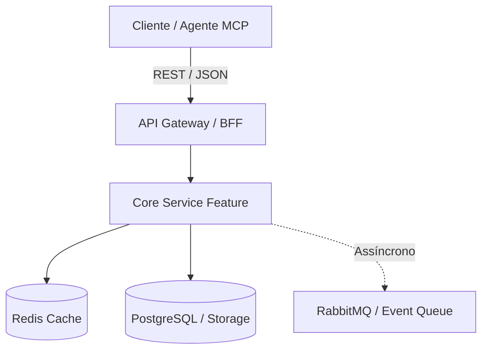

# PRD de Feature: [Nome da Feature]

## 1. Resumo Executivo
*Descreva em 2 a 3 frases claras o que a feature faz, qual dor essencial resolve e por que é prioridade estratégica no ecossistema KIOSK.*

---

## 2. Contexto e Problema

### 2.1 Público-Alvo e Stakeholders
- **Usuários Primários:** [Ex: Operadores de expedição, Desenvolvedores de integrações, Gerentes de franquia]
- **Sistemas Impactados:** [Ex: Hub KIOSK, Bling ERP, Touti, SAP, MCP Servers]

### 2.2 Cenários Atuais vs Cenário Desejado
- **Cenário Atual (Dor):** [O que acontece hoje, tempo gasto, taxa de erro ou fricção]
- **Cenário Desejado:** [Como o fluxo operará após a implantação da feature]

---

## 3. Objetivos e Métricas de Sucesso

| Objetivo de Negócio / Técnico | Métrica Quantitativa (KPI/SLO) | Meta Mensurável |
|---|---|---|
| Reduzir tempo de processamento | Latência P95 de sincronização | < 350 ms |
| Aumentar confiabilidade | Taxa de falhas de conciliação | < 0.05% |
| Escalabilidade operacional | Throughput sustentado | ≥ 100 RPS |

---

## 4. Escopo

### 4.1 Dentro do Escopo (In-Scope)
- [ ] Item 1
- [ ] Item 2
- [ ] Item 3

### 4.2 Fora do Escopo (Out-of-Scope)
- ❌ Item A (planejado para v2.1)
- ❌ Item B (responsabilidade do ERP legado)

---

## 5. Requisitos Funcionais (RF)

### RF-01: [Nome do Requisito]
- **Descrição:** [O que o sistema deve executar]
- **Atores:** [Quem ou qual serviço dispara]
- **Fluxo Principal (Happy Path):**
  1. O cliente/serviço envia o payload X.
  2. O sistema valida as credenciais e integridade.
  3. O processamento executa idempotentemente.
  4. Retorna resposta HTTP 200 com payload Y.
- **Fluxos Alternativos / Exceções:**
  - *Payload inválido:* Retorna HTTP 422 com schema de erro estruturado.
  - *Serviço externo indisponível:* Aciona Circuit Breaker e enfileira na Dead Letter Queue (DLQ).
- **Prioridade:** P0 (Must have) / P1 (Should have) / P2 (Nice to have)

---

## 6. Requisitos Não-Funcionais (RNF)

| Dimensão | Especificação / Limite Mandatório |
|---|---|
| **Performance (Latência)** | P95 < 200ms para leituras; P95 < 500ms para escritas síncronas |
| **Throughput & Concorrência** | Suporte a 150 RPS com degradação graciosa |
| **Disponibilidade (SLO)** | 99.9% de uptime mensal |
| **Segurança & Compliance** | Autenticação via mTLS / JWT Bearer, dados sensíveis mascarados em logs |
| **Idempotência** | Header `X-Idempotency-Key` obrigatório em mutações financeiras/estoque |
| **Observabilidade** | Logs estruturados (JSON), OpenTelemetry tracing, métricas RED/USE |

---

## 7. Arquitetura Proposta & Abordagem Técnica



- **Componentes Envolvidos:** [Listar novos serviços ou módulos afetados]
- **Contrato de API (Preview):**
```json
{
  "event_id": "evt_99812",
  "action": "sync_inventory",
  "status": "success",
  "timestamp": "2026-10-12T20:30:00Z"
}
```

---

## 8. Decisões Arquiteturais e Trade-offs

| Alternativa Avaliada | Decisão Escolhida | Justificativa e Trade-offs Aceitos |
|---|---|---|
| Processamento Síncrono vs Fila Assíncrona | Fila Assíncrona via RabbitMQ | Sacrifica resposta imediata ao cliente em prol de desacoplamento e proteção contra picos de tráfego. |
| Cache local vs Redis Centralizado | Redis com TTL de 300s | Evita inconsistência entre réplicas e respeita limite de memória dos nós. |

---

## 9. Dependências e Integrações
- **Dependências Técnicas:** [Bibliotecas, versões de runtime, banco de dados]
- **Dependências Externas:** [API Bling ERP v3, J&T Express Webhook, SAP RFC]
- **Dependências de Times:** [Time DEVOPS para provisionamento, Time QA para dataset de teste]

---

## 10. Riscos, Impactos e Planos de Mitigação

| Risco Identificado | Severidade | Probabilidade | Estratégia de Mitigação |
|---|---|---|---|
| Rate limit excedido na API externa | Alta | Média | Implementar Leaky Bucket local + Backoff Exponencial com Jitter |
| Concorrência simultânea de estoque | Crítica | Baixa | Bloqueio otimista via versionamento de linha (`version` column) |

---

## 11. Critérios de Aceitação (Definition of Done)
- [ ] Todos os RFs implementados com testes unitários cobrindo > 85% das linhas.
- [ ] Testes de integração automatizados validados no CI/CD.
- [ ] Latência P95 comprovada abaixo do SLO em teste de carga sintético.
- [ ] Documentação de API (OpenAPI / Swagger) atualizada e indexada no Vault.
- [ ] Alertas Prometheus e dashboards Grafana configurados para os Four Golden Signals.

---

## 12. Estratégia de Testes e Validação com IA
- **Casos de Teste Positivos:** Cenários nominais de sucesso com validação de payload.
- **Casos de Teste Negativos & Edge Cases:** Falhas de rede, payloads malformados, concorrência.
- **Validação de Agentes de IA:**
  - Golden Dataset criado com no mínimo 20 pares entrada/saída esperada.
  - Avaliação de prompts com Precision ≥ 0.85 e F1 ≥ 0.82.
  - Guardrails anti-alucinação validados contra injeção e ausência de dados.

---

### 💡 Guia de Geração com IA (Prompt de Entrevista MBA Full Cycle)
Para gerar este documento automaticamente utilizando um agente LLM, utilize o prompt:
> *"Você é um Principal Product Manager e Arquiteto de Software Sênior. Conduza uma entrevista técnica em 12 etapas sequenciais comigo para elicitar os requisitos da feature [Nome da Feature], e ao final gere o PRD completo preenchendo rigorosamente as 12 seções acima."*
