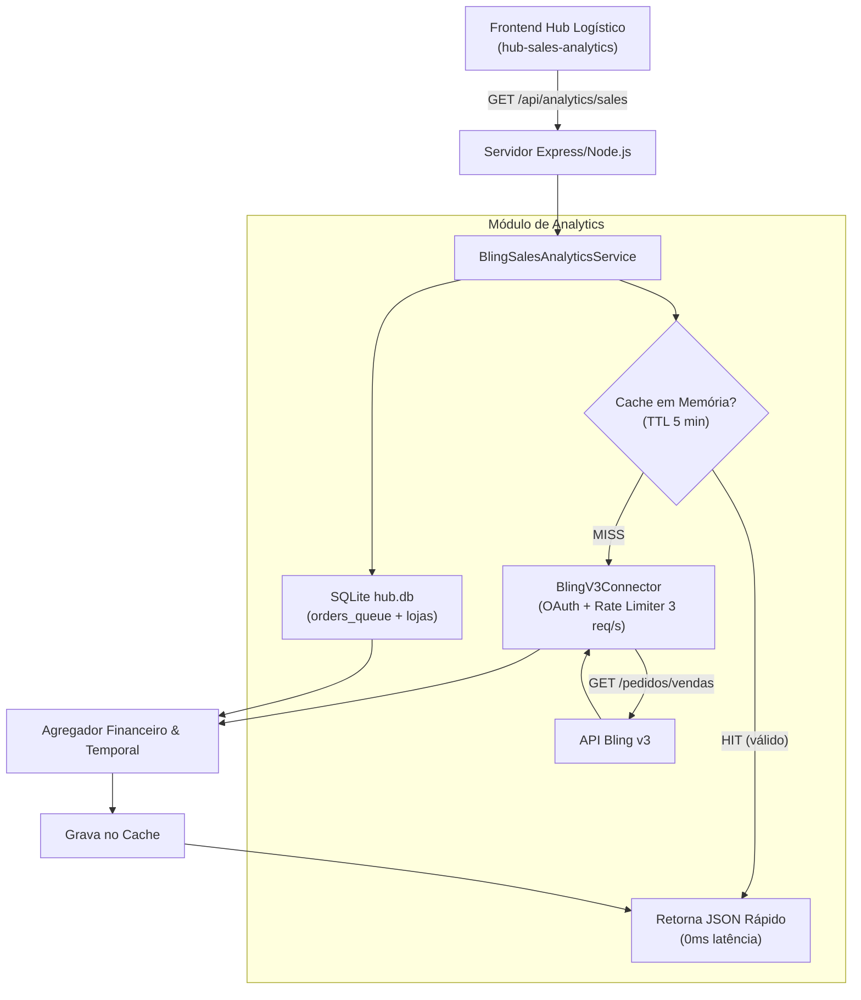

# Analytics de Vendas & Fulfillment Integrado ao Bling v3

## 1. Visão Geral

Este documento define a especificação da página de **Analytics de Vendas & Fulfillment** do Hub Logístico, transformando o conceito genérico de analytics em um painel executivo e operacional integrado diretamente à **API v3 do Bling** e ao banco **`hub.db`**.

O objetivo é fornecer visibilidade em tempo real para as lideranças da holding KIOSK Brands (Touti Cosmetics, Amavia Cosméticos, Yes! Cosmetics) sobre:
1. **Desempenho Comercial (Bling v3)**: Faturamento bruto (GMV), ticket médio, volume de pedidos e canais com maior tração.
2. **Eficiência Operacional & Logística (Hub)**: SLA de despacho, taxa de conversão da fila em etiquetas J&T emitidas e custo médio de frete por pacote.

---

## 2. Contrato da API Backend (`GET /api/analytics/sales`)

### 2.1. Parâmetros de Consulta (Query Params)

| Parâmetro | Tipo | Padrão | Descrição |
|---|---|---|---|
| `startDate` | String (YYYY-MM-DD) | D-30 | Data inicial do período de consulta no Bling |
| `endDate` | String (YYYY-MM-DD) | Hoje | Data final do período de consulta no Bling |
| `storeId` | Number/String | null (Todas) | ID da loja no Bling (ex: `206085936` para Touti ES) |
| `statusId` | Number | 9 (Atendido) | ID da situação no Bling (9=Atendido, 6=Em aberto) |
| `forceRefresh` | Boolean | false | Se true, ignora o cache em memória (TTL 5 min) |

### 2.2. Payload de Resposta (JSON)

```json
{
  "period": {
    "startDate": "2026-10-01",
    "endDate": "2026-10-13"
  },
  "summary": {
    "totalRevenue": 248950.80,
    "totalOrders": 1284,
    "averageTicket": 193.89,
    "totalShippingCost": 28410.00,
    "averageShippingPerOrder": 22.13,
    "totalProductsSold": 4120
  },
  "fulfillment": {
    "queuedTotal": 1284,
    "labelsGenerated": 1256,
    "pendingInQueue": 28,
    "failedQueue": 0,
    "fulfillmentRatePercent": 97.8
  },
  "byStore": [
    {
      "storeId": "206085936",
      "storeName": "KIOSK ESPIRITO SANTO (Touti ES)",
      "revenue": 114500.00,
      "ordersCount": 590,
      "sharePercentage": 46.0
    },
    {
      "storeId": "206084387",
      "storeName": "KIOSK RECIFE (Touti PE)",
      "revenue": 72150.00,
      "ordersCount": 380,
      "sharePercentage": 29.0
    },
    {
      "storeId": "206133846",
      "storeName": "Shopify E-Commerce",
      "revenue": 39800.80,
      "ordersCount": 194,
      "sharePercentage": 16.0
    },
    {
      "storeId": "206288765",
      "storeName": "Yes! Cosmetics",
      "revenue": 22500.00,
      "ordersCount": 120,
      "sharePercentage": 9.0
    }
  ],
  "topProducts": [
    {
      "sku": "PERF-TOUTI-VIP-50",
      "name": "Perfume Touti VIP 50ml",
      "quantity": 1420,
      "revenue": 106500.00
    },
    {
      "sku": "KIT-AMAVIA-RECONSTRUTOR",
      "name": "Kit Reconstrutor Capilar Amavia",
      "quantity": 890,
      "revenue": 62300.00
    },
    {
      "sku": "BATOM-YES-MATTE-RED",
      "name": "Batom Yes! Matte Red Velvet",
      "quantity": 620,
      "revenue": 21700.00
    }
  ],
  "timeline": [
    { "date": "2026-10-01", "revenue": 18500.00, "ordersCount": 95 },
    { "date": "2026-10-02", "revenue": 19200.00, "ordersCount": 98 }
  ],
  "fromCache": false,
  "calculatedAt": "2026-10-13T21:17:00.000Z"
}
```

---

## 3. Arquitetura da Solução



---

## 4. Como Adicionar a Rota no `server.js` do Hub

```javascript
const { BlingSalesAnalyticsService } = require('./hub-connectors');

// Instanciação única no startup:
const blingConnector = registry.getPrimaryErp();
const salesAnalytics = new BlingSalesAnalyticsService({
  blingConnector,
  db,
  cacheTtlMs: 300000 // 5 minutos
});

// Rota HTTP:
app.get('/api/analytics/sales', async (req, res) => {
  try {
    const { startDate, endDate, storeId, statusId, forceRefresh } = req.query;
    const data = await salesAnalytics.getSalesAnalytics({
      startDate,
      endDate,
      storeId,
      statusId: statusId ? Number(statusId) : 9,
      forceRefresh: forceRefresh === 'true'
    });
    res.json({ success: true, data });
  } catch (err) {
    res.status(500).json({ success: false, error: err.message });
  }
});
```
