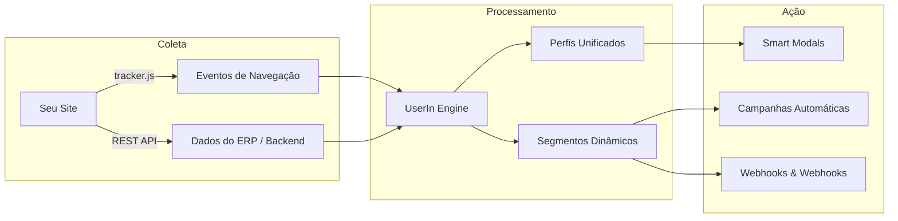

# Blueprint de Engenharia & UI/UX: Documentação Mintlify (Estilo UserIn)

> Este documento consolida a análise reversa e deep research completa realizada sobre a documentação oficial da UserIn ([userin.mintlify.app](https://userin.mintlify.app/)).
> Ele serve como guia de referência técnica, arquitetural e visual para você reproduzir uma documentação com o mesmo nível de excelência, clareza e UI/UX.

---

## 1. Arquitetura de Informação & Sitemap

A documentação da UserIn é dividida em duas grandes divisões no cabeçalho superior (**Top Navigation Tabs**):
1. **Guias** (Foco no produto, onboarding, plataforma e componentes visuais)
2. **API Reference** (Foco no desenvolvedor: Tracker JS, Journey Engine, REST API e OpenAPI Spec)

### 1.1 Árvore de Navegação Canônica

```text
├── Guias
│   ├── Início
│   │   ├── Bem-vindo à UserIn (/)
│   │   └── Visão Geral (/visao-geral)
│   ├── Onboarding (Time to First Value < 5 min)
│   │   ├── Primeiros Passos (/onboarding/primeiros-passos)
│   │   ├── Instalar o Tracker (/onboarding/instalar-tracker)
│   │   ├── Conectando Dados (/onboarding/conectando-dados)
│   │   └── Verificar Integração (/onboarding/verificar-integracao)
│   ├── Plataforma (Conceitos & Recursos Core)
│   │   ├── Ontologia de Dados (/plataforma/ontologia)
│   │   ├── Jornadas (/plataforma/jornadas)
│   │   ├── Regras (/plataforma/regras)
│   │   ├── Audiência (/plataforma/audiencia)
│   │   ├── Validador de Premiação (/plataforma/validador-premiacao)
│   │   └── Personalização com Variáveis Liquid (/plataforma/personalizacao-liquid)
│   └── Componentes (Biblioteca de Widgets & Mecânicas)
│       ├── Criando Componentes (/componentes/criando-componentes)
│       ├── Cards (/componentes/cards)
│       ├── Modais (/componentes/modais)
│       ├── Smart Blocks (/componentes/smart-blocks)
│       └── Mini Games (/componentes/mini-games)
└── API Reference
    ├── APIs e Integrações Técnicas (/api-reference/introduction)
    └── OpenAPI Spec (/api-reference/openapi.json)
```

---

## 2. Design System & Identidade Visual Mintlify

### 2.1 Tokens de Cores (CSS Variables)

A UserIn utiliza uma paleta azul de alto contraste (Huggs Blue) combinada com um tema dark sofisticado em tons de slate/obsidian:

```css
:root {
  /* Marca / Primária */
  --primary: 0 32 231;             /* #0020E7 - Azul UserIn / Huggs */
  --primary-light: 0 32 231;
  --primary-dark: 11 33 173;        /* #0B21AD - Hover & badges ativos */

  /* Fundos */
  --background-light: 255 255 255;  /* #FFFFFF */
  --background-dark: 9 9 15;        /* #09090F - Dark profundo fosco */

  /* Escala de Cinzas (Slate/Zinc) */
  --gray-50: 242 243 249;
  --gray-100: 238 238 245;
  --gray-200: 222 223 229;
  --gray-300: 206 206 213;
  --gray-400: 158 159 165;
  --gray-500: 111 112 119;
  --gray-600: 79 80 87;
  --gray-700: 62 63 69;
  --gray-800: 37 38 44;
  --gray-900: 22 23 29;
  --gray-950: 10 11 17;
}
```

### 2.2 Tipografia

- **Títulos e Texto Corrido:** `Inter` (Google Fonts, pesos 400, 500, 600, 700).
- **Código e Blocos de Terminal:** `PaperMono` ou `JetBrains Mono` / `Fira Code`.
- **Hierarquia:**
  - `h1`: 32px a 36px, `font-bold`, com espaçamento inferior e subtítulo imediato em estilo `blockquote`.
  - `h2`: 22px a 24px, `font-semibold`, com separador sutil `***` antecedente.
  - `h3`: 18px a 20px, `font-medium`.

---

## 3. Catálogo de Elementos e Componentes MDX (Copy & Paste)

Abaixo estão os modelos exatos dos componentes utilizados nas páginas da UserIn:

### 3.1 Cabeçalho Canônico de Artigo com Sumário Inline

```markdown
# Personalização com Variáveis

> Use variáveis dinâmicas para personalizar Smart Modals, Smart Blocks, emails e SMS com dados reais de cada visitante.

**Nesta página:**

* [O que são variáveis de personalização?](#o-que-são-variáveis-de-personalização)
* [Como funciona](#como-funciona)
* [Variáveis com valor padrão](#variáveis-com-valor-padrão)
* [Variáveis disponíveis](#variáveis-disponíveis)
* [Boas práticas](#boas-práticas)

***
```

---

### 3.2 Banner Hero Responsivo (Dark / Light Mode)

Imagens otimizadas que alternam de acordo com o tema selecionado pelo usuário:

```html


```

---

### 3.3 Grupos de Cards Navegáveis (`<CardGroup>` & `<Card>`)

Utilizado para destacar pilares, ferramentas ou rotas de navegação rápida:

#### Grid de 3 Colunas (Pilares / Recursos)
```jsx
<CardGroup cols={3}>
  <Card title="Capture comportamento" icon="radar">
    Cliques, scrolls, formulários e navegação completa. Tudo coletado automaticamente, sem configuração manual.
  </Card>

  <Card title="Entenda sua audiência" icon="brain">
    Dados brutos viram perfis ricos e segmentos dinâmicos que se atualizam em tempo real.
  </Card>

  <Card title="Converta no momento certo" icon="bullseye-arrow">
    Modais, smart blocks, automações e IA contextual. A mensagem certa, para a pessoa certa, na hora certa.
  </Card>
</CardGroup>
```

#### Grid de 2 Colunas com Links (Quickstart Onboarding)
```jsx
<CardGroup cols={2}>
  <Card title="Criar Conta" icon="user-plus" href="/onboarding/primeiros-passos">
    Configure seu projeto e receba sua chave de API em menos de 2 minutos.
  </Card>

  <Card title="Instalar Tracker" icon="code" href="/onboarding/instalar-tracker">
    Copie e cole o script. Compatível com qualquer site, SPA ou plataforma.
  </Card>

  <Card title="Conectar Dados" icon="link" href="/onboarding/conectando-dados">
    Identifique usuários logados e capture eventos customizados do seu negócio.
  </Card>

  <Card title="Validar Integração" icon="check-double" href="/onboarding/verificar-integracao">
    Veja seus primeiros dados chegando em tempo real no dashboard.
  </Card>
</CardGroup>
```

---

### 3.4 Passo a Passo Numérico Sequencial (`<Steps>` & `<Step>`)

Ideal para guias de onboarding, tutoriais de instalação e fluxos operacionais:

```jsx
<Steps>
  <Step title="Rastreamento automático">
    O tracker captura **page views, cliques, scrolls e formulários** no momento da instalação.
  </Step>

  <Step title="Unificação de identidade">
    Todo visitante ganha um perfil único. Ao logar ou preencher formulário, a identidade é unificada automaticamente.
  </Step>

  <Step title="Segmentação em tempo real">
    Regras comportamentais avaliam os visitantes a cada evento emitido.
  </Step>

  <Step title="Engajamento personalizado">
    Dispare modais, smart blocks e webhooks baseados no comportamento real.
  </Step>
</Steps>
```

---

### 3.5 Acordeões Colapsáveis por Stack (`<AccordionGroup>` & `<Accordion>`)

Padrão impecável da UserIn para apresentar tutoriais de instalação por plataforma (HTML, WordPress, Next.js, Shopify) sem poluir visualmente a página:

```jsx
<AccordionGroup>
  <Accordion title="HTML puro" icon="file-code" defaultOpen>
    Adicione diretamente na tag `<head>` da sua aplicação:

    ```html
    <script 
      src="https://cdn.userin.ai/tracker.js" 
      data-key="SUA_CHAVE_AQUI">
    </script>
    ```
  </Accordion>

  <Accordion title="Next.js (App Router)" icon="react">
    No arquivo `app/layout.tsx`:

    ```tsx
    import Script from 'next/script';

    export default function RootLayout({ children }) {
      return (
        <html>
          <head>
            <Script
              src="https://cdn.userin.ai/tracker.js"
              strategy="afterInteractive"
              data-key="SUA_CHAVE_AQUI"
            />
          </head>
          <body>{children}</body>
        </html>
      );
    }
    ```
  </Accordion>

  <Accordion title="WordPress" icon="wordpress">
    Adicione no arquivo `functions.php` do seu tema filho:

    ```php
    function injetar_tracker() {
      echo '<script src="https://cdn.userin.ai/tracker.js" data-key="SUA_CHAVE"></script>';
    }
    add_action('wp_head', 'injetar_tracker');
    ```
  </Accordion>
</AccordionGroup>
```

---

### 3.6 Callouts Contextuais & Alertas Semânticos

A documentação utiliza callouts estilizados para destacar recomendações, avisos e notas importantes:

```jsx
<Tip>
  Chame o método de identificação o mais cedo possível após o login do usuário para enriquecer o histórico unificado.
</Tip>

<Info>
  Segmentos podem ser usados como gatilhos no Editor de Fluxos ou para filtrar dashboards analíticos.
</Info>

<Warning>
  Nunca exponha sua API Secret Key em scripts client-side no navegador.
</Warning>

<div className="callout-blue">
  O formato suporta valores padrão de fallback: `{{campo:valor_padrao}}`.
</div>
```

---

### 3.7 Diagramas de Arquitetura em Mermaid

A documentação UserIn usa diagramas `Mermaid` integrados para ilustrar a esteira de dados de ponta a ponta:

````markdown

````

---

### 3.8 Documentação de APIs & Métodos Técnicos

Cada método JavaScript ou endpoint REST segue esta anatomia estrita:

1. **Assinatura e Propósito:** Breve explicação de uma frase.
2. **Exemplo de Código Executável:** Snippet limpo.
3. **Tabela de Parâmetros:** Nome, tipo, obrigatoriedade e descrição.
4. **Callout de Dica Técnica:** Observação prática.

```markdown
### `setExternalUserContext(userId, properties)`

Identifica o visitante atual com os dados do seu sistema, vinculando o perfil anônimo ao ID cadastrado.

```javascript
__SmartTrack.setExternalUserContext('user_123', {
  email: 'maria@empresa.com',
  name: 'Maria Silva',
  plan: 'premium'
});
```

| Parâmetro | Tipo | Obrigatório | Descrição |
| :--- | :--- | :---: | :--- |
| `userId` | `string` | Sim | Identificador único do usuário no banco |
| `properties` | `object` | Não | Dicionário de atributos adicionais do cliente |

<Tip>
  Verifique se o tracker foi carregado antes da chamada: `typeof __SmartTrack !== 'undefined'`.
</Tip>
```

---

## 4. Arquivo de Configuração Modelo (`mint.json`)

Se você for utilizar o Mintlify diretamente (`npx mintlify dev`) ou importar a estrutura em outro gerador, este é o schema canônico correspondente:

```json
{
  "$schema": "https://mintlify.com/schema.json",
  "name": "UserIn Docs",
  "logo": {
    "dark": "/logo/dark.svg",
    "light": "/logo/light.svg"
  },
  "favicon": "/favicon.png",
  "colors": {
    "primary": "#0020E7",
    "light": "#0020E7",
    "dark": "#0B21AD",
    "background": {
      "dark": "#09090F",
      "light": "#FFFFFF"
    }
  },
  "topbarLinks": [
    {
      "name": "Suporte",
      "url": "mailto:suporte@userin.ai"
    }
  ],
  "topbarCtaButton": {
    "name": "Acessar Plataforma",
    "url": "https://app.userin.ai"
  },
  "tabs": [
    {
      "name": "Guias",
      "url": "guias"
    },
    {
      "name": "API Reference",
      "url": "api-reference"
    }
  ],
  "navigation": [
    {
      "group": "Início",
      "pages": [
        "index",
        "visao-geral"
      ]
    },
    {
      "group": "Onboarding",
      "pages": [
        "onboarding/primeiros-passos",
        "onboarding/instalar-tracker",
        "onboarding/conectando-dados",
        "onboarding/verificar-integracao"
      ]
    },
    {
      "group": "Plataforma",
      "pages": [
        "plataforma/ontologia",
        "plataforma/jornadas",
        "plataforma/regras",
        "plataforma/audiencia",
        "plataforma/validador-premiacao",
        "plataforma/personalizacao-liquid"
      ]
    },
    {
      "group": "Componentes",
      "pages": [
        "componentes/criando-componentes",
        "componentes/cards",
        "componentes/modais",
        "componentes/smart-blocks",
        "componentes/mini-games"
      ]
    },
    {
      "group": "APIs e Integrações",
      "pages": [
        "api-reference/introduction"
      ]
    }
  ],
  "footerSocials": {
    "website": "https://userin.ai",
    "github": "https://github.com/userin"
  }
}
```

---

## 5. Princípios de Redação Técnica e UI/UX Aplicados

1. **Princípio do "Time-to-First-Value" (TTFV):**
   - Na página inicial, o leitor vê o código de instalação em menos de 1 scroll: `<script src="..."></script>`.
   - Menos texto expositivo, mais exemplos copiáveis.

2. **Carga Cognitiva Reduzida:**
   - Textos longos são divididos em `<AccordionGroup>` colapsados por padrão (ex: stacks tecnológicas). O leitor só expande a tecnologia que ele usa (Next.js ou WordPress).

3. **Feedback Visual Imediato:**
   - Antes/Depois de personalização apresentado em `<CardGroup>` comparativo lado a lado (ex: *"Sem personalização"* vs *"Com personalização"*).

4. **Contrato de API Transparente:**
   - Cada chamada mostra tanto o script do frontend quanto o payload HTTP correspondente, facilitando o trabalho de times Full Stack.
