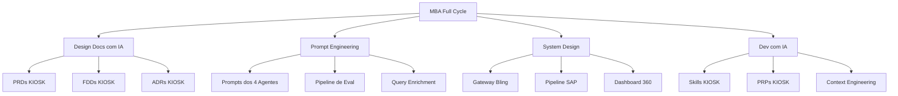

# 🏗️ Desafios Técnicos & Padrões Arquiteturais — MBA Full Cycle Aplicados à KIOSK

> **Origem:** MBA Full Cycle — Módulo 04 (Desafios Técnicos) + Módulo 02 (Bônus: System Design)  
> **Aplicação:** KIOSK Brands — Bling, Hub, Touti, SAP, Salesforce  
> **Status:** `#status/active` | `#type/guide` | **Data:** 2026-10-12

---

## 1. Desafio 1 — Ingestão e Busca Semântica (M04-01)

### Padrão MBA
O MBA propõe um pipeline de RAG (Retrieval Augmented Generation) completo usando:
- **LangChain** como orquestrador de pipeline
- **PostgreSQL + pgvector** como vector store
- **Embeddings** para indexação semântica
- **Busca híbrida** (keyword + semântica)

### Aplicação no Second Brain KIOSK
| Componente MBA | Equivalente KIOSK | Status | Gap |
|---|---|---|---|
| LangChain pipeline | `ingestion/` scripts Python | ✅ Implementado | Sem Query Reformulation |
| PostgreSQL + pgvector | Embeddings em JSON local | ⚠️ Parcial | Migrar para pgvector |
| Busca semântica | Dashboard search | ✅ Básico | Sem HyDE/ITER-RETGEN |
| Chunks atômicos | `chunks_system_design.json` | ✅ Implementado | Estender para Full Cycle |

### Solução Aplicada
O pipeline de ingestão do Second Brain (`ingestion/generate_intelligence_chunks.py`) já implementa chunks semânticos, mas sem as técnicas avançadas de query reformulation do MBA.

**Ação:** Implementar HyDE no endpoint de busca do dashboard para melhorar recall em queries vagas.

---

## 2. Padrões Arquiteturais de System Design (M02)

### 2.1 Projeto de Sistema e Requisitos (M02-01)

O MBA ensina uma metodologia estruturada para system design:

```
1. Requisitos de Engenharia → Funcionais + Não-Funcionais
2. Plano de Capacidade → QPS, storage, bandwidth, memória
3. Núcleo de Entidades → Modelagem do domínio
4. Design de API → Contratos REST/gRPC
5. Projeto do Sistema → Diagrama de componentes
6. Aprofundamento → Questões críticas e edge cases
```

### Aplicação nas Integrações KIOSK

| Integração KIOSK | Padrão MBA Aplicável | Ação |
|---|---|---|
| **Bling ERP** | Design de API + Resiliência (Circuit Breaker) | Criar FDD para API gateway Bling |
| **Hub de Etiquetas** | Orquestração de Sagas + Outbox Pattern | Já documentado em ADR-006, aprofundar com FDD |
| **Touti App** | BFF Pattern + CQRS | Criar HLD para camada de leitura otimizada |
| **SAP B1** | Mensageria Assíncrona + Event Sourcing | Criar ADR para estratégia de sync SAP |
| **Salesforce** | API Composition + Cache Strategy | ADR-001 já cobre, criar FDD complementar |

---

### 2.2 Estudo de Caso Uber (M02-02) — Aplicação KIOSK

O design do Uber ensina padrões diretamente aplicáveis:

| Padrão Uber | Aplicação KIOSK | Detalhe |
|---|---|---|
| **Geolocalização em tempo real** | Rastreamento de entregas J&T | Websockets para status real-time de pedidos |
| **Matching algorithm** | Roteamento de pedidos por transportadora | Algoritmo de seleção de melhor transportadora por região/custo |
| **Surge pricing** | Markup dinâmico por região | Precificação dinâmica baseada em demanda por CEP |
| **Event-driven architecture** | Pipeline de pedidos | Eventos: PedidoCriado → PagamentoConfirmado → NFEmitida → EtiquetaGerada |

---

### 2.3 Comunicação e Resiliência (M02-04) — Padrões Críticos

| Padrão | Contexto KIOSK | Implementação |
|---|---|---|
| **REST vs gRPC** | APIs públicas (REST) vs internas (gRPC) | MCP servers usam REST, avaliar gRPC para inter-service |
| **Kafka vs RabbitMQ** | Pipeline de pedidos KIOSK | RabbitMQ para tarefas com ACK, Kafka para event sourcing |
| **Websockets vs SSE** | Dashboard 360 real-time | SSE para updates unidirecionais do dashboard |
| **Protobuf vs Flatbuffers** | Serialização interna | Protobuf para contratos gRPC |

---

### 2.4 DevOps e SRE (M02-05) — Práticas para o Time DEVOPS

| Prática MBA | Aplicação KIOSK | Status |
|---|---|---|
| **SLI/SLO/SLA** | Definir SLOs para MCP servers | ⚠️ Gap identificado |
| **Error Budget** | Budget de 0.5% erro mensal | ⚠️ Não implementado |
| **Incident Management** | Runbooks de resolução | ✅ Playbooks no vault |
| **CI/CD Pipeline** | Deploy automatizado | ⚠️ Parcial (Docker, sem pipeline formal) |
| **Observabilidade** | Logs + Métricas + Traces | ✅ FlowLogger (ADR-006) |

---

## 3. Padrões de Design Aplicados — PRDs para Sistemas KIOSK

### PRD 1: Gateway de Integração Bling (Aplicando M07 + M02)

Seguindo o template de PRD do MBA:
- **Problema:** Integração Bling hoje é ponto-a-ponto sem padronização, cada endpoint tem tratamento diferente de erro
- **Solução:** Gateway centralizado com retry, circuit breaker e cache
- **Métricas:** P95 < 200ms, 99.5% uptime, zero duplicidade de NF
- **Arquitetura:** Microsserviço Go/Python + Redis Cache + RabbitMQ para async

### PRD 2: Pipeline de Dados SAP → Hub (Aplicando M04 + M02)

- **Problema:** Sync SAP é manual e inconsistente
- **Solução:** Pipeline event-driven com Outbox Pattern
- **Métricas:** Latência de sync < 30s, 100% consistência
- **Arquitetura:** CDC (Debezium) + Kafka + Consumer Hub

### PRD 3: Dashboard 360 Real-Time (Aplicando M02-04 + M05)

- **Problema:** Dashboard atual não reflete estado em tempo real
- **Solução:** CQRS com read model otimizado + SSE para push
- **Métricas:** Refresh < 2s, P95 dashboard load < 500ms
- **Arquitetura:** Read model Redis + SSE endpoint + React frontend

---

## 4. Lições dos Encontros ao Vivo Aplicadas

### Alta Escala com IA no Mundo Real (M03-07)
- Padrões de produção para sistemas com IA em alta escala
- Rate limiting de chamadas a LLMs
- Caching de respostas de LLM com TTL inteligente
- Fallback para modelos menores quando o principal estiver saturado

### Modernização de Legados (M03-06)
- Workflow para migração incremental de sistemas legados
- Estrangulamento progressivo (Strangler Fig Pattern)
- Testes de paridade entre sistema legado e novo

---

## 5. Mapa de Aplicação: MBA → KIOSK


