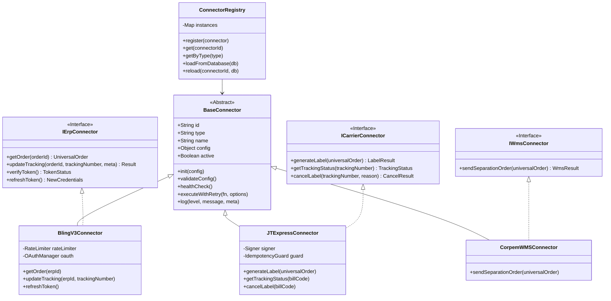

# Padrão Arquitetural de Conectores (Hub Integrations Engine)

## 1. Visão Geral e Justificativa

O **Hub Logístico** da KIOSK Brands atua como o barramento central entre ERPs de venda (**Bling v3**, futuramente SAP/Tiny), transportadoras (**J&T Express**, Correios) e operadores logísticos/WMS (**Corpem**).

Historicamente, o código em `adapters/` acumulou dívida técnica com lógica espalhada, resultando em:
1. **Falhas no ciclo de vida OAuth**: perda de refresh tokens ou falhas quando o token expira no meio do processamento (HTTP 401).
2. **Cegueira a rastreios pré-existentes**: emissão de etiquetas duplicadas e cobrança dupla de frete na J&T Express.
3. **Falta de rate-limiting padronizado**: erros `429 TOO_MANY_REQUESTS` ao atingir o limite estrito de 3 req/s do Bling.
4. **Acoplamento direto ao banco de dados SQLite**: ausência de uma camada unificada de abstração para conectores.

A nova arquitetura introduz o padrão **Connector Pattern** com porta universal (`BaseConnector`), desacoplando as regras de transporte/API das regras de negócio do motor (`engine.js`).

---

## 2. Diagrama de Arquitetura dos Conectores



---

## 3. Contratos Canônicos Universais

Para garantir que o `engine.js` nunca dependa de formatos proprietários de fornecedores, todas as trocas de dados passam por modelos canônicos:

### 3.1. `UniversalOrder` (Pedido Universal)

```typescript
interface UniversalOrder {
  orderId: string;              // ID único no ERP (ex: "27075351056")
  orderNumber: string;          // Número exibido ao usuário (ex: "27937")
  storeId: string | number;     // ID da Loja no Bling (ex: 206085936)
  status: string;               // Ex: "Atendido"
  createdAt: string;            // ISO Date
  
  customer: {
    id?: string | number;
    name: string;
    documentType: "F" | "J";    // CPF ou CNPJ
    documentNumber: string;     // Limpo, apenas dígitos
    email?: string;
    phone?: string;
  };

  shippingAddress: {
    recipientName: string;
    street: string;
    number: string;
    complement?: string;
    neighborhood: string;
    city: string;
    state: string;              // UF 2 letras
    zipCode: string;            // 8 dígitos limpos
    country: string;            // "BRASIL"
  };

  packages: {
    grossWeightKg: number;      // Ex: 0.85 (> 0 obrigatório)
    volumesCount: number;       // Quantidade de volumes
    volumeId?: string | number; // ID do objeto logístico no Bling
    serviceCode?: string;
  };

  invoice?: {
    id: string | number;
    accessKey: string;          // 44 dígitos obrigatórios
    number?: string;
    series?: string;
  };

  // 🛡️ CAMADA ANTI-DUPLICIDADE: Se já existir rastreio no ERP, este campo é PREENCHIDO
  existingTracking?: {
    trackingNumber: string;     // Ex: "888030978851756"
    carrier?: string;
    service?: string;
  };
}
```

### 3.2. `LabelResult` (Retorno de Emissão de Etiqueta)

```typescript
interface LabelResult {
  success: boolean;
  trackingNumber: string;       // billCode oficial da J&T
  txlogisticId: string;         // Identificador determinístico: HUB-{erpId}-{timestamp}
  carrier: "JT_EXPRESS";
  serviceType: string;
  alreadyExisted: boolean;      // True se foi reaproveitado para evitar cobrança dupla
  rawResponse?: any;
}
```

---

## 4. As 4 Regras de Ouro dos Conectores KIOSK

### Regra 1: Gestão Atômica e Pró-ativa do Token OAuth (Bling v3)
- O conector monitora `config.expiresAt`.
- Se `Date.now() > (expiresAt - 10 * 60 * 1000)` (menos de 10 min de vida restante), o conector **renova automaticamente** o token antes de despachar a requisição.
- Em caso de 401 inesperado, efetua 1 renovação forçada via `refresh_token`.
- As novas credenciais (`accessToken`, `refreshToken`, `expiresAt`) são salvas de volta na tabela `connectors` de forma assíncrona/atômica.

### Regra 2: Proteção Anti-Duplicidade em 3 Camadas (J&T Express)
Antes de chamar `POST /addOrder`:
1. Verifica se `universalOrder.existingTracking.trackingNumber` já existe (rastreio prévio no ERP).
2. Verifica se a fila local `orders_queue.tracking_number` já possui código.
3. Consulta a tabela `jt_emissions` para o mesmo `erp_id`.
Se qualquer uma das condições for verdadeira, **a emissão é bloqueada** e o código existente é reaproveitado.

### Regra 3: Idempotência de Atualização de Rastreio (`updateTracking`)
- Ao enviar o rastreio para o Bling, o conector primeiro compara se o código atual no Bling já é idêntico ao emitido.
- Se já for idêntico, a chamada de `PUT` é **dispensada** (poupa a cota de 3 req/s do Bling e evita acionar validações redundantes de NFe).

### Regra 4: Rate-Limiting com Leaky Bucket e Jitter
- Bling v3 aceita no máximo 3 requisições por segundo.
- O conector possui um limitador embutido que enfileira as requisições em intervalos de no mínimo 350ms, com retry automático e jitter exponencial em caso de status HTTP 429.

---

## 5. Estrutura dos Arquivos de Código

```
hub-connectors/
├── types.js                  # Definições de schemas e validações
├── BaseConnector.js          # Classe mãe abstrata (resiliência, retry, logging, rate limit)
├── BlingV3Connector.js       # Implementação ERP Bling (OAuth 2.0, extração com rastreio, update seguro)
├── JTExpressConnector.js     # Implementação Transportadora J&T (assinatura digest, anti-duplicidade)
├── CorpemWMSConnector.js     # Implementação WMS Corpem (ordem de separação universal)
├── ConnectorRegistry.js      # Gerenciador e fábrica com SQLite hub.db
├── index.js                  # Ponto de entrada com exports canônicos
└── test-connectors-offline.js# Suíte de testes automatizados (8 testes aprovados)
```

---

## 6. Como Integrar no `engine.js` do Hub Logístico

Substitua os antigos `adapters/bling.js` e `adapters/jtExpress.js` pelo `ConnectorRegistry`:

```javascript
const { ConnectorRegistry } = require('./hub-connectors');

// No startup do servidor ou ciclo do motor:
const registry = new ConnectorRegistry();
await registry.loadFromDatabase(db);

async function processOrderJob(job, loja, db) {
  const bling = registry.getPrimaryErp();
  const carrier = registry.getCarrier(loja.connector_id);

  // 1. Extração do Pedido Universal (já traz rastreio pré-existente e valida NF-e)
  const universalOrder = await bling.getOrder(job.erp_id);

  // 2. Geração da Etiqueta
  // 🛡️ Se o pedido já tiver rastreio no Bling, NÃO bate na API da J&T (evita duplicidade e frete duplo)
  const labelResult = await carrier.generateLabel(universalOrder);

  // 3. Persistência na Fila Local
  await db.run(
    "UPDATE orders_queue SET tracking_number = ?, universal_payload = ? WHERE id = ?",
    [labelResult.trackingNumber, JSON.stringify(universalOrder), job.id]
  );

  // 4. Gravação idempotente de rastreamento no Bling
  // 🛡️ Se o rastreio já estiver igual no Bling, dispensa o PUT redundante
  await bling.updateTracking(job.erp_id, labelResult.trackingNumber);

  // 5. Envio opcional para WMS (Corpem) se configurado
  const wmsConnectors = registry.getByType('wms');
  if (wmsConnectors.length > 0) {
    universalOrder.existingTracking = { trackingNumber: labelResult.trackingNumber };
    await wmsConnectors[0].sendSeparationOrder(universalOrder);
  }

  // 6. Finalização com Sucesso
  await db.run("UPDATE orders_queue SET status = 'success' WHERE id = ?", [job.id]);
}
```

