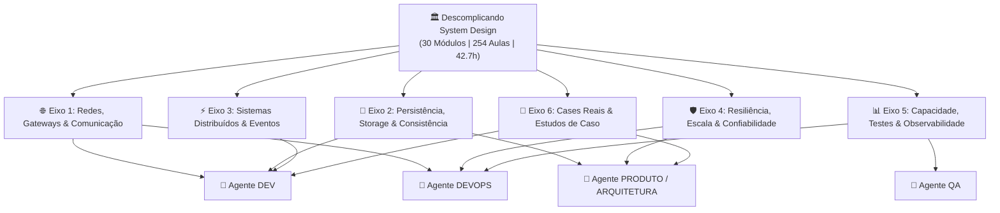

# 🏛️ Índice Mestre de System Design — Second Brain

> **Origem do Conhecimento:** Curso Completo *Descomplicando System Design*  
> **Volume de Conhecimento:** 30 Módulos | 254 Aulas | 42.72 Horas | 21.50 GB  
> **Status:** `#status/active` | **Data de Ingestão:** 2026-10-12  
> **Local dos Arquivos de Mídia:** `C:\Users\huggs\Downloads\Descomplicando System Design`  
> **Manifesto Estruturado:** `extracted_system_design/system_design_manifest.json`

---

## 1. Visão Geral e Propósito no Second Brain

O repositório de System Design consolida os princípios de arquitetura de software distribuído, alta escala, resiliência e engenharia de confiabilidade necessários para governar o ecossistema da **KIOSK Brands** e alimentar os **4 Agentes Especialistas**:

---

## 2. Matriz de Alinhamento aos 4 Agentes Especialistas

| Agente Especialista | Módulos Principais do Curso | Padrões e Práticas Incorporadas | Impacto Imediato nos Sistemas KIOSK |
| :--- | :--- | :--- | :--- |
| **🤖 DEV (Desenvolvimento)** | Day 09, 11, 12, 13, 18, 19, 20, Cases | Concorrência segura, Async I/O, CQRS, Saga Pattern, Outbox Pattern, Event Sourcing, BFF, gRPC/REST | Eliminação definitiva de duplicidade de etiquetas (DEM-17), processamento idempotente no Hub, desacoplamento do Bling v3 e Touti Cosmetics. |
| **🤖 DEVOPS (Infra & SRE)** | Day 1, 7, 8, 10, 21, 22, 25, 26, 27, 28 | Gateways, Rate Limiting (Token/Leaky Bucket), Service Mesh (eBPF), Blue/Green, Canary, Bulkheads, Cell-Based, SPOF & DR | Blindagem de infraestrutura contra falhas em cascata, isolamento de recursos por franqueado/marca, zero downtime em deploys. |
| **🤖 QA (Garantia de Qualidade)** | Day 14, 21, 24, 28 | Pirâmide de testes de carga (Smoke, Load, Stress, Spike, Breakpoint), testes de concorrência, validação de degradação graciosa | Suíte de testes de estresse no Hub antes de datas sazonais (Black Friday/Natal), homologação blindada sem mock quebrado. |
| **🤖 PRODUTO / ARQUITETURA** | Day 0, 2, 3, 4, 5, 6, 15, 16, 17, 23, Cases | Scale Cube (X/Y/Z), CAP/PACELC trade-offs, Sharding, Replicação & Quorum, Teoria das Filas (Little's Law), DDD | Planejamento de capacidade de longo prazo, unificação omnichannel (Touti, Bling, Salesforce, SAP), governança de ADRs. |

---

## 3. Navegação pelos Eixos Arquiteturais

Os 30 módulos foram sintetizados em 6 Guias Especializados no Vault com decisões técnicas, checklists e trade-offs:

1. **[[01-redes-gateways-comunicacao]]**  
   *Protocolos OSI, TCP/UDP, TLS, HTTP/1-2-3, Load Balancers L4/L7, Proxies Reversos (Envoy), API Gateways (Kong), BFF Pattern, Service Mesh (Sidecar, eBPF, ZTunnel), Comunicação Síncrona (REST, gRPC, Webhooks).*

2. **[[02-persistencia-storage-consistencia]]**  
   *Storage e I/O (IOPS, NVMe, RAID), Teorema CAP e PACELC, ACID vs BASE, Modelos de Dados (Row, Columnar, Key-Value, Graph, LSM-Trees vs B-Trees, Elasticsearch), Estratégias de Cache (Cache-Aside, Write-Behind, TTL, CDN), Sharding e Particionamento (Consistent Hashing), Replicação e Quorum.*

3. **[[03-sistemas-distribuidos-eventos-concorrencia]]**  
   *Processos, Threads, Mutexes, Deadlocks, Async I/O, Mensageria e Eventos (Kafka, RabbitMQ, SQS, FIFO, DLQ, Compaction), CQRS e Projeções, Saga Pattern (Orquestrado vs Coreografado, Transações Compensatórias, Outbox Pattern), Event Sourcing.*

4. **[[04-resiliencia-confiabilidade-alta-escala]]**  
   *Scale Cube (Eixos X, Y, Z), Patterns de Resiliência (Circuit Breaker, Exponential Backoff + Jitter, Timeout, Fallback, Blast Radius), Modelos de Deployment (Rolling, Blue/Green, Canary, Feature Flags, Ring), Bulkhead Lógico e Físico, Cell-Based Architecture, SPOF e Disaster Recovery (Ativo-Ativo, RTO, RPO).*

5. **[[05-capacidade-testes-carga-observabilidade]]**  
   *Performance e Latência (p95, p99, Saturação), Capacity Planning (Teoria das Filas, Lei de Little, Knee Curve), Testes de Carga e Estresse (Smoke, Load, Stress, Spike, Breakpoint), Observabilidade (USE Method, RED Method, Four Golden Signals, OpenTelemetry, SLI/SLO/SLA, Error Budgets).*

6. **[[06-cases-reais-estudos-de-caso]]**  
   *Cases completos do curso dissecados para a realidade KIOSK Brands: Encurtador de Links, Busca em Catálogo, Checkout Distribuído em Saga, Catálogo de Promoções de Alta Escala, Telemetria Geoespacial e Core Banking (DDD).*

---

## 4. Playbooks Criados a partir de System Design

- [[PB-001-suite-automatizada-do-hub]] — Validação de integridade do Hub
- [[PB-002-emissao-bloqueada-sem-nf-real]] — Trava de emissão fiscal
- [[PB-003-homologacao-sem-chamada-externa]] — Proteção de homologação
- **[[PB-004-resiliencia-circuit-breaker-retry-bulkhead]]** *(Novo)* — Padrão operacional de resiliência e degradação
- **[[PB-005-testes-de-carga-stress-breakpoint-qa]]** *(Novo)* — Protocolo de testes de carga e determinação de capacidade máxima
- **[[PB-006-transacoes-distribuidas-saga-outbox]]** *(Novo)* — Implementação de Sagas e Outbox Pattern para fluxos de pedidos
- **[[PB-007-disaster-recovery-spof-avaliacao-rto-rpo]]** *(Novo)* — Plano de contingência, eliminação de SPOFs e failover

---

## 5. Rastreabilidade com ADRs

- [[ADR-004-trace-ids-e-log-unificado-nas-chamadas-mcp]] — Tracing distribuído baseado no Golden Signals e OpenTelemetry
- [[ADR-006-implementacao-flowlogger-observabilidade-semaforos]] — Semáforos e concorrência no Hub
- **[[ADR-012-padroes-arquiteturais-system-design-para-agentes-especialistas]]** *(Nova)* — Formalização da governança de System Design para os agentes da KIOSK Brands.
