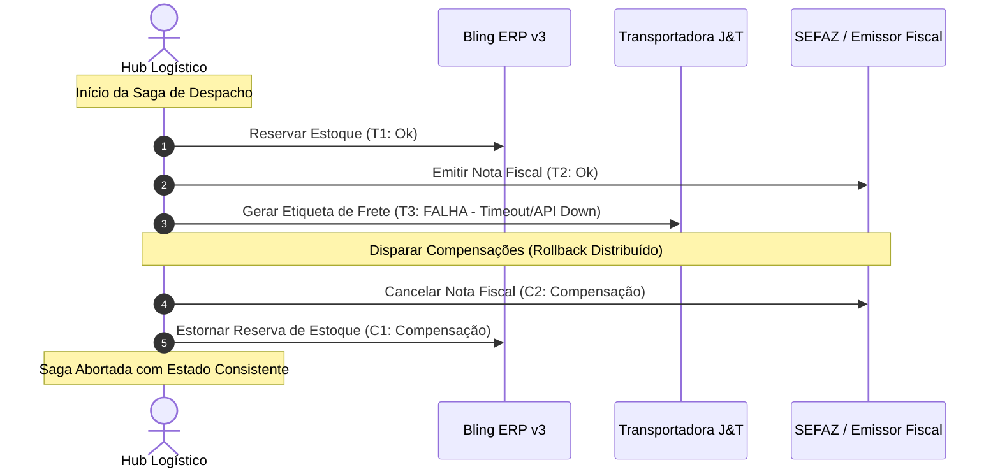

# Eixo 3: Sistemas Distribuídos, Eventos & Concorrência

> **Módulos de Origem:** Day 11 (Princípios de Concorrência e Paralelismo), Day 13 (Comunicação Assíncrona - Mensageria, Eventos e Streaming), Day 18 (CQRS), Day 19 (Saga Pattern), Day 20 (Event Sourcing Pattern).  
> **Agentes Beneficiados:** `🤖 DEV` e `🤖 PRODUTO / ARQUITETURA`

## 1. Concorrência vs Paralelismo & Primitivas de Sincronização

### Definições Fundamentais
- **Concorrência:** Lidar com múltiplas tarefas ao mesmo tempo (intercalação de execução / time slicing). Otimizado para I/O-bound (ex: chamadas a APIs do Bling e SAP).
- **Paralelismo:** Executar múltiplas tarefas simultaneamente em múltiplos núcleos físicos de CPU. Otimizado para CPU-bound (ex: hashing criptográfico, geração em lote de PDFs de etiquetas).

### Primitivas de Controle
- **Mutex (Mutual Exclusion):** Garante que apenas uma thread/processo acesse a seção crítica por vez.
- **Deadlock:** Ocorre quando duas threads disputam dois recursos com dependência circular:
  - *Condições de Coffman:* Exclusão mútua, Posse e espera, Não preempção, Espera circular.
  - *Prevenção:* Sempre adquirir múltiplos locks em **ordem alfabética/canônica estrita** em todo o código.
- **Race Conditions em Bancos de Dados:**
  - *Lost Updates / Write Skew:* Duas requisições lêem saldo = 100 e gravam 50 e 60 simultaneamente.
  - *Mitigação:* `SELECT ... FOR UPDATE` (Pessimistic Lock) ou coluna `version` incremental com `UPDATE ... WHERE version = expected_version` (Optimistic Lock).

---

## 2. Mensageria, Streaming & Arquiteturas Orientadas a Eventos

### Padrões de Mensagens
1. **Comandos:** Intenção imperativa que expressa uma ação que deve ser executada (`EmitirEtiquetaCommand`). Podem ser rejeitados se as regras falharem.
2. **Eventos de Domínio:** Fatos imutáveis no passado que já aconteceram (`EtiquetaEmitidaEvent`, `PedidoCriadoEvent`). Não podem ser cancelados, apenas compensados.
3. **Documentos:** Mensagens auto-contidas transportando o estado completo da entidade.

### Topologias de Mensageria (Kafka vs RabbitMQ vs SQS)
- **RabbitMQ (Message Broker AMQP):** Foco em roteamento flexível (Exchange Direct, Topic, Fanout), mensagens apagadas após confirmação (*ACK*), filas concorrentes inteligentes.
- **Apache Kafka / Redpanda (Log de Eventos Distribuído / Streaming):**
  - Append-only log particionado em disco.
  - Mensagens mantidas por tempo ou tamanho (*Retention*).
  - Múltiplos grupos de consumidores mantêm seu próprio *Offset*.
  - **Log Compaction:** Mantém apenas a última versão de cada chave no log (ideal para manter o estado atual de entidades no Second Brain).
- **Amazon SQS / Redis Streams:** Filas gerenciadas simples para desacoplamento de workers locais.

### Padrões de Entrega:
- **At-least-once (Pelo menos uma vez):** Padrão de praticamente todos os sistemas distribuídos. Exige **Idempotência estrita no consumidor**.
- **At-most-once (No máximo uma vez):** Mensagens podem ser perdidas, mas nunca duplicadas.
- **Exactly-once (Exatamente uma vez):** Virtualmente impossível de ponta a ponta sem transações distribuídas coordenadas; na prática, atinge-se via *At-least-once + Consumidor Idempotente*.

---

## 3. CQRS (Command Query Responsibility Segregation)

### Motivação Arquitetural
Modelos de dados ideais para processamento de regras de negócio (escrita transacional 3NF altamente normalizada com locks) são péssimos para relatórios complexos, visualizações analíticas e dashboards gerenciais.

```mermaid
graph LR
    User["Cliente / Webhook"] -->|Comandos de Escrita| WriteModel["Write Model (Transacional ACID)<br/>PostgreSQL / Hub"]
    WriteModel -->|Eventos de Domínio| Sync["Worker / Kafka / Outbox"]
    Sync -->|Projeção Materializada| ReadModel["Read Model (Desnormalizado)<br/>Redis / Elasticsearch / SQLite"]
    Dashboard["Dashboard Operacional / 360"] -->|Consultas O(1)| ReadModel
```

### Regras do CQRS:
1. Comandos nunca retornam dados de negócio complexos (apenas status de sucesso/ID criado).
2. Consultas nunca alteram o estado do sistema (*Side-Effect Free*).
3. O modelo de leitura é tolerante a consistência eventual (latência de milissegundos na projeção).

---

## 4. Saga Pattern: Transações Distribuídas sem 2PC

### O Fim do Two-Phase Commit (2PC)
O protocolo tradicional 2PC bloqueia recursos e nós participantes através de um coordenador central. Em arquiteturas de microsserviços modernos com APIs externas (Bling, SAP, J&T), 2PC é inviável porque essas APIs não suportam preparação e rollback de transação aberta.

### Padrão Saga
Uma sequência de transações locais $T_1, T_2, \dots, T_n$. Se a etapa $T_i$ falhar, o sistema dispara transações compensatórias em ordem reversa: $C_{i-1}, \dots, C_1$.



### Orquestração vs Coreografia
- **Coreografia (Orientada a Eventos):** Cada serviço ouve eventos e decide sua próxima ação. Ideal para fluxos pequenos (até 3 etapas). Risco de complexidade emergente ("arquitetura espaguete de eventos").
- **Orquestração (Orquestrador Central):** Um serviço coordenador (ex: State Machine no Hub ou Temporal/Cadence) dita explicitamente a ordem de chamada e as compensações. **Padrão recomendado para os fluxos da KIOSK Brands**.

---

## 5. Padrão Transacional Outbox (Transactional Outbox Pattern)

### O Problema do Dual-Write
Se o serviço salva no banco de dados local e depois publica no Kafka/RabbitMQ:
- Se o banco grava e a rede do Kafka cai: O evento nunca é emitido (inconsistência).
- Se publica no Kafka antes do commit do banco e o commit falha: O sistema emitiu evento de algo que não existe.

### Solução Arquitetural Outbox
1. A gravação do pedido e o registro do evento na tabela `outbox_events` ocorrem na **mesma transação ACID local do PostgreSQL/MySQL**.
2. Um processo background independente (Debezium via CDC ou polling leve com lock) lê a tabela de outbox e publica as mensagens no broker.
3. Ao receber confirmação do broker, marca a linha do outbox como processada.
4. **Resultado:** 100% à prova de falhas com garantia de entrega *At-Least-Once*.

---

## 6. Event Sourcing Pattern

### Conceito
Em vez de salvar apenas o "estado atual" de uma linha no banco (ex: `status = 'ENTREGUE'`), o banco armazena o histórico completo e ordenado de todos os eventos que aconteceram na entidade:
- `PedidoIniciadoEvent`
- `PagamentoAprovadoEvent`
- `NotaFiscalEmitidaEvent`
- `EtiquetaCriadaEvent`
- `MercadoriaDespachadaEvent`

### Vantagens:
- **Auditoria Perfeita:** Rastreamento total de quem, quando e por que o estado mudou.
- **Capacidade de Viagem no Tempo (Time Travel / Replay):** Capacidade de reconstruir o estado do sistema em qualquer data passada ou recalcular métricas retroativamente.
- **Snapshots:** Para agregados com centenas de eventos, salva-se um snapshot a cada $N$ eventos para acelerar a carga de memória.
