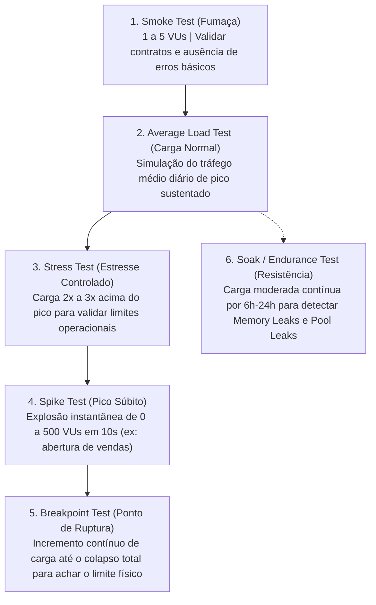
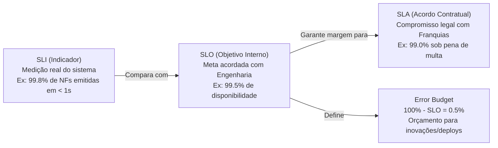

# 📊 Eixo 5: Capacidade, Testes de Carga & Observabilidade

> **Módulos de Origem:** Day 14 (Performance, Capacidade e Escalabilidade), Day 23 (Capacity Planning), Day 24 (Testes de Carga e Estresse), Day 28 (Observabilidade e Monitoramento).  
> **Status:** `#status/reference` | **Agentes Beneficiados:** `🤖 QA` e `🤖 DEVOPS`

---

## 1. Capacity Planning & Modelagem Matemática de Filas

### Lei de Little (Little's Law)
Em qualquer sistema estável em regime estacionário:
$$L = \lambda \times W$$
- $L$ = Número médio de itens dentro do sistema (concorrência / *In-Flight Requests*).
- $\lambda$ = Taxa média de chegada de requisições por segundo (Throughput / *RPS*).
- $W$ = Tempo médio de resposta / permanência de uma requisição no sistema (Latency).

*Exemplo Prático no Hub da KIOSK Brands:*
Se o Hub processa requisições de emissão com latência média de $500\text{ms}$ ($0.5\text{s}$) e a holding recebe um pico de $100\text{ pedidos/segundo}$ ($\lambda = 100$), o sistema precisará suportar exatamente:
$$L = 100 \times 0.5 = 50\text{ conexões concorrentes ativas}$$
Se o pool do servidor tiver apenas 20 workers configurados, a fila começará a crescer indefinidamente até o colapso por timeout.

### A Curva do Joelho (Knee Curve)
- **Zona Linear (Saudável):** Conforme a carga aumenta, o throughput cresce proporcionalmente e a latência permanece estável.
- **O Joelho (*Knee*):** Ponto ótimo de máxima eficiência econômica e saturação controlada.
- **Zona de Degradação (*Cliff* / Despenhadeiro):** Passado o joelho, filas explodem, trocas de contexto (*context switching*) e contenção de locks fazem a latência disparar exponencialmente e o throughput útil despencar a zero.

---

## 2. Pirâmide de Testes de Carga e Estresse (Especialidade QA)

Para garantir a confiabilidade operacional de datas críticas (Black Friday, Dia das Mães, Natal), o Agente QA executa a suíte de testes de performance estruturada:

### Tipos de Teste e Seus Critérios de Aceite
1. **Smoke Test:** Verifica se a aplicação responde 200 OK sem exceptions em 1 único worker.
2. **Average Load Test:** Mede se o P95 da latência permanece abaixo de 300ms sob tráfego normal.
3. **Stress Test:** Avalia se os mecanismos de autoscaling e filas absorvem a carga ou se degradam graciosamente.
4. **Spike Test:** Testa a robustez do Rate Limiter e se o sistema não crasha com a avalanche.
5. **Breakpoint Test:** Responde à pergunta executiva fundamental: *"Quantos pedidos por segundo o sistema suporta antes de começar a falhar?"*
6. **Soak Test:** Identifica vazamento lento de conexões no PostgreSQL ou vazamento de memória em loops de processamento.

---

## 3. Os Quatro Sinais Dourados (Four Golden Signals - Google SRE)

A espinha dorsal da telemetria e alarmística do Second Brain e do Hub Logístico:

1. **Latência:** O tempo que leva para atender uma requisição.
   - *Regra SRE:* Separar estritamente a latência das requisições bem-sucedidas da latência das requisições que falharam (erros rápidos como 500 imediato distorcem as médias; sempre usar **P95 e P99**).
2. **Tráfego:** A demanda colocada sobre o sistema (medido em Requisições por Segundo - RPS, conexões ativas ou bytes transferidos).
3. **Erros:** A taxa de requisições que falharam, seja explicitamente (HTTP 5xx) ou implicitamente (resposta 200 OK contendo payload de erro interno).
4. **Saturação:** Quão "cheio" está o serviço. Mede a fração mais restrita do recurso do sistema (uso de CPU, uso de memória, saturação do pool de conexões do banco de dados, tamanho da fila de mensagens).

---

## 4. Métodos USE e RED para Diagnóstico Rápido

### Método USE (Para Infraestrutura / Recursos - Brendan Gregg)
Para cada recurso de hardware/software (CPU, Memória, Disco, Rede, Thread Pool):
- **U - Utilization (Utilização):** Porcentagem de tempo em que o recurso esteve ocupado.
- **S - Saturation (Saturação):** Volume de trabalho represado na fila aguardando o recurso.
- **E - Errors (Erros):** Contagem de falhas/erros reportados pelo recurso (ex: TCP retransmits, falhas de I/O).

### Método RED (Para Serviços / Microsserviços - Tom Wilkie)
Para cada endpoint ou microsserviço da arquitetura:
- **R - Rate (Taxa):** Número de requisições por segundo recebidas.
- **E - Errors (Erros):** Número de requisições com falha por segundo.
- **D - Duration (Duração / Latência):** Tempo que as requisições levaram para serem concluídas (distribuição P50, P90, P99).

---

## 5. Acordos de Nível de Serviço: SLA, SLO, SLI & Error Budget

- **SLI (Service Level Indicator):** Uma métrica quantitativa do nível de serviço oferecido.
- **SLO (Service Level Objective):** O objetivo alvo do SLI acordado entre produto e engenharia.
- **SLA (Service Level Agreement):** O contrato com penalidades financeiras caso o serviço caia abaixo do combinado.
- **Error Budget (Orçamento de Erro):** A margem de falha tolerada pelo SLO. Se o orçamento de erro do mês estiver intacto, a equipe pode lançar novos deploys e features agressivamente. Se o orçamento estiver esgotado, todos os deploys de produto são congelados e a equipe foca 100% em confiabilidade e refatoração técnica.
