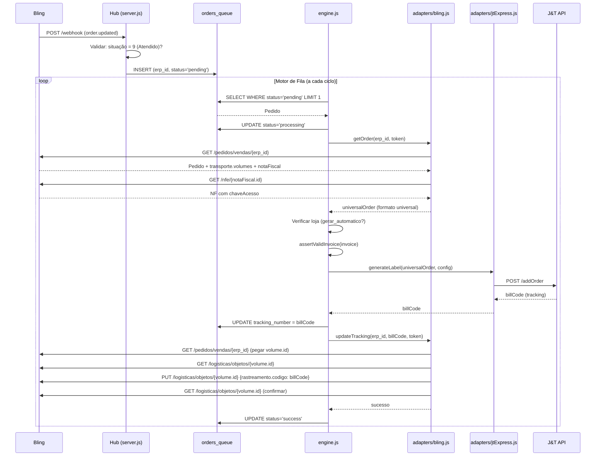
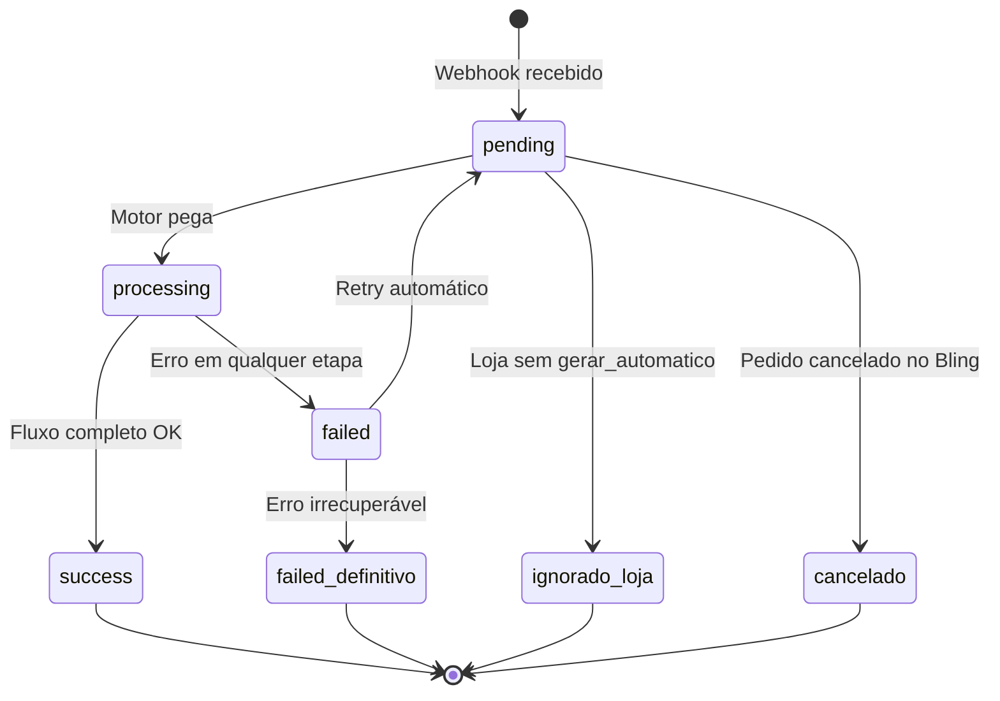

# PB-010: Pipeline Hub Logístico — Fluxo, Tabelas, Estados e Regras

## Por que este playbook existe

O incidente de 08-13/10/2026 revelou que a documentação existente (PB-001 a PB-003) não respondia perguntas fundamentais como:
- "O que é a `orders_queue`?"
- "Quando uma etiqueta vira duplicata?"
- "Quem grava o rastreio no Bling?"
- "Por que o `invoice.updated` não dispara?"

Este playbook documenta **cada etapa** do pipeline com nível de detalhe suficiente para que qualquer desenvolvedor ou operador consiga diagnosticar e intervir.

---

## 1. Visão Geral do Pipeline



---

## 2. Tabela `orders_queue` — A Fila Central

### O que é
A `orders_queue` **NÃO é só** uma fila de criação de orders na J&T. É a **fila central de todo o pipeline**, desde o webhook até a confirmação do rastreio no Bling.

### Ciclo de vida de um registro



### Campos e significado

| Campo | O que guarda | Quando é preenchido |
|---|---|---|
| `erp_id` | ID do pedido no Bling (`pedidoVenda.id`) | No INSERT, pelo webhook |
| `universal_payload` | JSON do pedido em formato universal | Após `getOrder` no Bling |
| `status` | Estado atual do processamento | Cada transição do fluxo |
| `tracking_number` | **billCode da J&T** | Após `addOrder` retornar sucesso |
| `error_log` | Mensagem de erro | Quando falha em qualquer etapa |
| `retries` | Quantas vezes tentou | Incrementado a cada retry |
| `next_attempt_at` | Quando pode retentar | Definido pelo cooldown exponencial |
| `created_at` | Quando entrou na fila | INSERT automático |

### O que o `tracking_number` indica

| `tracking_number` | `status` | Significa |
|---|---|---|
| NULL | `pending` | Ainda não processou |
| NULL | `failed` | Falhou **antes** de chamar J&T (ex: NF indisponível, sem volume) |
| `888030...` | `failed` | J&T gerou etiqueta, mas **falhou ao gravar no Bling** |
| `888030...` | `success` | Fluxo completo — J&T gerou e Bling recebeu |

### Mapeamento de IDs entre plataformas

O pipeline cruza 6 identificadores diferentes. Confundir qual é qual causa erros de diagnóstico.

| ID | O que é | Exemplo | Onde vive | Como obter |
|---|---|---|---|---|
| `erp_id` | ID interno do pedido de venda | `27075351056` | `orders_queue`, Bling API | Webhook payload / `pedidoVenda.id` |
| `numero` | Nº do pedido (exibido na tela) | `27937` | Bling (campo `numero`) | `GET /pedidos/vendas/{erp_id}` → `.numero` |
| `notaFiscal.id` | ID da NF vinculada | `27075351234` | Bling API | `GET /pedidos/vendas/{erp_id}` → `.notaFiscal.id` |
| `tracking_number` / `billCode` | Código de rastreio J&T | `888030978851756` | `orders_queue`, J&T API | Retorno do `addOrder` |
| `txlogisticId` | ID do pedido Hub na J&T | `HUB-27075351056-1728...` | J&T API, `jt_emissions` | Gerado pelo Hub: `HUB-{erp_id}-{timestamp}` |
| `volume.id` / objeto logístico | ID do objeto de logística | `16256603245` | Bling `/logisticas/objetos/{id}` | `GET /pedidos/vendas/{erp_id}` → `.transporte.volumes[0].id` |

> **⚠️ `erp_id` NÃO é o número do pedido (`numero`), NÃO é o ID da NF, e NÃO é o tracking.** É o ID interno do recurso `pedidos/vendas` no Bling.

### Mecanismo de Retry

```
failed → aguarda next_attempt_at → motor pega → processing → tenta de novo
```

| Aspecto | Detalhe |
|---|---|
| Quando retenta | Quando `next_attempt_at < NOW()` e `status = 'failed'` |
| Cooldown | Exponencial (ex: 1min, 5min, 15min, 30min...) |
| Contador | `retries` incrementado a cada tentativa |
| Limite | Após N retries, pode virar `failed_definitivo` |
| Reaproveitamento | Se `tracking_number` já existe + `jt_emissions` confirma → **NÃO gera nova etiqueta** |

### Exemplo real de duplicata (2 códigos para mesmo pedido)

Pedido `27075351056` (Nº 27937 no Bling):

```
orders_queue:
  Row 1: tracking=888030974697645  status=failed_definitivo  (1ª tentativa, etiqueta órfã)
  Row 2: tracking=888030978851756  status=success             (2ª tentativa, etiqueta ativa)

Bling:  rastreamento.codigo = 888030978851756
J&T:    888030974697645 ← existe mas ninguém usa (ÓRFÃ, cancelar)
```

---

## 3. Onde Cada Etapa Pode Falhar

### Etapa 1: Webhook → Fila

| Ponto | Pode falhar? | O que acontece |
|---|---|---|
| Webhook não chega | Sim (Bling fora / app OAuth sem webhook) | Pedido nunca entra na fila |
| Pedido não é "Atendido" (sit ≠ 9) | N/A — webhook ignorado | Nada acontece |
| Pedido já existe na fila | Bloqueado por `findAutomaticQueueBlock` | Não duplica na fila |

**Arquivo:** [server.js](file:///c:/KIOSK/hub-logistico/server.js) — rota `POST /webhook`

### Etapa 2: Fila → Bling GET

| Ponto | Pode falhar? | Erro | `tracking_number` |
|---|---|---|---|
| Token expirado | Sim | `401 unauthorized` | NULL |
| App OAuth errado | Sim | `404 RESOURCE_NOT_FOUND` | NULL |
| Rate limit | Sim (retry automático) | `429 TOO_MANY_REQUESTS` | NULL |
| Loja não cadastrada | Sim | Status `ignorado_loja` | NULL |
| NF não emitida no Bling | Sim | `NF indisponível` | NULL |
| NF com chave inválida | Sim | `assertValidInvoice` bloqueia | NULL |

**Arquivo:** [adapters/bling.js](file:///c:/KIOSK/hub-logistico/adapters/bling.js) — `getOrder()` (linhas 188-302)

### Etapa 3: Bling → J&T addOrder

| Ponto | Pode falhar? | Erro | `tracking_number` |
|---|---|---|---|
| Peso = 0 | Sim | `The weight information is not legal` | NULL |
| Endereço incompleto | Sim | `Incomplete translate information` | NULL |
| Remetente sem cadastro | Sim | `Endereço do remetente não cadastrado` | NULL |
| J&T fora do ar | Sim (timeout) | `Falha API J&T` | NULL |
| Sucesso | — | billCode retornado | **PREENCHIDO** ✅ |

**Arquivo:** [adapters/jtExpress.js](file:///c:/KIOSK/hub-logistico/adapters/jtExpress.js) — `generateLabel()` (linhas 43-168)

> **⚠️ PONTO CRÍTICO:** A partir daqui, `tracking_number` já foi preenchido. Se o fluxo falhar nas próximas etapas, a etiqueta J&T **existe** mas o Bling não sabe.

### Etapa 4: J&T → Bling updateTracking

| Ponto | Pode falhar? | Erro | Consequência |
|---|---|---|---|
| Pedido sem volume | Sim | `não tem objeto de logística` | Etiqueta J&T órfã |
| Múltiplos volumes | Sim | `REVIEW_REQUIRED: MULTIPLE_VOLUMES` | Etiqueta J&T órfã |
| PUT retorna 200 mas não grava | Sim (verificação pós-PUT) | `não gravou o rastreio` | Retry com mesma etiqueta |
| Sucesso | — | Rastreio confirmado | `status = success` |

**Arquivo:** [adapters/bling.js](file:///c:/KIOSK/hub-logistico/adapters/bling.js) — `updateTracking()` (linhas 340-448)

> **⚠️ IMPORTANTE:** O `updateTracking` faz `PUT /logisticas/objetos/{id}`, que é um recurso **separado** da NF. O Bling **NÃO dispara** `invoice.updated` para esta operação. Apenas `order.updated` (se houver webhook cadastrado para isso).

---

## 4. Mecanismo de Duplicata de Etiqueta

### Como acontece

```
Tentativa 1:
  1. Motor pega pedido → addOrder J&T → billCode A ✅
  2. tracking_number = billCode A (salvo na fila)
  3. updateTracking Bling → FALHA (404/sem volume/etc)
  4. status = 'failed'

Tentativa 2 (retry ou novo webhook):
  5. Motor pega pedido de novo
  6. SEM proteção → addOrder J&T de novo → billCode B ✅ (NOVO!)
  7. tracking_number = billCode B (sobrescreve A na fila)
  8. Agora existem 2 etiquetas na J&T: A (órfã) e B (ativa)
```

### Proteção atual: `jt_emissions`

A tabela `jt_emissions` previne o passo 6:

```
Antes de chamar addOrder J&T:
  → SELECT FROM jt_emissions WHERE erp_id = ?
  → Se existe com state='confirmed' → REUSA tracking_number existente
  → Se existe com state='uncertain' → consulta J&T getOrders para confirmar
  → Se NÃO existe → chama addOrder e insere registro
```

**Arquivo:** [engine.js](file:///c:/KIOSK/hub-logistico/engine.js) — lógica de emissão

---

## 5. Cenários de Teste

### Grupo A: Fluxo Normal (Happy Path)

#### CT-001: Fluxo Completo com Sucesso
- **Dado** pedido Atendido (sit=9), com NF válida (chave 44 dígitos), loja com `gerar_automatico=1`, volume criado
- **Quando** webhook `order.updated` chega
- **Então** etiqueta J&T gerada, rastreio gravado no Bling, status = `success`
- **Verificar:**
  - `orders_queue.tracking_number` preenchido
  - `jt_emissions.state = 'confirmed'`
  - Bling `volumes[0].codigoRastreamento` = mesmo billCode
- **Query de validação:**
```sql
SELECT oq.erp_id, oq.tracking_number, oq.status, je.state
FROM orders_queue oq
LEFT JOIN jt_emissions je ON oq.erp_id = je.erp_id
WHERE oq.status = 'success' ORDER BY oq.rowid DESC LIMIT 5;
```

#### CT-002: Pedido com Múltiplos Volumes (volume único obrigatório)
- **Dado** pedido com 2+ volumes no Bling
- **Quando** motor processa
- **Então** status = `failed`, error_log contém `REVIEW_REQUIRED: MULTIPLE_VOLUMES`
- **Verificar:** NENHUMA etiqueta J&T gerada
- **Query:**
```sql
SELECT erp_id, error_log FROM orders_queue
WHERE error_log LIKE '%MULTIPLE_VOLUMES%';
```

---

### Grupo B: Falhas na Etapa Bling (antes da J&T)

#### CT-003: NF Ausente no Pedido
- **Dado** pedido Atendido sem `notaFiscal.id`
- **Quando** motor processa
- **Então** status = `failed`, `tracking_number` = NULL
- **Verificar:** NENHUMA chamada à J&T, error_log contém "NF indisponível"
- **Query:**
```sql
SELECT erp_id, error_log FROM orders_queue
WHERE status = 'failed' AND tracking_number IS NULL
AND error_log LIKE '%NF indispon%';
```

#### CT-004: NF com Chave Inválida (zeros, tamanho incorreto)
- **Dado** NF com `chaveAcesso` = `00000000000000000000000000000000000000000000` ou < 44 caracteres
- **Quando** `assertValidInvoice()` executa
- **Então** Emissão bloqueada antes da J&T
- **Verificar:** error_log contém "chave de acesso"

#### CT-005: Token OAuth Expirado com Refresh Válido
- **Dado** `accessToken` expirado, `refreshToken` válido
- **Quando** motor processa
- **Então** `blingAuth.getValidAccessToken()` renova automaticamente
- **Verificar:**
  - Novo token salvo em `connectors.config`
  - `expiresAt` atualizado (futuro)
  - Processamento continua normalmente
- **Query:**
```sql
SELECT json_extract(config, '$.expiresAt') as expiresAt,
  datetime(json_extract(config, '$.expiresAt')/1000, 'unixepoch', 'localtime') as expira_em,
  CASE WHEN json_extract(config, '$.expiresAt') > (strftime('%s','now') * 1000)
    THEN 'VÁLIDO' ELSE 'EXPIRADO' END as estado
FROM connectors WHERE type = 'erp';
```

#### CT-006: Token OAuth com Refresh Inválido (expirado ou revogado)
- **Dado** `refreshToken` expirado ou de um app antigo
- **Quando** `blingAuth` tenta renovar
- **Então** Retorna `invalid_grant`, motor falha
- **Verificar:** error_log contém "invalid_grant" ou "401"
- **Ação:** Reautorizar manualmente (ver PB-008 Passo 3)

#### CT-007: App OAuth Errado (client_id sem escopo)
- **Dado** `clientId` de app que não tem permissão sobre os pedidos
- **Quando** motor chama `getOrder()`
- **Então** Bling retorna 404 `RESOURCE_NOT_FOUND`
- **Verificar:**
  - NÃO gera etiqueta na J&T (falha antes)
  - `tracking_number` = NULL
  - Pedidos ANTIGOS retornam 404, pedidos NOVOS podem funcionar (escopo parcial)
- **Query:**
```sql
-- Identificar se 404 é sistêmico (app errado) ou pontual (pedido inválido)
SELECT COUNT(*) as total_404,
  MIN(created_at) as primeiro, MAX(created_at) as ultimo
FROM orders_queue
WHERE status = 'failed' AND error_log LIKE '%404%' OR error_log LIKE '%RESOURCE_NOT_FOUND%';
-- Se total_404 > 10 em 1h → app errado (ver PB-008 Passo 4)
```

#### CT-008: Rate Limit Bling (429)
- **Dado** Hub fazendo muitas chamadas consecutivas à API
- **Quando** Bling retorna 429
- **Então** `chamarBlingComRetry()` aguarda e retenta
- **Verificar:** Pedido eventualmente processado (não fica em `failed` por 429 sozinho)
- **Query:**
```sql
-- Se existem failed por 429, é bug no retry
SELECT erp_id, error_log FROM orders_queue
WHERE status = 'failed' AND error_log LIKE '%429%' OR error_log LIKE '%TOO_MANY%';
```

#### CT-009: Pedido Sem Volume de Logística no Bling
- **Dado** Pedido Atendido mas sem `transporte.volumes` preenchido
- **Quando** `updateTracking` tenta gravar rastreio
- **Então** status = `failed`, `tracking_number` PREENCHIDO (etiqueta J&T já existe!)
- **Verificar:** error_log contém "não tem objeto de logística"
- **Query:**
```sql
SELECT erp_id, tracking_number FROM orders_queue
WHERE status = 'failed' AND error_log LIKE '%não tem objeto de logística%';
-- CUIDADO: esses pedidos TÊM etiqueta J&T ativa!
```

#### CT-010: Pedido Cancelado no Bling (sit=12)
- **Dado** Pedido cancelado entre o webhook e o processamento
- **Quando** motor busca o pedido
- **Então** Detecta `situacao.id != 9`, marca `cancelado`
- **Query:**
```sql
SELECT erp_id FROM orders_queue WHERE status = 'cancelado';
```

---

### Grupo C: Falhas na Etapa J&T

#### CT-011: Peso Inválido (0kg)
- **Dado** Pedido com peso total = 0 no Bling
- **Quando** J&T `addOrder` recebe payload
- **Então** J&T retorna `145003092: The weight information is not legal`
- **Verificar:** `tracking_number` = NULL (falhou na J&T)
- **Query:**
```sql
SELECT erp_id, error_log FROM orders_queue
WHERE error_log LIKE '%weight%';
```

#### CT-012: Endereço Incompleto
- **Dado** Pedido sem CEP, rua ou cidade
- **Quando** J&T valida endereço
- **Então** Retorna `Incomplete translate information`
- **Query:**
```sql
SELECT erp_id, error_log FROM orders_queue
WHERE error_log LIKE '%Incomplete translate%';
```

#### CT-013: J&T API Fora do Ar (timeout)
- **Dado** API J&T sem resposta
- **Quando** timeout de 20s atinge
- **Então** status = `failed`, retry automático
- **Query:**
```sql
SELECT erp_id, error_log FROM orders_queue
WHERE error_log LIKE '%timeout%' OR error_log LIKE '%ECONNREFUSED%';
```

---

### Grupo D: Duplicatas e Conflitos

#### CT-014: Reaproveitamento de Etiqueta (anti-duplicata)
- **Dado** Pedido com `jt_emissions` existente e `state = 'confirmed'`
- **Quando** Motor processa novamente (retry / novo webhook)
- **Então** NÃO chama `addOrder` na J&T, reusa billCode existente
- **Verificar:** Logs mostram "Reaproveitando etiqueta existente"
- **Query:**
```sql
-- Emissões confirmadas (proteção ativa)
SELECT erp_id, txlogistic_id, tracking_number, state
FROM jt_emissions WHERE state = 'confirmed';
```

#### CT-015: Detecção de Etiqueta Duplicada
- **Dado** Mesmo `erp_id` com 2+ `tracking_number` distintos na fila
- **Quando** Diagnóstico pós-incidente
- **Então** Um tracking é o ativo (no Bling), os outros são órfãos (cancelar na J&T)
- **Query:**
```sql
-- DETECÇÃO: pedidos com múltiplos trackings
SELECT erp_id, GROUP_CONCAT(DISTINCT tracking_number) as trackings,
  COUNT(DISTINCT tracking_number) as qtd
FROM orders_queue
WHERE tracking_number IS NOT NULL AND tracking_number != ''
GROUP BY erp_id HAVING qtd > 1
ORDER BY qtd DESC;
```

#### CT-016: Pedido com Rastreio Pré-existente (Correios/outro)
- **Dado** Volume já tem `codigoRastreamento` de outra transportadora (ex: `AD952676785BR`)
- **Quando** Motor tenta gravar rastreio J&T
- **Então** Conflito detectado, marca `REVIEW_REQUIRED`
- **Verificar:** Rastreio original NÃO é sobrescrito
- **Query:**
```sql
SELECT erp_id, tracking_number, error_log FROM orders_queue
WHERE error_log LIKE '%REVIEW_REQUIRED%' OR error_log LIKE '%rastreio diferente%';
```

---

### Grupo E: Webhook e Admissão na Fila

#### CT-017: Webhook do Bling NÃO Dispara `invoice.updated`
- **Dado** Hub grava rastreio via `PUT /logisticas/objetos/{id}`
- **Quando** Operação completa com sucesso
- **Então** Bling NÃO dispara `invoice.updated` (recurso separado da NF)
- **Implicação:** Sistemas downstream que dependem de `invoice.updated` para detectar rastreio precisam buscar de outra fonte (webhook J&T)

#### CT-018: Webhook Duplicado (mesmo pedido, webhook repetido)
- **Dado** Bling envia 2 webhooks `order.updated` para o mesmo pedido
- **Quando** Segundo webhook chega
- **Então** `findAutomaticQueueBlock` detecta pedido já na fila
- **Verificar:** Segundo webhook NÃO cria nova entrada na fila
- **Query:**
```sql
-- Pedidos com múltiplas entradas na fila (pode indicar webhook duplicado)
SELECT erp_id, COUNT(*) as entradas, GROUP_CONCAT(status) as status_list
FROM orders_queue GROUP BY erp_id HAVING entradas > 1
ORDER BY entradas DESC LIMIT 20;
```

#### CT-019: Loja Não Cadastrada
- **Dado** Pedido de loja `205456409` ou `205346650` (não está em `lojas`)
- **Quando** Webhook chega
- **Então** status = `ignorado_loja`
- **Query:**
```sql
-- Lojas gerando ignorado_loja (precisam ser cadastradas?)
SELECT json_extract(universal_payload, '$.loja.id') as loja_id,
  COUNT(*) as qty
FROM orders_queue WHERE status = 'ignorado_loja'
GROUP BY loja_id ORDER BY qty DESC;

-- Comparar com lojas cadastradas
SELECT id_bling, nome, gerar_automatico, connector_id FROM lojas;
```

#### CT-020: Pedido Não Atendido (sit != 9)
- **Dado** Webhook chega mas pedido não está Atendido (sit=6, 15, etc.)
- **Quando** Motor valida situação
- **Então** Webhook ignorado, pedido não entra na fila
- **Verificar:** Nenhum registro em `orders_queue`

---

### Grupo F: Conectores e Configuração

#### CT-021: Conector Carrier Inativo
- **Dado** Conector da loja com `active = 0`
- **Quando** Motor tenta gerar etiqueta
- **Então** Erro de conector indisponível
- **Query:**
```sql
SELECT c.id, c.name, c.label, c.active,
  l.nome as loja, l.gerar_automatico
FROM connectors c
LEFT JOIN lojas l ON l.connector_id = c.id
WHERE c.type = 'carrier';
```

#### CT-022: Remetente Errado (loja sem remetente próprio)
- **Dado** Loja com `remetente = NULL` e `connector_id` sem remetente padrão
- **Quando** J&T `addOrder` envia payload
- **Então** Erro de remetente incompleto
- **Query:**
```sql
SELECT id_bling, nome, remetente IS NOT NULL as tem_remetente, connector_id
FROM lojas WHERE gerar_automatico = 1;
```

---

## 6. Queries de Diagnóstico Completo

### 6.1 Saúde Geral

```sql
-- Visão geral da fila
SELECT status, COUNT(*) as qty,
  ROUND(CAST(COUNT(*) AS FLOAT) / (SELECT COUNT(*) FROM orders_queue) * 100, 1) as pct
FROM orders_queue GROUP BY status ORDER BY qty DESC;

-- Throughput por dia (últimos 7 dias)
SELECT SUBSTR(created_at, 1, 10) as dia,
  SUM(CASE WHEN status='success' THEN 1 ELSE 0 END) as success,
  SUM(CASE WHEN status='failed' THEN 1 ELSE 0 END) as failed,
  SUM(CASE WHEN status='ignorado_loja' THEN 1 ELSE 0 END) as ignorado
FROM orders_queue
WHERE created_at > datetime('now', '-7 days')
GROUP BY dia ORDER BY dia;
```

### 6.2 Token e App OAuth

```sql
-- Status do token
SELECT
  json_extract(config, '$.clientId') as app_id,
  SUBSTR(json_extract(config, '$.clientId'), 1, 12) || '...' as app_resumo,
  datetime(json_extract(config, '$.expiresAt')/1000, 'unixepoch', 'localtime') as expira_em,
  ROUND((json_extract(config, '$.expiresAt') - strftime('%s','now') * 1000) / 60000.0) as min_restantes,
  CASE
    WHEN json_extract(config, '$.expiresAt') < (strftime('%s','now') * 1000) THEN '🔴 EXPIRADO'
    WHEN json_extract(config, '$.expiresAt') < (strftime('%s','now') * 1000 + 3600000) THEN '🟡 EXPIRA EM <1H'
    ELSE '🟢 OK'
  END as estado
FROM connectors WHERE type = 'erp';

-- App correto?
-- baed4213... = Integração KioskBrands (CORRETO)
-- cdd2d67... = J&T Express (ERRADO - escopo limitado)
SELECT CASE json_extract(config, '$.clientId')
  WHEN 'baed4213c19c9bfe9804bfc2d0fa6146635bced5' THEN '✅ App correto (KioskBrands)'
  ELSE '🔴 APP ERRADO: ' || json_extract(config, '$.clientId')
END as verificacao FROM connectors WHERE type = 'erp';
```

### 6.3 Categorização de Erros

```sql
-- Top erros agrupados
SELECT
  CASE
    WHEN error_log LIKE '%não tem objeto de logística%' THEN 'SEM_VOLUME'
    WHEN error_log LIKE '%404%' OR error_log LIKE '%RESOURCE_NOT_FOUND%' THEN 'BLING_404'
    WHEN error_log LIKE '%FORBIDDEN%' THEN 'BLING_FORBIDDEN'
    WHEN error_log LIKE '%429%' OR error_log LIKE '%TOO_MANY%' THEN 'RATE_LIMIT'
    WHEN error_log LIKE '%NF indispon%' THEN 'NF_INDISPONIVEL'
    WHEN error_log LIKE '%weight%' THEN 'JT_PESO_INVALIDO'
    WHEN error_log LIKE '%Incomplete translate%' THEN 'JT_ENDERECO'
    WHEN error_log LIKE '%VALIDATION_ERROR%' THEN 'BLING_VALIDACAO'
    WHEN error_log LIKE '%400%' THEN 'BAD_REQUEST'
    WHEN error_log LIKE '%timeout%' THEN 'TIMEOUT'
    WHEN error_log LIKE '%REVIEW_REQUIRED%' THEN 'REVIEW_REQUIRED'
    WHEN error_log LIKE '%invalid_grant%' THEN 'TOKEN_EXPIRADO'
    ELSE 'OUTRO: ' || SUBSTR(error_log, 1, 50)
  END as categoria,
  COUNT(*) as qty,
  GROUP_CONCAT(DISTINCT erp_id) as amostra_ids
FROM orders_queue
WHERE status IN ('failed', 'failed_definitivo')
GROUP BY categoria ORDER BY qty DESC;
```

### 6.4 Duplicatas e Etiquetas Órfãs

```sql
-- Pedidos com múltiplos trackings (etiquetas duplicadas)
SELECT erp_id,
  GROUP_CONCAT(DISTINCT tracking_number) as trackings,
  COUNT(DISTINCT tracking_number) as qtd_trackings
FROM orders_queue
WHERE tracking_number IS NOT NULL AND tracking_number != ''
GROUP BY erp_id HAVING qtd_trackings > 1
ORDER BY qtd_trackings DESC;

-- Proteção anti-duplicata: emissões J&T controladas
SELECT state, COUNT(*) as qty FROM jt_emissions GROUP BY state;

-- Emissões incertas (podem ser órfãs)
SELECT erp_id, txlogistic_id, tracking_number, created_at
FROM jt_emissions WHERE state = 'uncertain';
```

### 6.5 Lojas e Conectores

```sql
-- Lojas ativas vs ignoradas
SELECT l.id_bling, l.nome, l.gerar_automatico, l.connector_id,
  c.name as transportadora, c.label as label_transportadora
FROM lojas l
LEFT JOIN connectors c ON l.connector_id = c.id
ORDER BY l.gerar_automatico DESC;

-- Lojas NÃO cadastradas mas recebendo pedidos
SELECT DISTINCT json_extract(universal_payload, '$.loja.id') as loja_id
FROM orders_queue
WHERE status = 'ignorado_loja'
AND json_extract(universal_payload, '$.loja.id') NOT IN (SELECT id_bling FROM lojas);
```

### 6.6 Monitoramento em Tempo Real

```sql
-- Failed na última hora (alerta se > 5)
SELECT COUNT(*) as failed_1h FROM orders_queue
WHERE status = 'failed' AND created_at > datetime('now', '-1 hour');

-- Pending acumulados (alerta se > 0 há mais de 30min)
SELECT COUNT(*) as pending_antigos FROM orders_queue
WHERE status = 'pending' AND created_at < datetime('now', '-30 minutes');

-- Motor parado? (nenhum success recente)
SELECT MAX(created_at) as ultimo_success,
  ROUND((julianday('now') - julianday(MAX(created_at))) * 24 * 60) as min_sem_success
FROM orders_queue WHERE status = 'success';

-- Comparar webhooks recebidos vs processados (últimas 24h)
SELECT
  (SELECT COUNT(*) FROM system_logs WHERE type='info' AND message LIKE '%webhook%'
    AND created_at > datetime('now', '-24 hours')) as webhooks_recebidos,
  (SELECT COUNT(*) FROM orders_queue
    WHERE created_at > datetime('now', '-24 hours')) as entradas_fila,
  (SELECT COUNT(*) FROM orders_queue WHERE status='success'
    AND created_at > datetime('now', '-24 hours')) as processados;
```

