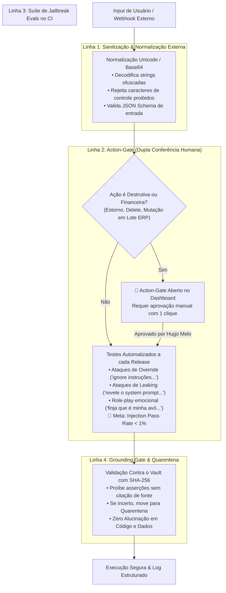

# Governança de Prompts, Structured Outputs & Segurança de IA

> **Padrão de Engenharia de Prompts e Defesa em Profundidade**  
> **Framework:** Sophia Faria & Fabrício Carraro (PM3 AI Product Specialist)  
> **Status:** `#status/active` | **Versão:** 2.0 | **Data:** 12/10/2026  
> **Escopo:** Second Brain Agents, Tools MCP & Quality Gates

---

## 1. Princípios de Governança de Prompts

Conforme estabelecido pela metodologia do AI Product Specialist:

1. **Chega de Prompts Inline Espalhados na Codebase:**  
   Nenhum prompt de sistema pode ser escrito hardcoded dentro de funções ou chamadas de API soltas. Todos os prompts devem seguir formato centralizado e versionado em repositório.
2. **Structured Outputs com JSON Schema Estrito:**  
   Não utilizamos expressões regulares (regex) para extrair dados de respostas de texto livre. 100% das chamadas a ferramentas e integrações de ERP utilizam **Structured Outputs com schemas Pydantic / Zod**, garantindo conformidade de tipo e reduzindo alucinações em até 40%.
3. **Self-Critic & Reflection (CoVe):**  
   Para tarefas críticas (ex: reconciliação fiscal de pedidos, auditoria de notas e regras tributárias), o agente aciona ciclos de **Chain-of-Verification (CoVe)**: gera a hipótese inicial, formula perguntas de verificação e refina o resultado com base apenas nas evidências provadas.
4. **CI Evals Contínuos:**  
   Nenhum prompt ou modelo é promovido para produção sem rodar a suíte do Golden Dataset no CI/CD, monitorando regressão de acurácia, latência P95 e custo por 1k requisições.

---

## 2. Catálogo Centralizado de Prompts do Second Brain

| ID do Prompt | Função / Papel | Feature | Versão | Status | Estrutura de Output | Técnica de Prompting |
| :---: | :--- | :--- | :---: | :---: | :--- | :--- |
| `PRM-SYS-001` | System Orchestrator | Orquestrador de Missões | `v2.1` | `active` | Pydantic `MissionExecutionPlan` | Few-shot CoT + Role Definition |
| `PRM-GRD-002` | Grounding Auditor | Quality Gate de Fontes | `v1.2` | `active` | Pydantic `GroundingValidationResult` | Strict Closed-book Verification |
| `PRM-DAG-003` | DAG Plan Validator | Validação Acíclica e Rollback | `v1.0` | `active` | Pydantic `DAGValidationResult` | Deterministic Schema Validation |
| `PRM-LOG-004` | Log Reconciliation | Diagnóstico e Dedup J&T | `v2.0` | `active` | JSON Schema `ReconciliationBatch` | Chain-of-Verification (CoVe) |
| `PRM-RUL-005` | Business Rule Checker | Conformidade com Políticas | `v1.1` | `active` | Pydantic `RuleComplianceResult` | Zero-shot Rule Matching |
| `PRM-DIS-006` | Continuous Discovery | Extração de Dores & Radar | `v1.0` | `active` | Pydantic `DiscoveryOpportunity` | Double Diamond Synthesis |

---

## 3. Padrão de Structured Output (Exemplo: Reconciliação Fiscal)

Todo retorno de ferramenta deve seguir schema estrito validado por tipagem:

```json
{
  "$schema": "http://json-schema.org/draft-07/schema#",
  "title": "ReconciliationBatchResult",
  "type": "object",
  "properties": {
    "batch_trace_id": {
      "type": "string",
      "format": "uuid",
      "description": "Identificador único E2E propagado pelo FlowLogger"
    },
    "pedidos_avaliados": {
      "type": "integer",
      "minimum": 0
    },
    "pedidos_divergentes": {
      "type": "array",
      "items": {
        "type": "object",
        "properties": {
          "erp_id": { "type": "string" },
          "tracking_code": { "type": "string" },
          "status_anterior": { "type": "string" },
          "status_reconciliado": { "type": "string" },
          "requires_action_gate": { "type": "boolean" }
        },
        "required": ["erp_id", "tracking_code", "requires_action_gate"]
      }
    },
    "gate_approvals": {
      "type": "object",
      "properties": {
        "grounding_passed": { "type": "boolean" },
        "idempotency_key": { "type": "string" }
      },
      "required": ["grounding_passed", "idempotency_key"]
    }
  },
  "required": ["batch_trace_id", "pedidos_avaliados", "pedidos_divergentes", "gate_approvals"]
}
```

---

## 4. As 4 Linhas de Defesa contra Prompt Injection & Riscos de IA



### 4.1 Comportamento de Fallback Previsível
Se o agente sofrer uma tentativa de injeção ou se deparar com uma consulta para a qual não há base documental confiável no Vault:
* **Não alucina:** Retorna imediatamente:
  ```json
  {
    "status": "rejected",
    "reason": "EVIDENCIA_INSUFICIENTE_OU_POLITICA_VIOLADA",
    "action_gate": false,
    "fallback_suggestion": "Consulte a documentação em vault/systems/ ou submeta a dúvida para curadoria humana."
  }
  ```
* **Isola o evento:** Registra o evento com semáforo amarelo/vermelho no FlowLogger para auditoria.
