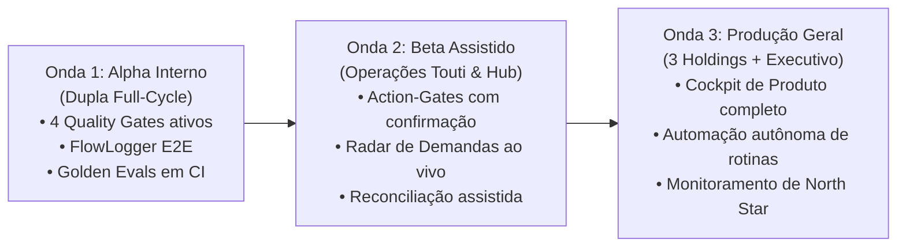

# PRD: Second Brain Platform V2 (Autonomous Operations Operating System)

> **Tipo de Documento:** Product Requirements Document (PRD)  
> **Produto:** KIOSK Second Brain Platform V2  
> **Autor & Liderança Técnica:** Hugo Melo  
> **Ciclo:** Q4 2026  
> **Alinhamento Metodológico:** PM3 AI Product Specialist / Double Diamond Framework

## 1. Resumo Executivo & Contexto de Negócio

### 1.1 Oportunidade
A KIOSK Brands opera três grandes holdings (Touti Cosmetics, Amavia Cosméticos e Yes! Cosmetics) integrando e-commerce (Yampi), ERPs (Bling, SAP), WMS (Corpem), transportadoras (J&T Express) e CRMs (Salesforce, SULTS). 

A expansão rápida dessas marcas sobrecarregou a operação com **incidentes recorrentes de integração, divergência de dados entre sistemas e gargalos de atendimento operacional**. A liderança de engenharia e produto (Hugo Melo, Full-Cycle Lead) necessita de um sistema central de IA com alta confiabilidade operacional que diagnostique, orquestre e execute resoluções de forma determinística, permitindo que as marcas escalem sem aumento proporcional no headcount técnico.

### 1.2 Objetivo do Produto
Entregar a versão 2.0 da **Second Brain Platform**, transformando o repositório documental e o grafo local em uma plataforma viva de **operações autônomas orientada a Compound AI**, com 4 Quality Gates em tempo de execução, rastreabilidade visual (FlowLogger) e painel executivo de métricas de produto.

---

## 2. Objetivos de Negócio & Metas de Produto (OKRs)

* **Objetivo 1 (Eficiência Operacional):** Drástica redução no tempo de resolução de incidentes em ERPs e Hubs logísticos.
  * **KR 1.1:** Reduzir o MTTR de incidentes críticos de integração de 4 horas para menos de 5 minutos em 90% dos casos.
  * **KR 1.2:** Atingir 0 (zero) etiquetas de frete duplicadas na J&T Express através do Idempotency Gate.
* **Objetivo 2 (Governança & Confiabilidade de IA):** Garantir que nenhuma ação de IA seja executada sem fundamentação verificável.
  * **KR 2.1:** 100% das missões autônomas validadas pelos 4 Quality Gates (Grounding, DAG, Rules, Idempotency).
  * **KR 2.2:** Manter score do Golden Dataset >= 95.0/100 em todas as execuções de CI/CD.
* **Objetivo 3 (Visibilidade Executiva):** Prover transparência total de status para diretores e sócios (Tadeu, Davi).
  * **KR 3.1:** 100% das 17 frentes ativas monitoradas em tempo real com indicador de bloqueio externo e próximo passo claro em menos de 30 segundos.

---

## 3. Não-Objetivos (Out of Scope para V2)

1. **Substituição dos ERPs:** O Second Brain não armazena dados transacionais de pedidos de forma definitiva; ele orquestra, audita e diagnostica sobre as APIs dos ERPs.
2. **Execução Irrestrita sem Human-in-the-Loop:** Ações que envolvam estorno financeiro em massa, deleção definitiva de dados ou alteração direta em esquemas de produção de ERPs exigem obrigatoriamente aprovação manual (Action-Gate).
3. **Treinamento de LLMs Proprietários do Zero:** O sistema utiliza modelos de fronteira comerciais (Claude 3.7 / Gemini 2.5 / GPT-4o) combinados a Compound AI, RAG estruturado e Golden Dataset calibrado.

---

## 4. Personas & Jornadas do Usuário (User Stories)

### 4.1 US-01: Diagnóstico Autônomo de Falha com Fontes Verificáveis
* **Como:** Hugo Melo (Tech/Product Lead)
* **Quero:** Que o assistente de IA diagnostique a causa raiz de um erro de webhook (ex: DEM-17 / divergência Bling vs Hub) apontando o arquivo exato no Vault e o trecho de código correspondente.
* **Para que:** Eu possa validar a causa raiz em menos de 1 minuto sem precisar debugar logs brutos no servidor.
* **Critérios de Aceitação:**
  1. A resposta do agente deve citar obrigatoriamente o arquivo do Vault com hash SHA-256 e intervalo de linhas.
  2. O Grounding Gate deve aprovar a citação com score de ancoragem >= 95%.
  3. Caso o agente não encontre evidência documental, deve retornar fallback explícito: *"Evidência ausente no Vault para esta regra. Movendo contexto para quarentena."*

### 4.2 US-02: Execução de Rotina Transacional com Idempotência e Rollback
* **Como:** Hugo Melo (Engenharia Core & Automação)
* **Quero:** Que uma missão de sincronização em lote (ex: reconciliação de 44 pedidos duplicados na J&T) passe por validação de idempotência e gere um batch trace único.
* **Para que:** Se a conexão cair no meio do caminho, o sistema saiba exatamente onde parou e execute rollback atômico sem duplicar dados.
* **Critérios de Aceitação:**
  1. O sistema deve gerar um `batch_trace_id` (UUID v4) antes de iniciar qualquer etapa.
  2. Cada etapa deve validar sua chave de idempotência (`IdempotencyGate`). Se a chave já existir, retorna o resultado prévio em cache sem reenviar para a API externa.
  3. Em caso de falha em qualquer passo do DAG, o sistema deve acionar a função de rollback cadastrada para reverter alterações parciais e gravar log estruturado no FlowLogger.

### 4.3 US-03: Visão de Produto e Radar de Demandas para a Liderança
* **Como:** Tadeu / Davi (Diretoria Executiva)
* **Quero:** Acessar o Dashboard e ver um painel executivo com a North Star Metric, o status das 3 marcas (Touti, Amavia, Yes!) e as frentes bloqueadas por terceiros.
* **Para que:** Eu possa cobrar parceiros externos (Bling, J&T) em reuniões semanais sem precisar interromper os desenvolvedores.
* **Critérios de Aceitação:**
  1. O Dashboard deve conter a aba **"🎯 Produto & Estratégia"** com visualização rápida das métricas da Tríade PM3.
  2. Deve destacar as demandas em `#status/blocked-externo` com o nome do responsável e o próximo passo claro.
  3. Permite alternar entre visão de negócio e visão técnica com 1 clique.

---

## 5. Requisitos Funcionais (FRs)

| ID | Nome do Requisito | Descrição | Prioridade (RICE) |
| :---: | :--- | :--- | :---: |
| **FR-01** | **Orquestração por Quality Gates** | Executar toda missão através dos 4 Quality Gates (Grounding, DAG, Rules, Idempotency) com retorno booleano e justificativa auditável. | `#p0-must` |
| **FR-02** | **Rastreabilidade FlowLogger com Semáforos** | Emissão unificada de logs coloridos com semáforos no terminal e JSON estruturado com `batch_trace_id` e duração em ms. | `#p0-must` |
| **FR-03** | **Cockpit de Produto no Dashboard** | Nova interface no Dashboard exibindo a Tríade de Métricas, Funil Double Diamond e Matriz RICE das frentes ativas. | `#p0-must` |
| **FR-04** | **Memória com Quarentena e Purga** | Isolamento de novos conhecimentos em `quarantine_store.py` até validação humana ou atingimento de score de confiança >= 0.85. | `#p1-should` |
| **FR-05** | **Suíte Contínua de Golden Dataset Evals** | Execução de benchmark automatizado com casos padrão-ouro cobrindo as dores reais da KIOSK (Logística, ERP, CRM, Fiscal). | `#p1-should` |
| **FR-06** | **Action-Gate com Aprovação Humana** | Modal de confirmação no dashboard para ações classificadas como de alto risco financeiro ou destrutivas. | `#p1-should` |

---

## 6. Requisitos Não-Funcionais (NFRs)

1. **Performance & Latência:**  
   * Busca no grafo/RAG: P95 < 1.500 ms.  
   * Execução de missão completa com os 4 Gates: P95 < 3.500 ms.
2. **Segurança & Anti-Injection:**  
   * Validação estrita de todos os inputs via schemas Pydantic / Structured Outputs.  
   * Taxa de sucesso de ataques de prompt injection (override, leaking, role-play) < 1.0% na suíte de testes de segurança.
3. **Disponibilidade & Resiliência:**  
   * Operação contínua offline/local do Dashboard sem dependência de internet para consultas no snapshot do Vault.
4. **Idempotência & Transacionalidade:**  
   * Chave de idempotência única com TTL configurável para 100% das mutações externas em ERPs.

---

## 7. Estratégia de Lançamento & Rollout em Ondas (Launch Strategy)

Seguindo as boas práticas de lançamento de produtos de IA ensinadas na Formação AI Product Specialist:

1. **Onda 1 (Alpha - Concluído):**  
   Implementação do núcleo Compound AI, 4 Quality Gates, FlowLogger visual e suíte de Golden Dataset Evals rodando localmente com a liderança técnica (Hugo Melo).
2. **Onda 2 (Beta Assistido - Atual):**  
   Conexão dos fluxos de reconciliação de etiquetas (DEM-01 e DEM-17) com Action-Gate (aprovação humana pré-envio) e liberação do Cockpit de Produto para acompanhamento de demandas.
3. **Onda 3 (Escala Geral - Q4 2026):**  
   Expansão dos squads autônomos para as operações da Amavia (DEM-05) e Yes! Cosmetics (DEM-06), automatizando a auditoria contínua de fretes e conciliações fiscais.
