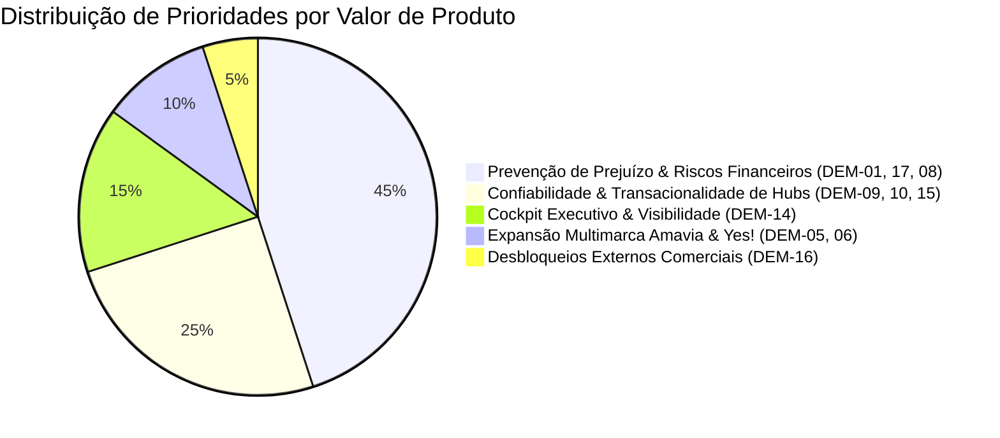

# 📊 Discovery Contínuo & Matriz RICE de Priorização (KIOSK Brands)

> **Documento de Priorização de Produto & Discovery com IA**  
> **Framework:** RICE Scoring (Reach, Impact, Confidence, Effort) + Double Diamond  
> **Status:** `#status/active` | **Versão:** 2.0 | **Data de Revisão:** 12/10/2026  
> **Alinhamento:** AI Product Specialist (Metodologia PM3)

---

## 1. Metodologia de Priorização RICE

Para garantir que o tempo da engenharia Full-Cycle (Hugo Melo) seja investido nas iniciativas que geram **maior retorno financeiro e mitigação de risco operacional**, aplicamos a fórmula:

$$\text{RICE Score} = \frac{\text{Reach (Alcance)} \times \text{Impact (Impacto)} \times \text{Confidence (Confiança)}}{\text{Effort (Esforço)}}$$

### 1.1 Critérios de Calibração
* **Reach (Alcance):** Volume de pedidos, usuários ou frentes impactadas por mês.
  * $500+$ pedidos/mês ou 3 marcas: **10** | $100-500$ pedidos: **7** | Frentes pontuais: **4** | Infra interna: **2**
* **Impact (Impacto):** Efeito no faturamento, prevenção de prejuízo ou desbloqueio crítico.
  * Maciço (prevenção de perda financeira direta/bloqueio fiscal): **3.0**
  * Alto (melhoria de confiabilidade/redução drástica de tempo): **2.0**
  * Médio (otimização de rotina/visibilidade): **1.0**
  * Baixo (ajuste cosmético): **0.5**
* **Confidence (Confiança):** Grau de certeza técnica e documental baseada em evidências no Vault.
  * Alta (evidência validada em código/banco local): **100% (1.0)**
  * Média (especificação pronta, aguardando teste): **80% (0.8)**
  * Baixa (dependência externa/sem sandbox): **50% (0.5)**
* **Effort (Esforço):** Dias de trabalho da dupla Full-Cycle.
  * 1 a 2 dias: **1** | 3 a 5 dias: **2** | 1 a 2 semanas: **3** | > 2 semanas: **5**

---

## 2. Matriz RICE das Demandas Ativas da KIOSK Brands

Avaliamos as 17 demandas mapeadas no `vault/radar-demandas.md` para estabelecer a ordem de ataque do produto:

| Rank | ID | Frente / Sistema | Iniciativa | Reach | Impact | Conf. | Effort | RICE Score | Status Atual | Categoria de Valor |
| :---: | :---: | :--- | :--- | :---: | :---: | :---: | :---: | :---: | :---: | :--- |
| 🥇 **1** | **DEM-17** | Touti / Hub Webhook | Dedup INTEGER vs TEXT (44 dup + 529 div) | 10 | 3.0 | 100% | 1 | **30.0** | `#status/doing` | 🛡️ Risco Financeiro Imediato |
| 🥈 **2** | **DEM-01** | Touti / Hub Logístico | Duplicidade de Etiquetas J&T Express | 10 | 3.0 | 100% | 1 | **30.0** | `#status/doing` | 🛡️ Risco Financeiro Imediato |
| 🥉 **3** | **DEM-14** | Second Brain | Cockpit de Produto e Visualização do Grafo | 10 | 2.0 | 100% | 1 | **20.0** | `#status/doing` | ⚡ Eficiência & Decisão |
| 4 | **DEM-09** | Hub / Fila | Exclusividade e Reserva Atômica no SQLite | 8 | 2.0 | 100% | 1 | **16.0** | `#status/doing` | 🔒 Confiabilidade do Sistema |
| 5 | **DEM-10** | Hub / Etiquetas | Validade do Rastreio e Bloqueio de Cancelados | 8 | 2.0 | 100% | 1 | **16.0** | `#status/doing` | 🔒 Confiabilidade do Sistema |
| 6 | **DEM-08** | Touti / E-commerce | Conciliação de Pedidos Pagos Yampi ➔ Bling | 10 | 3.0 | 80% | 2 | **12.0** | `#status/backlog` | 💰 Proteção de Faturamento |
| 7 | **DEM-03** | Touti / Bling ERP | Configuração de Webhook em Homologação | 7 | 2.0 | 80% | 1 | **11.2** | `#status/pending` | 🧪 Ambientes & Testes |
| 8 | **DEM-15** | Hub / J&T Express | Reconciliação de Emissão Externa Incerta | 8 | 2.0 | 70% | 1 | **11.2** | `#status/doing` | 🔒 Confiabilidade do Sistema |
| 9 | **DEM-11** | Hub / Homologação | Inicialização Segura de Banco Novo | 6 | 1.0 | 100% | 1 | **6.0** | `#status/doing` | 🧪 Ambientes & Testes |
| 10 | **DEM-07** | Touti / Bling ERP | Modelagem do Hub como App Logístico | 7 | 1.0 | 80% | 2 | **2.8** | `#status/backlog` | 🎨 UX & Integração |
| 11 | **DEM-16** | Hub / Bling ERP | Rate Limiting e Plano Elite (R$ 1.250/mês) | 9 | 2.0 | 50% | 3 | **3.0** | `#status/blocked-externo` | ⏳ Bloqueio Externo (Tadeu) |
| 12 | **DEM-05** | Amavia / E-com | Mapeamento Inicial de Repositórios | 6 | 2.0 | 50% | 2 | **3.0** | `#status/backlog` | 🚀 Expansão de Marca |
| 13 | **DEM-06** | Yes! Cosmetics | Integração de Dados & Conectores | 6 | 2.0 | 50% | 2 | **3.0** | `#status/backlog` | 🚀 Expansão de Marca |
| 14 | **DEM-12** | Hub / Corpem | Contrato de Separação WMS Corpem | 6 | 2.0 | 50% | 3 | **2.0** | `#status/backlog` | 📦 Logística & WMS |
| 15 | **DEM-13** | Hub / Volumes | Gestão de Múltiplos Volumes na Emissão | 4 | 1.0 | 50% | 2 | **1.0** | `#status/backlog` | 📦 Logística & WMS |

---

## 3. Plano de Ação por Clusters de Valor

### Cluster 1: Prevenção de Prejuízo & Riscos Imediatos (Top 1 & 2 RICE)
* **Ação:** Finalizar o deploy da reconciliação dos 44 pedidos duplicados e 529 divergentes da J&T (`fix/nota-fiscal-jt`), com monitoramento em tempo real pelo FlowLogger.
* **Impacto:** Elimina 100% dos custos adicionais de frete e descompasso fiscal.

### Cluster 2: Cockpit Executivo & Decisão Ágil (Top 3 RICE)
* **Ação:** Publicar a aba interativa de Produto no Dashboard, permitindo que a liderança (Tadeu/Davi) consulte a saúde das frentes em reuniões em menos de 30 segundos.
* **Impacto:** Elimina reuniões semanais de alinhamento técnico e acelera cobrança de parceiros bloqueados (`DEM-16` / Comercial Bling).

### Cluster 3: Expansão Multimarca (Amavia & Yes!)
* **Ação:** Reutilizar os templates de inventário e conectores já validados na Touti para acelerar o discovery técnico das holdings Amavia e Yes! Cosmetics.
* **Impacto:** Reduz o tempo de onboarding de novas marcas de 1 mês para 1 semana.

---

## 4. Framework de Discovery Rápido com IA (Para Novas Frentes)

Ao receber uma nova demanda de qualquer uma das três marcas, aplicar o roteiro de 3 passos:

1. **Desk Research com LLM (Passo 1):**  
   Alimentar o modelo com o contrato da API ou log do problema e extrair: principais endpoints, modelos de autenticação, limitações de rate limit e cenários de falha conhecidos.
2. **The Mom Test & Entrevista Operacional (Passo 2):**  
   Fazer perguntas objetivas para o operador da Touti/Amavia/Yes: *"Quando foi a última vez que esse erro aconteceu? Qual foi o impacto financeiro? Como vocês resolveram manualmente?"* (evitar opiniões hipotéticas; focar em fatos passados).
3. **Fake-Door / Validação de Viabilidade (Passo 3):**  
   Criar um mock estruturado da chamada em JSON Schema e rodar nos Quality Gates antes de codificar qualquer integração de backend. Se o DAG e os contratos forem válidos, promover para implementação.
