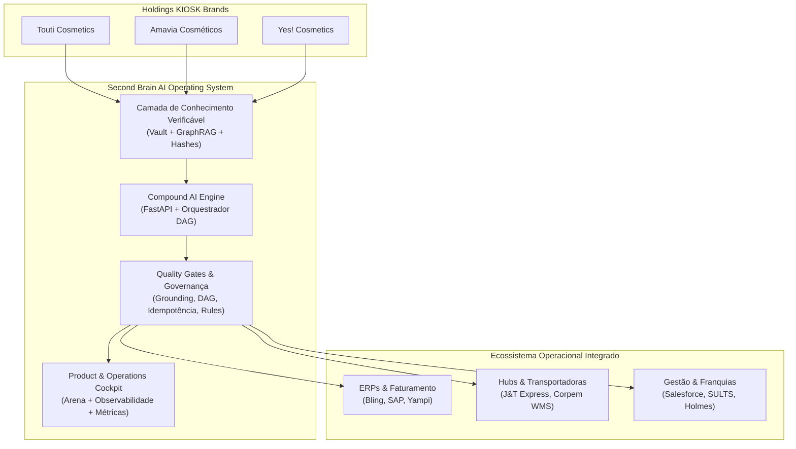
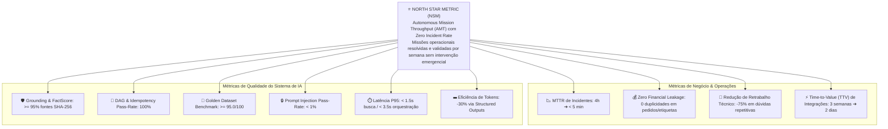
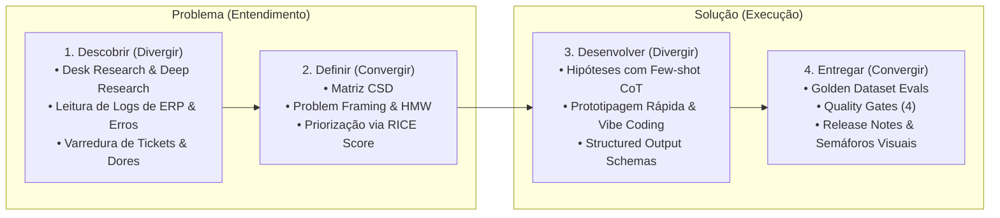
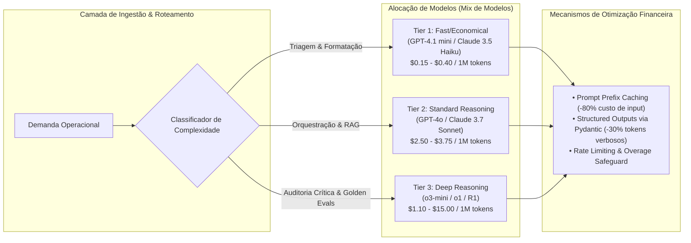

# 🎯 Visão de Produto & Estratégia AI-First (Second Brain KIOSK Brands)

> **Documento Oficial de Estratégia e Escopo de Produto**  
> **Framework:** AI Product Specialist (Metodologia PM3 / Double Diamond / AI Triad Metrics)  
> **Status:** `#status/active` | **Versão:** 2.0 | **Liderança de Produto & Engenharia:** Hugo Melo  
> **Escopo:** Holdings Touti Cosmetics, Amavia Cosméticos, Yes! Cosmetics & Operações KIOSK

---

## 1. Contexto e Declaração da Visão de Produto

### 1.1 O que é o Second Brain?
O **Second Brain** é o **Sistema Operacional Autônomo e Copiloto de Operações (Autonomous Operations Copilot & Compound AI Operating System)** da KIOSK Brands. 

Ele transcende a definição de uma simples ferramenta interna ou repositório de documentos: trata-se de um **produto de IA de missão crítica** projetado para orquestrar conhecimento corporativo, diagnosticar gargalos em ecossistemas de e-commerce e ERPs, mitigar riscos fiscais/logísticos e executar fluxos operacionais automatizados com **confiabilidade determinística, rastreabilidade ponta a ponta e zero tolerância a duplicidades**.



---

## 2. Problem Framing: Transformando Dores em Oportunidades (HMW)

Inspirado no framework de **Problem Framing & Reframing** do AI Product Specialist, formulamos as 5 declarações estratégicas *How Might We (Como Podemos)* que direcionam todo o roadmap do produto:

1. **HMW Operacional & Descentralização:**  
   *Como podemos transformar centenas de documentos técnicos, contratos de API e regras de negócio dispersos entre 3 holdings em decisões e automações autônomas 100% confiáveis e verificáveis em segundos?*
2. **HMW Confiabilidade & Transacionalidade:**  
   *Como podemos garantir que rotinas automatizadas em ERPs (Bling, Yampi, J&T) nunca dupliquem etiquetas nem percam pedidos pagos quando houver instabilidade de rede, aplicando idempotência, rollback atômico e rastreabilidade E2E?*
3. **HMW Escala da Engenharia Full-Cycle:**  
   *Como podemos permitir que a engenharia Full-Cycle (Hugo Melo) gerencie e audite com excelência o ecossistema tecnológico de mais de 4.000 pontos e franquias, operando com a alavancagem de 9 squads autônomos de IA?*
4. **HMW Continuous Discovery:**  
   *Como podemos fazer com que o Second Brain identifique ativamente anomalias operacionais, gaps documentais e novas demandas de produto antes que elas se transformem em chamados de suporte de emergência ou perdas financeiras?*
5. **HMW Governança & Segurança de IA:**  
   *Como podemos blindar as decisões de negócio contra alucinações, vazamento de dados confidenciais (PII) e injeções de prompt maliciosas, garantindo auditoria humana (Action-Gates) para qualquer ação de alto risco?*

---

## 3. Personas e Mapeamento de Valor (Jobs to be Done - JTBD)

| Persona | Perfil & Contexto | Dores Principais | Job to be Done (JTBD) | Proposta de Valor do Second Brain |
| :--- | :--- | :--- | :--- | :--- |
| **Hugo Melo** | Full-Cycle Product & Tech Lead | Sobrecarga de contexto em multi-frentes, conciliação manual de dados de ERP e risco de regressão em deploy. | *"Quando preciso destravar uma frente crítica ou integrar um ERP, quero ter contexto instantâneo e automações com garantia atômica para entregar sem risco de quebra."* | Orquestração Compound AI com 4 Quality Gates, FlowLogger visual e memória com quarentena. |
| **Tadeu & Davi** | Liderança Executiva & Operacional KIOSK | Falta de visibilidade de gargalos, dependência de reuniões para saber status e custos imprevistos de ERP/APIs. | *"Quando avalio a saúde das marcas, quero entender em 30 segundos onde estão os bloqueios externos e o impacto no negócio para tomar decisões rápidas."* | Radar de Demandas ao vivo, métricas de negócio claras e estimativa de ROI por frente. |
| **Equipes de Operações & Logística** | Operadores Touti, Amavia e Yes! | Reconciliação manual de pedidos travados, duplicidade de etiquetas de frete e chamados repetitivos de suporte. | *"Quando um pedido falha entre a Yampi e o Bling, quero diagnóstico imediato da causa-raiz e solução em 1 clique sem esperar dias por TI."* | Resolução de incidentes guiada por IA, conciliação automatizada e autoatendimento com fontes verificáveis. |

---

## 4. Árvore de Métricas de Sucesso do Produto (PM3 Triad Metrics)

O sucesso do Second Brain não é medido por "número de chats", mas pelo impacto no negócio e pela robustez da IA segundo a **Tríade de Métricas do AI Product Specialist**:



### 4.1 Nível 0: North Star Metric (NSM)
* **Definição:** **Autonomous Mission Throughput (AMT) com Zero Incident Rate**.
* **Fórmula:** Volume semanal de missões operacionais (diagnósticos, conciliações, propostas de código, auditorias de frete) concluídas autonomamente e aprovadas nos Quality Gates sem gerar nenhum rollback emergencial ou chamado reaberto.
* **Meta:** >= 50 missões autônomas validadas/semana com taxa de sucesso de 100%.

### 4.2 Nível 1 (L1 Metrics): Métricas de Impacto no Negócio & Feature (Leading Indicators)
1. **Mean Time to Resolution (MTTR):** Redução do tempo de diagnóstico e remediação de incidentes operacionais de 4 horas para menos de 5 minutos.
2. **Prevenção de Perdas Financeiras (Zero Financial Leakage):** Redução a **Zero** de custos de frete duplicados por reemissão de etiquetas J&T (resolução DEM-01 e DEM-17) e zero perda de pedidos pagos Yampi ➔ Bling.
3. **Alavancagem Produtiva Full-Cycle:** Capacidade da liderança Full-Cycle (Hugo Melo) manter e auditar 17 frentes simultâneas (DEM-01 a DEM-17) sem degradação de foco ou perda de qualidade.
4. **Time to Value (TTV):** Redução de 15 dias para 48h na elaboração de especificação técnica e prototipagem funcional para novos conectores de ERP/WMS (ex: Corpem, SAP).
5. **Taxa de Resolução de Primeira Interação (FCR Operacional):** >= 90% das consultas e diagnósticos resolvidos no primeiro ciclo de execução do Copiloto.

### 4.3 Nível 2 (L2 Metrics): Performance do Motor de IA (Técnica & Avaliação Contínua)
1. **Framework HHH (Helpful, Honest, Harmless):**
   * *Helpful:* >= 96% de aderência direta ao objetivo da missão sem verbosidade desnecessária.
   * *Honest (Grounding & FactScore):* >= 98% de fidelidade factual ao contexto do Vault referenciando SHA-256 (0% de fabricação não-verificável).
   * *Harmless (Guardrails):* 0% de vazamento de PII/credenciais e 0% de bypass de Action-Gates.
2. **Métricas RAGAS do Pipeline de Conhecimento:**
   * *Faithfulness:* >= 0.95 (resposta 100% ancorada nos chunks recuperados).
   * *Answer Relevancy:* >= 0.92 (resposta atende precisamente à pergunta operacional).
   * *Context Precision:* >= 0.90 (chunks recuperados são estritamente relevantes).
   * *Context Recall:* >= 0.95 (todo o contexto necessário do Vault/ERP foi indexado).
3. **Golden Dataset Benchmark:** Score ponderado >= 95.0/100 sobre o conjunto curado de 150 questões de score humano executado automaticamente via CI/CD.
4. **DAG Determinism & Idempotência:** 100% de execução sem ciclos e garantia transacional atômica com checksum SHA-256 em lote.
5. **Latência & Eficiência Operacional:**
   * *Time to First Token (TTFT):* < 400ms.
   * *Latência P95:* < 1.5s para buscas semânticas / < 3.5s para DAGs com 4 Quality Gates.
   * *Unit Economics de Tokens:* Redução de 30% no consumo via structured outputs, caching de prefixos de prompts e roteamento inteligente para modelos leves (ex: GPT-4.1 mini / Haiku 3.5 para triagem; o3-mini / Sonnet 3.7 para raciocínio complexo).

---

## 5. Estratégia de Product Discovery Contínuo (Double Diamond com IA)

O Second Brain utiliza o modelo **Double Diamond potencializado por IA** (conforme ensinado na Formação AI Product Specialist) para garantir que nenhuma feature seja construída sem validação de necessidade real:



1. **Desk Research Automatizado:** Análise constante de logs operacionais e da base de conhecimento para extrair anomalias antes do usuário relatar.
2. **Matriz CSD Dinâmica:** Certezas, Suposições e Dúvidas atualizadas em tempo real a cada interação dos agentes.
3. **Priorização RICE Integrada:** Toda nova demanda do Radar de Demandas é avaliada por Alcance (Reach), Impacto (Impact), Confiança (Confidence) e Esforço (Effort).
4. **Prototipagem Ágil & Golden Data:** Qualquer nova automação só é promovida para produção após validação em Golden Dataset e aprovação humana (Action-Gate).

---

## 6. Governança, Segurança e Experiência do Usuário (UX de IA)

### 6.1 As 4 Linhas de Defesa contra Riscos e Prompt Injection
Seguindo os padrões do AI Product Specialist:
1. **Linha 1 - Sanitização e Validação Estruturada:** Todo input do usuário passa por normalização Unicode/Base64 e validação de schema antes de chegar aos LLMs.
2. **Linha 2 - Action-Gate (Dupla Conferência):** Toda ação sensível (ex: disparo em produção de estorno, reemissão de NF, purga de banco ou envio externo) exige aprovação explícita de Hugo Melo no dashboard.
3. **Linha 3 - Suíte de Jailbreak Evals no CI:** Pipeline automatizado rodando testes de role-play emocional, leaking de system prompt e override direto para garantir taxa de vulnerabilidade < 1%.
4. **Linha 4 - Quality Gates de Execução:** Grounding Gate (impede alucinação), DAG Gate (impede loops infinitos) e Idempotency Gate (impede duplicidade transacional).

### 6.2 UX de IA & Semáforos Visuais
- **Semáforos Visuais do FlowLogger:** Cada etapa da execução exibe semáforos verdes/amarelos/vermelhos com tempos em milissegundos e identificador único `batch_trace_id`.
- **Explicabilidade:** O produto sempre cita o documento do Vault, o trecho exato e o hash SHA-256 de onde a decisão foi tomada.
- **Fallback Previsível:** Se a IA identificar incerteza ou ausência de documentação, o sistema não inventa: aciona fallback explícito para quarentena de memória e notifica a engenharia.

---

## 7. Unit Economics de Tokens & Gestão Financeira da IA (Framework Aiman Smaili)

Para garantir que o Second Brain seja sustentável e gere ROI comprovado para a holding, aplicamos o framework de **Unit Economics de IA**:



### 7.1 Princípios de Custos Operacionais
1. **Mix de Modelos:** Nunca utilizar modelos frontier caros para tarefas determinísticas de formatação ou parsing de JSON.
2. **Prompt Prefix Caching:** Cache ativo dos System Prompts padronizados do Second Brain para reduzir o custo de input em até 80%.
3. **Cálculo de ROI por Automação:** Toda frente (ex: DEM-01 Reconciliação J&T) tem custo por execução medido (< $0.02) comparado ao custo de homem-hora manual ($12.50/h) e prevenção de perdas ($45.00/etiqueta duplicada), resultando em um ROI superior a **60x**.

---

## 8. Modelo de Maturidade & AI Readiness (Framework Juliana Araújo)

Para acompanhar e evoluir o ecossistema corporativo da KIOSK Brands de forma sustentável, o Second Brain mede a maturidade da organização em **5 Dimensões**:

| Dimensão de Maturidade | Nível Atual (Nível 3: Sistêmico) | Meta de Curto Prazo (Nível 4: Otimizado) | Critério de Aceitação / Evidência |
| :--- | :--- | :--- | :--- |
| **1. Estratégia & Negócio** | Foco em eficiência e resolução de gargalos operacionais conhecidos (17 demandas). | Previsão ativa de demanda e recomendação proativa de novas iniciativas. | Integração do Radar de Demandas ao OKR da holding. |
| **2. Dados & Infraestrutura** | Vault local sincronizado com Google Drive (23 docs) e GraphRAG em memória. | Pipeline contínuo com Qdrant vetorial, embeddings dimensionais e cache redis. | Ingestão incremental com hash SHA-256 e manifest JSON. |
| **3. Governança & Ética** | 4 Linhas de Defesa, Action-Gates para ações de alto risco e FlowLogger. | Guardrails automatizados em tempo de inferência com NeMo / Llama-Guard. | 0% de bypass de Action-Gates e suíte de jailbreak no CI. |
| **4. Pessoas & Cultura** | Liderança Full-Cycle (Hugo Melo) operando com assistência do Second Brain. | Democratização do acesso guiado para operadores Touti, Amavia e Yes!. | Autoatendimento para dúvidas de regras fiscais e estoque. |
| **5. Operações (LLMOps)** | Testes unitários com pytest, mocks isolados e FlowLogger no terminal. | Observabilidade contínua (Langfuse/OpenTelemetry), Golden Dataset Evals e TTFT < 400ms. | Telemetria E2E de latência, tokens e custo em tempo real. |

---

## 9. Growth Loop com IA & Data Flywheel (Framework Aiman Smaili & Lucca Kazan)

O Second Brain opera sob a mecânica de um **Data Flywheel Operacional**:

```mermaid
graph TD
    U[Utilização Operacional do Second Brain<br/>Holdings Touti, Amavia, Yes!] -->|Execuções & Diagnósticos| D[Logs de Decisão & Telemetria do FlowLogger]
    D -->|Detecção de Casos Críticos & Falhas| F[Curadoria Humana por Hugo Melo]
    F -->|Anotações de Alta Qualidade| G[Expansão do Golden Dataset (150+ itens)]
    G -->|Continuous Fine-Tuning & Prompt Refinement| M[Modelos & Prompts Mais Precisos]
    M -->|Menor Latência, Custo e 0 Alucinações| V[Maior Adoção e Confiança da Holding]
    V --> U
```

1. **Mais Uso Operacional:** Operadores e líderes consultam e resolvem pedidos travados e dúvidas de catálogo.
2. **Mais Rastreabilidade:** O FlowLogger registra traces com `batch_trace_id` e contexto completo.
3. **Casos Críticos Identificados:** Consultas com feedback negativo ou exceções são transformadas em novos testes do Golden Dataset.
4. **Refinamento Contínuo:** Prompts e pipelines de RAG são ajustados e validados contra os 150 casos de ouro.
5. **Aumento de Adoção:** O copilot torna-se cada vez mais infalível, atraindo mais casos de uso complexos.

---

## 10. Relação com Documentos do Vault

- [[radar-demandas]] · Status operacional de todas as frentes da KIOSK Brands.
- [[compound_ai_architecture_plan]] · Especificação técnica dos 4 Quality Gates e Golden Evals.
- [[teams/teams.yaml]] · Mapeamento dos 9 squads autônomos e seus protocolos.
- [[prd-second-brain-platform-v2]] · PRD com requisitos funcionais e critérios de aceitação.

### ADRs (Architecture Decision Records)
- [[ADR-006-implementacao-flowlogger-observabilidade-semaforos]] · Rastreabilidade E2E e semáforos visuais.
- [[ADR-007-hierarquia-metricas-l1-l2-framework-hhh-ragas]] · Hierarquia de Métricas L1/L2, HHH e RAGAS.
- [[ADR-008-unit-economics-tokens-roteamento-tier-modelos]] · Unit Economics de Tokens e Mix de Modelos por Tier.
- [[ADR-009-modelo-maturidade-ia-5-dimensoes-ai-readiness]] · Modelo de Maturidade de IA em 5 Dimensões.
- [[ADR-010-drivesyncengine-pipeline-ingestao-conhecimento-google-drive]] · Pipeline de Ingestão de Conhecimento via Google Drive.
- [[ADR-011-growth-loop-data-flywheel-golden-dataset]] · Growth Loop, Data Flywheel e Golden Dataset.

### Referências Externas (Drive: AI Product Specialist)
- [[references/02-medindo-e-provando-resultado-de-produtos-com-ia-lucca-kazan-pdf]] · Métricas L1/L2, HHH e RAGAS.
- [[references/14-avalia-o-e-observabilidade-mantendo-o-controle-dos-llms-ok-pptx-microsoft-powerpoint]] · Observabilidade, Goldenset e DeepEval.
- [[references/17-modelos-de-maturidade-e-readiness-de-ia-juliana-ara-jo-pdf]] · Readiness em 5 Dimensões.
- [[references/19-monetiza-o-e-pricing-de-funcionalidades-genai-aiman-mustafa-smaili-pptx-microsoft-powerpoint]] · Unit Economics de Tokens e Pricing.
- [[references/20-go-to-market-e-lan-amento-de-produtos-com-ia-aiman-mustafa-smaili-pptx-microsoft-powerpoint]] · GTM, Onboarding e Growth Loops.

