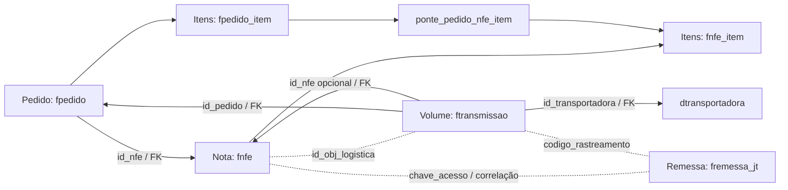

# Mapa de Entidades, Domínios e Casos de Uso do Hub Logístico

Síntese do documento-fonte `hub-logistico/docs/contexto-dominios-entidades-usecases.md`
(179 linhas, 20/10/2026) e do comparativo `docs/comparativo-sqlite-fluxo-testes.md`
(276 linhas, 21/10/2026). Relaciona o PostgreSQL `integracoes_ecommerce`, o hub
JavaScript (revisão `9adafa06`) e a implementação TypeScript na branch
`refactor/ddd-clean-architecture`.

## Linguagem e Identidades

| Conceito | Identidade | Significado no código |
|---|---|---|
| Pedido de venda | `fpedido.id_pedido` | `erp_id`, `erpId`, `UniversalPayload.orderId`. ID interno, não o número comercial. |
| Número comercial | `fpedido.numero_pedido`, `numero_yampi`, `num_shopify` | Referências humanas ou de canal. |
| Nota fiscal | `fnfe.id_nfe` | `invoice_id`, `invoiceId`. Identidade do gatilho fiscal. |
| Documento fiscal | `fnfe.chave_acesso`, `numero`, `serie` | Papéis diferentes; nenhum é o ID do pedido. |
| Volume / objeto logístico | `ftransmissao.id_volume` | `pedido.transporte.volumes[].id`. Não é serviço nem rastreio. |
| Serviço logístico | `ftransmissao.servico` (texto) | Sem `servico.id` preservado no PostgreSQL. |
| Transportadora | `dtransportadora.id_transportadora` | ID local; diferente de logística Bling ou conector do hub. |
| Intenção de emissão | `jt_emissions.erp_id` | `EmissionIntent` no TS. Preserva `txlogistic_id` e estado. |
| Tarefa de integração | `orders_queue.id` | Classe TS `Order`. Não representa integralmente `fpedido`. |
| Loja | `dloja.id_loja` / `lojas.id_bling` | Cadastro vs habilitação/configuração no hub. |

> IDs externos são strings opacas. Não usar o ID de uma tabela como se pertencesse a outra.

## Relações Confirmadas no PostgreSQL



Setas tracejadas = correlação sem FK declarada. O schema permite vários volumes por pedido e
vários itens/vínculos fiscais.

## 5 Bounded Contexts

### 1. Pedidos e Qualificação Comercial
Identificar a venda, canal, loja, itens e situação. JS: `shippingPolicy.js`,
`findOrderForInvoice`, admissão manual. TS: `ShippingPolicy`, `UniversalPayload`,
`QualifyOrderByInvoiceUseCase`, `ManualEnqueueUseCase`.

### 2. Fiscal
Identidade e aptidão fiscal da NF-e para despacho. Exige situação 5 ou 6, número positivo,
série numérica, chave de 44 dígitos não zerada e data válida. JS: `invoicePolicy.js`,
`invoiceEvents.js`. TS: `InvoicePolicy`, `ValidatedInvoice`,
`QualifyOrderByInvoiceUseCase`.

### 3. Expedição e Remessas
Escolher transporte, proteger emissão, obter etiqueta, manter rastreio, cancelar. JS:
`engine.js`, `adapters/jtExpress.js`, `adapters/bling.js`. TS: `EmissionIntent`,
`ShippingLabel`, `CarrierPort`, `DispatchOrderUseCase`, `CancelShipmentUseCase`.

### 4. Configuração Operacional
Habilitação automática, conector, remetente e acessos. JS: tabelas `lojas`, `connectors`,
`users`. TS: `Store`, `Connector`, `SenderAddress`, `User` e repositórios.

### 5. Consulta e Acompanhamento
Projeções locais para listagens e status. JS: `queueMonitor.js`, `queueOrderStatus.js`,
`analytics.js`. TS: `QueueMonitorRepository`, `AnalyticsRepository`.

## Casos de Uso (JS ↔ TS)

| Ação | Implementação JS | Implementação TS |
|---|---|---|
| Receber evento ERP | `POST /webhook/bling` | `HandleBlingWebhookUseCase` |
| Registrar evento fiscal | `invoiceEvents.js::receiveInvoiceEvent` | `ReceiveInvoiceEventUseCase` |
| Qualificar pedido pela NF | `invoiceEvents.js::processNextInvoiceEvent` | `QualifyOrderByInvoiceUseCase` |
| Solicitar despacho manual | `POST /api/enviar` | `ManualEnqueueUseCase` |
| Despachar pedido | `engine.js::processQueue` | `ProcessOrderUseCase` |
| Sincronizar rastreio | `adapters/bling.js::updateTracking` | `BlingUpdateTracking` via `ErpPort` |
| Cancelar remessa | `POST /api/jt/cancelar` | `CancelShipmentUseCase` |
| Imprimir etiqueta | Rotas de impressão | `PrintLabelUseCase` |
| Conferir NF-e (novo) | `POST /api/nf/conferencia` | — (ainda não no TS) |

## Limites e Divergências entre Branches

1. **Venda ≠ tarefa:** `Order` no TS contém `id`, `status`, `retries` da fila. Futura
   entidade comercial deve ser distinta (proposta: `DispatchJob`).
2. **Retentativas:** JS reinicia ciclo após 10 retries sem trava de 5 min; TS produz `failed`
   após 11 ciclos 429.
3. **Eventos fiscais:** `invoiceEvents.js` pode marcar evento como `failed` após esgotar
   orçamento.
4. **Objeto ausente:** adapter JS lança erro sem `transporte.volumes[0].id`; criação
   automática não implementada nesse caminho (PR #38 endereça parcialmente).
5. **Mensageria:** branch TS possui contratos e modos; produção usa SQLite.

## Fluxo Consolidado

```
Evento NF recebido
  → persistir evento
  → qualificar dados fiscais
  → localizar pedido e validar vínculo, situação e loja
  → admitir tarefa no SQLite
  → reservar tarefa
  → conferir emissão/rastreios anteriores
  → resolver conector e remetente
  → emitir somente quando seguro e necessário
  → preservar confirmação J&T
  → sincronizar objeto logístico Bling
  → notificar WMS quando configurado
  → concluir tarefa
```

Relacionado: [[hub-ontologia-ddd-proposta]], [[hub-arquitetura-ddd-typescript]],
[[hub-gatilho-nfe-e-politicas-de-emissao]], [[protecoes-processamento-emissao-hub]].
