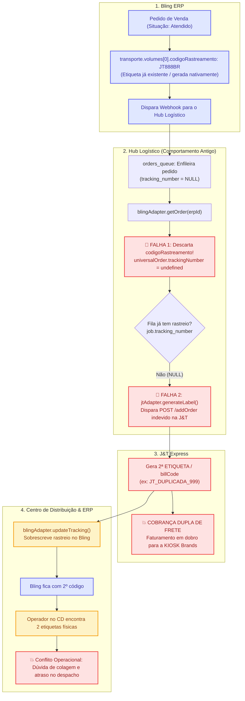
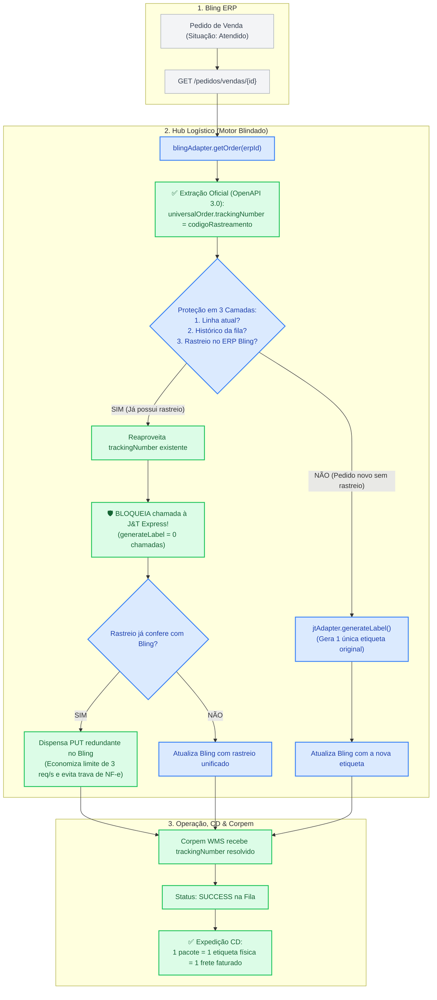

# Relatório de Incidente Técnico: Duplicidade de Etiquetas e Cobrança Dupla de Frete (J&T Express / Bling)

**Data do Incidente/Análise:** 2026-10-07  
**Serviço Afetado:** Hub Logístico Modular (`hub-logistico-v4-completo` / `SRV-API`)  
**Stakeholders Envolvidos:** Jefferson (E-Commerce), Tadeu (Gerente de TI), Davi (Supervisor de TI), Hugo Melo (Desenvolvedor Pleno)  
**Status:** Correção em três camadas presente; proteções adicionais validadas localmente em 2026-10-08. Implantação desta revisão pendente.

---

## 1. Contexto e Notificação do Problema
Durante reunião com a liderança de TI e E-Commerce, Jefferson (Líder de E-Commerce) reportou uma falha operacional crítica recorrente:
> *"Toda vez que cai pedido no Bling, a transportadora tá gerando duas etiquetas pro mesmo pacote. O operador no CD imprime uma, daí sai outra ou a J&T cobra em dobro no faturamento do frete. A gente tá pagando frete duplicado."*

Além do impacto operacional no Centro de Distribuição (onde operadores ficavam em dúvida sobre qual código colar na caixa ou encontravam duas impressões físicas), a holding KIOSK Brands (Touti / Amavia / Yes!) vinha sendo cobrada duas vezes pelo frete na fatura mensal da J&T Express.

---

## 2. Investigação Técnica e Mecânica da Causa Raiz

A análise minuciosa do fluxo do [hub-logistico](file:///C:/KIOSK/hub-logistico) revelou que a duplicidade ocorria devido a uma conjunção de duas falhas de integração:

### Falha 1: Cegueira a Rastreios Pré-Existentes no ERP (`adapters/bling.js`)
No método `getOrder(erpId)` do Bling Adapter, a conversão do JSON retornado pela API do Bling (`GET /pedidos/vendas/{id}`) para o objeto agnóstico `universalOrder` ignorava completamente os objetos de logística e volumes já gerados no Bling:
```javascript
// adapters/bling.js (Estado Original Bugado)
return {
    orderId: pedido.id.toString(),
    orderNumber: pedido.numero,
    // ... campos de cliente, endereço, pacote e nota fiscal ...
    // AUSÊNCIA CRÍTICA: Não lê pedido.transporte.volumes[0].codigoRastreamento
    // nem pedido.transporte.volumes[0].rastreamento.codigo
};
```
Quando um pedido nascia no Bling já associado à integração nativa da J&T ou caso um operador/aplicativo já houvesse emitido o rastreio no Bling, o Hub Logístico transformava o pedido em um `universalOrder` com `trackingNumber: undefined`.

### Falha 2: Disparo Incondicional de Emissão de Rastreio (`engine.js`)
No motor de processamento da fila (`engine.js`), a geração de etiqueta na J&T era decidida apenas pela presença do campo `job.tracking_number`:
```javascript
// engine.js (Estado Original Bugado)
let tracking = job.tracking_number; // Inicia como NULL na tabela orders_queue
if (tracking) {
    await registrarLog(db, 'info', `Reaproveitando etiqueta J&T já gerada...`);
} else {
    // SEMPRE entrava aqui no primeiro processamento do pedido!
    tracking = await jtAdapter.generateLabel(universalOrder, carrierConfig); // POST /addOrder na J&T
    await registrarLog(db, 'sucesso', `Etiqueta J&T gerada: ${tracking}`);
    await db.run("UPDATE orders_queue SET tracking_number = ? WHERE id = ?", [tracking, job.id]);
}

// Em seguida, sobregravava no Bling o novo código gerado
await blingAdapter.updateTracking(job.erp_id, tracking, accessToken);
```

### O Ciclo Vicioso da Duplicidade:
1. O pedido 18353 possuía rastreio original `JT8880192837465BR` criado nativamente no Bling.
2. O webhook do Bling ou o envio manual inseria o pedido em `orders_queue` (`tracking_number = NULL`).
3. O `blingAdapter.getOrder()` lia o pedido mas descartava o rastreio existente.
4. O `engine.js` detectava `job.tracking_number === NULL` e chamava `jtAdapter.generateLabel()`.
5. A J&T Express recebia o `POST /addOrder` e alocava um **SEGUNDO** `billCode` (`JT_NOVA_DUPLICADA_...`), gerando faturamento de frete duplo.
6. O Hub chamava `blingAdapter.updateTracking()`, sobrescrevendo o rastreio no Bling e deixando o operador do CD com dois códigos conflitantes.

---

## 2.1. Comparativo Arquitetural em Fluxogramas

### Fluxo com Erro (Antes do Fix — Geração Duplicada e Frete Duplo)



---

### Fluxo Corrigido (Depois do Fix — Proteção em 3 Camadas)



---

## 3. Coleta de Prova com Reprodução a Nível Local

Para comprovar formalmente a causa raiz antes de modificar qualquer código de produção, foi desenvolvido o teste automatizado em [tests/repro_duplicidade.js](file:///C:/KIOSK/hub-logistico/tests/repro_duplicidade.js).

O teste simula exatamente o cenário real:
- Banco SQLite em memória com a tabela `orders_queue` e a loja configurada.
- Pedido ERP no Bling já contendo `transporte.volumes[0].codigoRastreamento = "JT8880192837465BR"`.
- O motor de fila processa o pedido.

### Log de Execução da Reprodução (Prova Coletada):
```text
======================================================================
🧪 INICIANDO TESTE DE REPRODUÇÃO LOCAL: DUPLICIDADE DE ETIQUETAS J&T
======================================================================

📌 ETAPA 1: Verificando se blingAdapter.getOrder() captura o rastreio existente...
   - Pedido ERP ID: 991827364
   - Rastreio existente no Bling: JT8880192837465BR
   - Rastreio extraído em universalOrder.trackingNumber: undefined
   ⚠️ [BUG DETECTADO NO ADAPTER]: getOrder() ignorou o rastreio existente e retornou undefined/null!

📌 ETAPA 2: Processando o pedido na fila do motor (engine.js)...
[INFO] Iniciando processamento do pedido ERP ID: 991827364
[INFO] Pedido 991827364 convertido para formato universal.
[INFO] Endereço do pedido 991827364: {"zip":"29010000","state":"ES","city":"Vitória","street":"Av Jeronimo Monteiro","number":"100","complement":"SEM COMPLEMENTO","neighborhood":"Centro"}
   🚨 [CHAMADA INDEVIDA NA J&T]: generateLabel() foi acionado! Nova etiqueta emitida: JT_NOVA_DUPLICADA_1791394390927
[SUCESSO] Etiqueta J&T gerada: JT_NOVA_DUPLICADA_1791394390927
   🚨 [SOBREGRAVAÇÃO NO BLING]: updateTracking() foi acionado para gravar "JT_NOVA_DUPLICADA_1791394390927" no Bling.
[INFO] Rastreio JT_NOVA_DUPLICADA_1791394390927 atualizado no Bling.
[SUCESSO] Fluxo completo finalizado para o pedido 991827364.

📊 RESULTADO DA EXECUÇÃO DO MOTOR:
   - Status final na fila: success
   - tracking_number gravado na fila: JT_NOVA_DUPLICADA_1791394390927
   - Total de chamadas a jtAdapter.generateLabel(): 1
   - Total de chamadas a blingAdapter.updateTracking(): 1

======================================================================
💥 PROVA COLETADA: O ERRO FOI REPRODUZIDO COM SUCESSO!
   Explicação do Erro:
   O pedido já possuía o rastreio "JT8880192837465BR" no Bling.
   O motor gerou uma SEGUNDA etiqueta "JT_NOVA_DUPLICADA_1791394390927" na J&T Express.
   Isso confirma a duplicidade física e o frete cobrado em dobro relatado pelo Jefferson.
======================================================================
```

---

## 4. Plano de Correção Definitiva (Patch)

1. **Camada de Adaptação (`adapters/bling.js`):**
   - Mapear `pedido.transporte.volumes[0].codigoRastreamento || pedido.transporte.volumes[0].rastreamento?.codigo || pedido.transporte.etiqueta?.rastreamento` para `universalOrder.trackingNumber`.
2. **Camada de Decisão do Motor (`engine.js`):**
   - Antes de chamar `jtAdapter.generateLabel()`, verificar se:
     a) O job já possui `tracking_number` na fila;
     b) Uma execução anterior para o mesmo `erp_id` já havia gravado um `tracking_number`;
     c) O próprio `universalOrder.trackingNumber` já veio preenchido do ERP.
   - Em caso positivo, **ignorar a chamada à J&T**, registrar log informativo e reutilizar o código existente.
   - Se o código já existia no Bling e não sofreu alteração, dispensar a chamada redundante de `updateTracking()` (evitando consumo desnecessário do limite de 3 req/s do Bling e prevenindo falhas de bloqueio de NF-e).
3. **Validação:**
   - Reexecução do teste automatizado garantindo que `chamadasGenerateLabel === 0`.

---

## 5. Como Fazer a Validação Manual (Passo a Passo)

Para qualquer desenvolvedor, analista ou líder técnico reproduzir e validar a correção manualmente em ambiente local ou no servidor:

### Método A: Validação via Terminal (Suíte Automatizada)
1. Navegue até a pasta do projeto:
   ```bash
   cd C:\KIOSK\hub-logistico
   ```
2. Execute a suíte de validação:
   ```bash
   npm test
   ```
   *Alternativamente, para o teste isolado de reprodução:*
   ```bash
   node tests/repro_duplicidade.js
   ```

### Método B: Validação Manual com Pedido Real no Bling
1. **Identificar um Pedido com Rastreio no Bling:**
   - Acesse o painel do Bling (`Vendas > Pedidos de Venda`).
   - Localize um pedido na situação **"Atendido"** que já possua objeto de postagem ou código de rastreamento preenchido na aba **Transporte > Volumes**. Anote o número e o ID do pedido (ex: `27006187350`).
2. **Consultar o Banco Local do Hub:**
   - Verifique se o pedido já passou pela fila:
     ```bash
     sqlite3 hub.db "SELECT id, erp_id, status, tracking_number FROM orders_queue WHERE erp_id = '27006187350';"
     ```
3. **Simular o Enfileiramento / Reenvio Manual:**
   - Enfileire o pedido para reprocessamento na tabela de fila:
     ```bash
     sqlite3 hub.db "INSERT INTO orders_queue (erp_id, status) VALUES ('27006187350', 'pending');"
     ```
4. **Acompanhar os Logs do Motor:**
   - Observe a saída do console ou consulte a tabela `system_logs`:
     ```bash
     sqlite3 hub.db "SELECT type, message, created_at FROM system_logs ORDER BY id DESC LIMIT 5;"
     ```

---

## 6. Comportamento Esperado (Critérios de Aceite)

Ao realizar as etapas acima, os seguintes critérios devem ser estritamente atendidos:

| Componente | Comportamento Esperado (Sucesso) | Indicador de Falha (Se Ocorresse) |
| :--- | :--- | :--- |
| **Log do Motor (`engine.js`)** | Registra mensagem informativa: `[INFO] Pedido ERP <id> já possui código de rastreio no ERP (<tracking>) — emissão na J&T dispensada para evitar duplicidade.` | `[INFO] Etiqueta J&T gerada: <novo_código>` |
| **Transportadora (J&T Express)** | **0 chamadas** ao endpoint `POST /addOrder`. Nenhuma nova cobrança de frete gerada na fatura. | Novo `billCode` gerado na J&T para o mesmo pedido. |
| **ERP (Bling)** | O código de rastreio original permanece intacto. A chamada de `updateTracking` é **dispensada** quando o código já confere. | Rastreio é sobrescrito no Bling ou erro de nota bloqueada. |
| **Fila SQLite (`orders_queue`)** | `status` vai para `'success'`, e `tracking_number` armazena exatamente o código original do Bling. | Gera linha duplicada ou substitui o rastreio por um novo. |
| **WMS (Corpem)** | Recebe o `universalOrder.trackingNumber` com o código pré-existente unificado. | WMS recebe tracking divergente do impresso na DANFE. |
| **Centro de Distribuição (CD)** | Operador imprime e cola **uma única etiqueta física** no pacote correspondente à remessa. | Operador encontra duas etiquetas impressas para o mesmo pacote. |

## Revisão de 2026-10-08 e limites

A proteção em três camadas cobre quatro cenários originais; não garante ausência de duplicidade em qualquer falha distribuída. Reserva atômica, bloqueios de rastreios cancelados/conflitantes, intenção durável e proteção de homologação foram adicionados localmente. Dezesseis cenários passaram com serviços simulados. Procedimentos em [[protecoes-processamento-emissao-hub]]. Diagramas anteriores representam o fluxo simplificado.

## Revisão de 2026-10-08 (turno 2) — Falha 4: Dedup INTEGER vs TEXT

### Falha 4: Comparação de tipos incompatíveis na dedup do webhook (`server.js:238`)

Identificada em 08/10/2026 às 17:00 BRT. A query de deduplicação do webhook usava `pedidoWebhook.id` (JavaScript `number`, bind como `sqlite3_bind_int64`) para comparar com `erp_id` (coluna TEXT no SQLite). No SQLite, **INTEGER nunca é igual a TEXT** (seção 4.0 "Type Conversions Prior to Comparison"), portanto a dedup **nunca encontrava** pedido existente na fila.

```javascript
// BUG: pedidoWebhook.id é number → SQLite bind como INTEGER
db.get("SELECT id FROM orders_queue WHERE erp_id = ? AND status IN ('pending','processing','success')", [pedidoWebhook.id])

// FIX: String() força TEXT → comparação TEXT vs TEXT funciona
db.get("SELECT id FROM orders_queue WHERE erp_id = ? AND status IN ('pending','processing','success')", [String(pedidoWebhook.id)])
```

O INSERT na linha 255 já usava `String()` desde setembro/2026, mas a query de dedup (linha 238) ficou sem conversão.

### Impacto medido

- **44 pedidos** com 2 tracking codes cada (24/09 a 08/10)
- Distribuição: 24/09(1), 26/09(1), 29/09(2), 30/09(3), 01/10(8), 03/10(1), 06/10(7), 07/10(1), 08/10(25)
- **529 pedidos** adicionais com potencial divergência Hub ≠ Bling (tracking diferente gravado por retry com novo txlogisticId após 429 no UPDATE)

### Evidência de correção

Prova de conceito no pedido 27055321029 (NF 27055368944 / 002412):

| Sistema | ANTES | DEPOIS |
|---|---|---|
| Hub | `888030971516484` (NF=0) | `888030971516484` (sem mudança) |
| Bling | `888030972082358` ❌ | `888030971516484` ✅ |
| J&T | `888030971516484` (NF=0) | `888030971516484` (NF=002412) ✅ |
| Alinhado? | ❌ Divergente | ✅ Todos iguais |

Correção em 2 passos: (1) `addOrder` com mesmo txlogisticId + NF correta → upsert na J&T; (2) `PUT /logisticas/objetos/{id}` no Bling → tracking corrigido. GET→merge→PUT preservou peso, dimensões e embalagem.

### Correção no código

Commit `e60344d` na branch `fix/nota-fiscal-jt`. 32/32 testes aprovados. Deploy pendente. Correção em lote dos pedidos afetados pendente de autorização.
