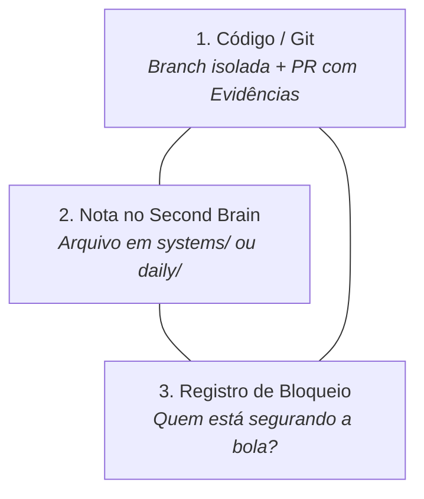

# Método de Auto-Auditoria: Gestão Multi-Frentes sem Perda de Contexto

> **Objetivo:** Permitir que um desenvolvedor pleno/sênior atue simultaneamente em múltiplos ecossistemas (Touti, Amavia, Yes!, ERPs, Transportadoras, Infraestrutura) mantendo controle total sobre o que está sendo feito, o que está travado e o que já foi entregue com provas.

## 1. O Triângulo de Ouro de Cada Demanda

Para nunca ser pego de surpresa em reuniões com gerentes ou cobranças de status, **toda demanda deve ter 3 pontas fechadas**:

1. **Ponta de Código (Git):** Nenhuma alteração sem branch descritiva (`fix/...`, `feat/...`) e Pull Request aberta com descrição de Causa Raiz, Correção e Evidências.
2. **Ponta de Conhecimento (Second Brain):** Todo aprendizado ou descoberta sobre a arquitetura da KIOSK Brands vira nota markdown (`systems/<nome-do-sistema>.md`).
3. **Ponta de Responsabilidade:** Ter sempre claro se a bola está **com você** (`#status/doing`) ou **com um terceiro** (`#status/blocked-externo`).

---

## 2. A Rotina de 10 Minutos por Dia

### No Início do Dia (5 min):
1. Abrir a nota do dia em `daily/YYYY-MM-DD.md`.
2. Listar as **Top 3 Prioridades** do dia.
3. Checar o [[radar-demandas]]: quem estava me bloqueando ontem já respondeu?

### Durante o Dia (Tempo Real):
* Quando trocar de frente (ex: de Touti para Amavia ou para Infra):
  * Deixe 1 linha no diário com o comando ou estado que parou.
  * Se bloqueou em alguém, anote o nome de quem você acionou.

### No Fim do Dia (5 min):
1. Marcar o que foi concluído.
2. Atualizar o [[radar-demandas]].
3. Se algo ficou pendente de outra pessoa, deixar o lembrete de cobrança para o dia seguinte.

---

## 3. Como Responder a Cobranças em 10 Segundos

Quando um gestor (Tadeu / Davi / Jefferson) perguntar no Teams: *"Hugo, como está a demanda X?"*:

Você nunca responde com "estou vendo" ou "tá quase". Você responde com a **fórmula de status executivo**:

> **[Estado Atual] + [O que já fiz e comprovei] + [Quem/O que é o próximo passo]**
> 
> *Exemplo Real de Hoje:*
> *"A correção está concluída e validada localmente e no servidor. Já subi a homologação isolada na porta 3001 e a PR #1 está pronta. No momento estamos aguardando apenas o apontamento do DNS pela infraestrutura para homologarmos com o Bling."*
